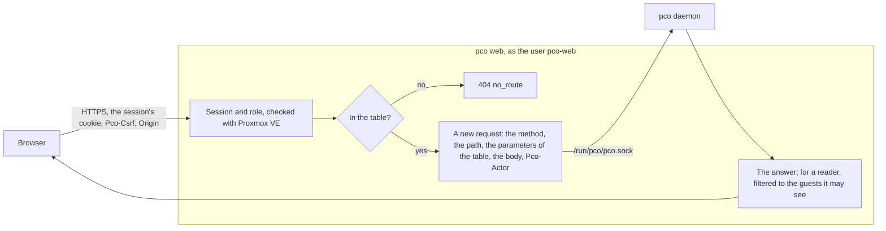

# API

The daemon answers a JSON API on a unix socket. The `pco` commands that ask the daemon use it,
the web interface uses it through pco web, and a script on the node can use it too. This page is
its reference: who may call it, every route with what it takes and what it answers, the errors,
the stream, and how pco web passes the calls of the page on to it.

The contract is the names of the routes and of the fields, the codes of the errors, the route
states and the levels. The messages, the `detail` of a step and the text of a problem are for
people and can change. A field that is added later is added beside the others and changes none
of them.

## The socket and who may call it

The socket is `/run/pco/pco.sock`, in a directory of mode 0750; the socket has mode 0660. Both
belong to root, and to the group `pco-web` while that group exists. The daemon reads the user id
of the process at the other end of each connection from the kernel, and answers two users:

- root;
- `pco-web`, the user of the web interface, while `/usr/lib/systemd/system/pco-web.service` is
  there. The daemon decides this when it starts: after the package of the web interface is
  installed or removed, `systemctl restart pco`.

Anyone else gets `403` with the code `forbidden` and the message `not allowed`, whatever the
method, the path or the body, so a refusal says nothing about which routes exist.
[Security](security.md#the-socket-api-and-who-may-call-it) says why, and why `pco-web` counts as
an admin of pco.

There is no login, no TLS and no network listener: whoever may connect is trusted. The API never
answers with a secret: a credential carries no token, and the messages of a refused token have
it cut out.

As root on the node, with `curl`:

    curl --unix-socket /run/pco/pco.sock http://pco/v1/version

```json
{
  "version": "1.2.3",
  "boot": "9f2c4e1a0b7d3c55",
  "profile": "host",
  "node": "node1",
  "pollInterval": "10s"
}
```

The host name in the URL is not read; `pco` is as good as any. In the appliance the socket is the
same path inside the container. The appliance has no `curl`: a script there uses the `pco`
commands with `--json`, which print the daemon's answers as it sent them.

## Requests and answers

- A `POST` or a `PUT` says `Content-Type: application/json` and carries one JSON object, at
  most 1 MiB, which has to arrive within 30 seconds. A key the route does not take is refused.
  Any other method takes no body.
- An answer is JSON. A list in it is `[]` when it is empty, never `null`.
- A time is RFC 3339, in UTC. A duration is written as Go writes it, `10s`, `1m0s`.
- An owner is `qemu/101`, `lxc/200` or `manual/<id>`.
- Every answer carries `Pco-Boot: <16 hex digits>`, which names the process of the daemon. It is
  new at every start, and the event numbers of the stream count within it.
- An admin action is recorded in an event of the kind `admin`, with its actor: `root (cli)` for
  root. For `pco-web`, the actor is what pco web names in the header `Pco-Actor`, such as
  `alice@pve (ticket)`: 1 to 128 of the letters, the digits and `. _ @ ! : ( ) -` and space. The
  header is read from `pco-web` alone.
- A change waits for the cycle that runs, at most 35 seconds, and is answered `503
  unavailable` with `a cycle is running and took longer than 35s; try again` when it waited
  longer. The server lets an answer take 70 seconds; give a client at least that.

```bash
curl --unix-socket /run/pco/pco.sock -X POST -H 'Content-Type: application/json' \
  --data '{"hostname": "www.example.com", "owner": "qemu/102"}' http://pco/v1/claims/resolve
```

## Errors

Every error answer is one object:

```json
{
  "error": "the settings changed since they were read at revision 7 and are at revision 8 now; read them again",
  "code": "refused"
}
```

`field` is there when the refusal is about one field of the request, as its path in the JSON,
such as `denyHosts[2]` or `managed.detachGrace`. `credential` is there when the daemon refused a
token it could check: the credential and its report, which say what the token can and cannot do.
A client acts on the code:

| Code | Status | Meaning |
|---|---|---|
| `invalid` | 400 | The request is wrong: a body that is not the JSON of the route, a field out of range, a query that does not parse. |
| `forbidden` | 403 | Not allowed: a peer the socket does not answer, or a rotation asked by another user than root. |
| `not_found` | 404 | No such thing: a credential, a guest, a manual route, a hostname without a route. |
| `no_route` | 404 | No such route. |
| `method_not_allowed` | 405 | The route takes another method. |
| `refused` | 409 | The daemon refuses, and says why: a revision or an offer that is not the current one, a guest that changed since it was shown, a credential that still manages something. Read again, and decide again. |
| `holder_changed` | 409 | A diagnosis named the route it expected to hold the hostname, and another holds it now. |
| `too_large` | 413 | The body is larger than 1 MiB. |
| `unsupported_media_type` | 415 | A `POST` or `PUT` without `Content-Type: application/json`. |
| `internal` | 500 | Something went wrong in the daemon; `journalctl -u pco` has it. |
| `unavailable` | 503 | Not now: a cycle ran too long, Cloudflare did not answer in time, the request was cancelled, or every stream is taken. The message says which. |

## Routes

The paths below are those of the socket. `:id` stands for a part of the path, such as
`/v1/credentials/a1b2c3d4/check`. The last column says what the web interface may call, as
`/api/v1` and the same path, and with which role; [Through the web interface](#through-the-web-interface)
has the rest.

| Route | Answers | Command line | Web interface |
|---|---|---|---|
| `GET /v1/version` | the version, the boot, the profile, the node, the poll interval | none | reader |
| `GET /v1/state` | the state of the last cycle | `pco status --json`, `pco routes`, `pco plan` | reader, filtered |
| `GET /v1/events` | events | `pco events` | reader, filtered |
| `GET /v1/stream` | the stream | none | reader, filtered |
| `GET /v1/traffic` | the traffic of the connectors and of the targets | none | reader, filtered |
| `GET /v1/traffic/route` | the connections to the target of one route | none | reader, filtered |
| `POST /v1/sync` | 202 | `pco sync` | admin |
| `POST /v1/apply` | what was accepted | `pco apply`, `pco apply --confirm-deletes` | admin |
| `POST /v1/adopt` | 200 | `pco adopt` | admin |
| `POST /v1/tunnels/rotate` | the tunnel | `pco tunnel rotate` | not passed on |
| `GET /v1/credentials` | the credentials | `pco credential list` | reader |
| `POST /v1/credentials` | the credential, 201 | `pco credential add` | admin |
| `POST /v1/credentials/:id/check` | the credential | `pco credential check` | admin |
| `DELETE /v1/credentials/:id` | 200 | `pco credential remove` | admin |
| `GET /v1/claims` | the claims | `pco claims list` | reader, filtered |
| `POST /v1/claims/resolve` | 200 | `pco claims resolve` | admin |
| `GET /v1/approvals` | the approvals | `pco guest list` | reader, filtered |
| `POST /v1/guests/approve` | the approval | `pco guest approve` | admin |
| `POST /v1/guests/revoke` | 200 | `pco guest revoke` | admin |
| `GET /v1/guests` | the guests of the last listing | `pco guest list` | reader, filtered |
| `GET /v1/guests/:kind/:vmid/annotation` | the route text of a guest's Notes | none | reader, filtered |
| `GET /v1/segments` | the segments | `pco segment list` | not passed on |
| `POST /v1/segments/acknowledge` | 200 | `pco segment acknowledge` | not passed on |
| `POST /v1/segments/revoke` | 200 | `pco segment revoke` | not passed on |
| `GET /v1/diagnose` | the steps | `pco diagnose` | reader, as `POST /api/v1/diagnose` |
| `GET /v1/doctor` | the findings | `pco doctor` | reader, as `POST /api/v1/doctor` |
| `GET /v1/settings` | the settings with their revision | `pco settings show` | reader |
| `PUT /v1/settings` | the settings as saved | `pco settings apply` | admin |
| `GET /v1/routes/manual` | the manual routes | `pco route manual list` | reader |
| `POST /v1/routes/manual` | the route, 201 | `pco route manual add` | admin |
| `PUT /v1/routes/manual/:id` | the route | none | admin |
| `DELETE /v1/routes/manual/:id` | 200 | `pco route manual remove` | admin |
| `POST /v1/daemon/restart` | 202 | none; `systemctl restart pco` | admin |
| `GET /v1/networks` | the networks reached through a leg | `pco network list` | reader, filtered |
| `GET /v1/networks/candidates` | the bridges and VLANs a network may be attached to | `pco network candidates` | admin |
| `POST /v1/networks/probe` | who answers for an address | `pco network probe` | admin |
| `POST /v1/networks` | the network, 201 | `pco network attach` | admin |
| `GET /v1/networks/:id` | one network with its service addresses | `pco network show` | admin |
| `DELETE /v1/networks/:id` | 200 | `pco network detach` | admin |
| `GET /v1/managed` | the managed network: its cards, what waits and why | `pco managed status` | reader, filtered |
| `POST /v1/managed/approve` | the consent | `pco managed approve` | admin |
| `POST /v1/managed/revoke` | 200 | `pco managed revoke` | admin |
| `POST /v1/managed/enable` | 200 | `pco network managed enable` | admin |

A route that changes something and has nothing to say answers `{}`.

### Version and state

`GET /v1/version` answers as above. `pollInterval` is the interval of the last settings read.

`GET /v1/state` answers the state of the last cycle, the document `pco status --json` prints;
[Operations](operations.md#exit-codes-and---json) lists its fields. It carries `ETag:
"<digest>"`, and a request with `If-None-Match` of that tag is answered `304` without a body. The
digest names what the state holds and leaves out every time in it, so two cycles over the same
world have the same digest, and a client that holds the state fetches it again only when it
changed.

### Events

`GET /v1/events` answers the newest events that pass every filter, oldest first:

```json
[
  {
    "seq": 7,
    "boot": "9f2c4e1a0b7d3c55",
    "at": "2026-10-01T12:00:00Z",
    "level": "warn",
    "kind": "route",
    "subject": "www.example.com",
    "message": "qemu/101: unreachable",
    "route": "www.example.com",
    "guest": "qemu/101",
    "account": "0123456789abcdef0123456789abcdef"
  }
]
```

`route`, `guest`, `tunnel` and `account` name what the event is about, where it is about one, and
`actor` who asked for an admin action. [Problems](problems.md#event-kinds) says what each kind
reports.

| Parameter | Takes |
|---|---|
| `since`, `until` | a time, RFC 3339: events after `since` and not after `until`. The limit counts back from `until`, so a range in the past gets the newest events of that range. |
| `after`, `boot` | the `seq` of the last event the client has, and the boot it belongs to: events after it. After a seq of another boot, every event passes. |
| `route`, `guest`, `tunnel`, `account`, `kind`, `level` | a value each, repeatable: an event passes with one of the values, exactly. |
| `limit` | 1 to 5000; 1000 without it. |
| `history` | `1` reads the event log on the node as well, `/var/lib/pco/events.log` and `events.log.1`, the newest 10 MiB; without it only the last thousand events in memory. |

```bash
curl --unix-socket /run/pco/pco.sock 'http://pco/v1/events?kind=admin&level=warn&history=1&limit=50'
```

### The stream

`GET /v1/stream` is a stream of server-sent events: what the daemon publishes, as it happens. It
begins with `hello` and ends when the client goes, the daemon stops, or the client fell too far
behind. A comment, `: ping`, comes every 15 seconds.

```text
event: hello
data: {"boot":"9f2c4e1a0b7d3c55","version":"1.2.3","seq":812,"digest":"5e0c1f7a92b4d3e8","pollInterval":"10s"}

event: state
data: {"at":"2026-10-01T12:00:00Z","finishedAt":"2026-10-01T12:00:02Z","digest":"77a1c0de5f3b2a90"}

id: 9f2c4e1a0b7d3c55:813
event: event
data: {"seq":813,"boot":"9f2c4e1a0b7d3c55","at":"2026-10-01T12:00:00Z","level":"warn","kind":"route","subject":"www.example.com","message":"qemu/101: unreachable (connection refused)","route":"www.example.com","guest":"qemu/101","account":"0123456789abcdef0123456789abcdef"}

id: 9f2c4e1a0b7d3c55:1826
event: gap
data: {"boot":"9f2c4e1a0b7d3c55","from":814,"to":1826,"count":1013,"level":"warn"}

event: traffic
data: {"at":"2026-10-01T12:00:05Z","tunnels":[{"tunnelId":"00000000-0000-4000-8000-000000000001","rps":38.2,"errorsPerSec":0.1,"concurrent":3,"haConnections":4,"stale":false}],"routes":[{"hostname":"www.example.com","owner":"qemu/101","target":"10.0.0.11:8080","flowsPerSec":2.4,"stale":false}],"routesTotal":1}

event: reset
data: {"reason":"boot changed"}

: ping
```

| Message | Carries | Comes |
|---|---|---|
| `hello` | the boot, the version, the `seq` of the last event, the digest of the state, the poll interval | first |
| `state` | when the cycle began and ended, and the digest of the state it published | whenever a state is published; fetch `/v1/state` only when the digest is not the one you hold |
| `event` | an event, with the id `<boot>:<seq>` | as it happens |
| `gap` | a range of events not sent one by one: the boot, `from` and `to`, how many, and the highest level among them, with the id `<boot>:<to>` | see below |
| `traffic` | the newest sample of each tunnel, and the figures of at most 100 routes: the busiest, then those that stopped since the last notice; `routesTotal` says how many have one, `routesWhy` why there are none | every 5 seconds |
| `reset` | why the client has to start over: `boot changed` or `too far behind` | see below |

**Gaps.** The events of a cycle come in one batch, and some kinds come by the thousand: a
`route` event for each route at the first cycle after a start, an `action` for each action
applied, a `claim` for each claim of a new install. Of a batch, the events of the kinds `route`,
`action` and `claim` beyond the first 32 come as one `gap`. Every other kind comes one by one.
A client that wants the events of a gap reads them with `GET /v1/events?after=<from - 1>&limit=`.

**Resuming.** A client that reconnects sends the id of the last event it saw, `<boot>:<seq>`, in
the header `Last-Event-ID` or the query `lastEventId`. With the same boot, the daemon sends the
events after it from the thousand it keeps in memory, those it no longer keeps as a `gap` of the
level `warn`. With another boot, the daemon was restarted: the first message is `reset` with
`boot changed`, and the client drops what it holds and fetches the state again.

**A slow client.** Up to 256 messages or 1 MiB wait for each client. Past that, the waiting
events of the three kinds above fold into a gap, and of the `state` and `traffic` messages only
the newest is kept. A client with 4096 messages or 4 MiB waiting even so gets `reset` with `too
far behind`, and the stream ends. At most 16 streams are open at once, and the seventeenth is
answered `503 unavailable` with `16 streams are open already; try again later`. pco web holds one,
whatever the number of browsers.

```bash
curl --no-buffer --unix-socket /run/pco/pco.sock http://pco/v1/stream
```

### Traffic

`GET /v1/traffic` answers what the last scrapes found, for each connector on this node, and the
connections the connectors opened to the target of each route, which the egress filter counts:

```json
{
  "at": "2026-10-01T12:00:05Z",
  "interval": "5s",
  "tunnels": [
    {
      "tunnelId": "00000000-0000-4000-8000-000000000001",
      "node": "node1",
      "cloudflared": "2026.9.3",
      "configVersion": 14,
      "haConnections": 4,
      "edges": [{ "connection": 0, "location": "fra08" }, { "connection": 1, "location": "ams01" }],
      "rttMs": [11.2, 18.9, 11.4, 19.3],
      "stale": false,
      "samples": [{ "at": "2026-10-01T12:00:05Z", "rps": 38.2, "errorsPerSec": 0.1, "concurrent": 3 }]
    }
  ],
  "routes": [
    { "hostname": "www.example.com", "owner": "qemu/101", "target": "10.0.0.11:8080", "flowsPerSec": 2.4, "stale": false }
  ],
  "routesTotal": 1
}
```

The samples of a tunnel cover 15 minutes, oldest first, one every 5 seconds: requests and proxy
errors per second, from the connector's own counters, which count every request of the tunnel
whichever hostname it was for. A tunnel is `stale` after three scrapes in a row failed.
`flowsPerSec` is the connections opened per second to an address and port: new connections, not
requests. `shared` counts the other routes on the same target, which share the figure. When there
are no figures for the targets, `routes` is empty and `routesWhy` says why: `the egress filter was
not checked yet`, `the egress filter is off: pco has no per-guest counters`, `the egress filter is
not loaded`, `the egress filter is not the one pco loads`, or `the counters could not be read:`
followed by the reason.

`GET /v1/traffic/route?hostname=<hostname>` answers the 15 minutes of one route's target:
`{"hostname", "target", "shared", "samples": [{"at", "flowsPerSec"}]}`, and `not_found` for a
route without a target.

### Cycles and publishing

`POST /v1/sync` asks for a cycle now and answers `202` at once.

`POST /v1/apply` is `pco apply`. Every call that is not refused leaves observe-only mode, when the
daemon is in it, and asks for a cycle: from then on the daemon changes Cloudflare. There is no body
that keeps observe-only mode; do not call it to look, `GET /v1/state` does that. The body says
whether the call also accepts what waits for a confirmation:

```json
{ "confirmDeletes": true, "offer": "9298960fb3d77f2d" }
```

With no body, `{}` or `"confirmDeletes": false`, the call leaves observe-only mode and confirms
nothing. With `"confirmDeletes": true` it accepts what waits as well, but only with `offer`, the
`offer` of the state that showed what waits, which the daemon compares with its own: when what
waits is not what was shown, the call is refused with `what waits for a confirmation changed since
it was shown; look again and repeat`, and changes nothing, observe-only mode included. The answer
says whether the call left observe-only mode and what it accepted:

```json
{
  "leftObserveOnly": true,
  "accepted": [
    {
      "kind": "dns-removals",
      "subject": "",
      "detail": "mass delete guard: 7 of 9 records are being removed (1 in zones that could not be listed); confirm to proceed",
      "items": ["a.example.com", "b.example.com"]
    }
  ]
}
```

`POST /v1/adopt {"name": "www.example.com"}` asks the next run that can to replace the DNS record
of someone else in the way of the name, or take back a record of this install that lost its
marker; the request is dropped after five minutes if no run could.

`POST /v1/tunnels/rotate {"account": "<account id>"}` gives the tunnel of the install in that
account a new secret, which cuts every connector but pco's, and answers `{"tunnel", "tunnelId",
"accountId"}`. Without an account it takes the one tunnel of the install. It restarts every
connector of the tunnel, so the daemon takes it from root alone: `pco-web` is refused with `only
root may rotate the secret of a tunnel`.

### Credentials

`GET /v1/credentials` answers every stored credential with the report of its last check, from
the store rather than the last cycle:

```json
[
  {
    "id": "a1b2c3d4",
    "label": "main",
    "kind": "scoped",
    "checked": true,
    "report": {
      "token": { "id": "0123456789abcdef0123456789abcdef", "status": "active", "expiresOn": "2027-01-01T00:00:00Z" },
      "accounts": [{ "id": "0123456789abcdef0123456789abcdef", "name": "Main" }],
      "zones": [{ "id": "fedcba9876543210fedcba9876543210", "name": "example.com", "status": "active", "accountId": "0123456789abcdef0123456789abcdef" }],
      "checks": [{ "capability": "token", "ok": true }],
      "excluded": [],
      "deep": true,
      "usable": true,
      "checkedAt": "2026-10-01T12:00:00Z"
    }
  }
]
```

`POST /v1/credentials {"label": "main", "token": "<token>"}` checks the token with Cloudflare,
stores it when it can do what pco needs, and answers `201` with the credential. The token has 20
to 256 characters, all of `A-Z a-z 0-9 _ -`. A token the daemon refuses is answered with the
reason, and with `credential` when it could check it. [Cloudflare token](cloudflare-token.md#reading-the-check)
says how to read the report.

`POST /v1/credentials/:id/check {"deep": true}` checks the token again; `deep` proves the write
permissions with a test DNS record and a test tunnel, which it deletes again. A deep check of many
zones may take most of a minute. `DELETE /v1/credentials/:id` removes a credential, and is refused
while it still manages zones, tunnels or records.

### Claims, guests and segments

`GET /v1/claims` answers who holds each hostname and who waits for it:

```json
[
  {
    "hostname": "www.example.com",
    "holder": "qemu/101",
    "guest": { "kind": "qemu", "vmid": 101, "name": "web-1" },
    "since": "2026-10-01T12:00:00Z",
    "state": "conflict",
    "waiting": [
      { "owner": "qemu/102", "guest": { "kind": "qemu", "vmid": 102, "name": "web-2" }, "since": "2026-10-01T12:01:00Z" }
    ]
  }
]
```

`state` is `serving`, `conflict`, `held`, `pending` or `unknown`, and `missingSince` says since
when the holder no longer asks for the hostname. `POST /v1/claims/resolve {"hostname", "owner"}`
hands the hostname to an owner that claims it.

`GET /v1/guests` answers the guests of the last listing of Proxmox VE, `[]` when the last cycle did
not list every guest:

```json
[
  {
    "ref": "qemu/101",
    "name": "web-1",
    "node": "node1",
    "running": true,
    "tagged": true,
    "identity": "uuid:4c4c4544-0042-3510-8051-b4c04f4e3432",
    "approval": "approved",
    "routes": 2,
    "issues": 0
  }
]
```

`approval` is `approved`, `waiting`, `changed` or `not-needed`.
`GET /v1/guests/qemu/103/annotation` answers the route text of the guest's Notes, the fenced
block or the one-line form, at most 8192 characters, with the line it begins at and the issues
the last cycle found in it, and nothing else of the Notes:

```json
{
  "ref": "qemu/103",
  "block": "```cf-tunnel\napp.example.com -> :3000\n```",
  "startLine": 4,
  "issues": [{ "guest": { "kind": "qemu", "vmid": 103 }, "line": 5, "col": 5, "msg": "a broken entry" }]
}
```

`GET /v1/approvals` answers the approvals, each with the identity it was made in, the identity the
last listing showed, whether they match, and the MACs and soft-denied addresses it holds.
`POST /v1/guests/approve` approves a guest:

```json
{ "owner": "lxc/300", "identity": "uuid:300", "macs": ["bc:24:11:00:03:00"], "addresses": ["192.0.2.1"] }
```

`identity` is the identity the admin was shown: a guest that has another one now is refused, as a
guest re-created under its VMID or a clone needs an approval of its own. Left empty, the identity
of the last listing is approved. `macs` are the MACs the state shows the guest waits for at
`observed`, which must be those it shows now, and `addresses` the soft-denied addresses the guest
may be published at. A guest the last cycle did not see is refused. The answer is the approval,
with the admission mode it matters in. `POST /v1/guests/revoke {"owner": "lxc/300"}` removes it.

`GET /v1/segments` answers the segments routes at `observed` were proven on, and those
acknowledged; `POST /v1/segments/acknowledge` and `/v1/segments/revoke` take `{"bridge": "vmbr1",
"vlan": 20}`, `vlan` 0 or left out for an untagged one.

### Diagnosis and doctor

`GET /v1/diagnose?hostname=<hostname>` walks the chain of the route that holds the hostname and
answers its steps, `route`, `zone`, `dns`, `ingress`, `connector`, `identity`, `path`, `tcp` and
`http`, each with a level and a detail. A step after the first failure is `skipped`, but a failed
`connector` skips nothing, as the daemon asks the target without one:

```json
[
  { "name": "route", "level": "ok", "detail": "qemu/101 (web-1) holds it; state active" },
  { "name": "tcp", "level": "warn", "detail": "skipped", "skipped": true }
]
```

With `owner=<owner>`, it walks the chain only while that owner holds the hostname, and answers
`409 holder_changed` otherwise.

`GET /v1/doctor` runs the checks of `pco doctor` and answers its findings, each with what to do:
`{"check", "level", "detail", "fix"}`. [Problems](problems.md#doctor-checks) lists the checks.
Both probe the node, the guests and Cloudflare: do not run them in a loop.

### Settings

`GET /v1/settings` answers the settings with their revision, the settings the daemon reads only at
its start, their ranges, and notes on settings it uses otherwise than stored;
[Settings](settings.md#changing-the-settings) shows one. `PUT /v1/settings` saves them at the
revision they were read at, and takes the whole `settings` object, not the keys that change: a
key left out is saved as empty or zero, not as its default, and is refused where zero is out of
range. So read them first:

    curl --unix-socket /run/pco/pco.sock http://pco/v1/settings

and send back `rev` as it came and every key of `settings`, with what you change changed, here
`grace`:

```json
{
  "rev": 7,
  "settings": {
    "gateTag": "cf-tunnel",
    "pollInterval": "10s",
    "grace": "2m0s",
    "admission": "tag",
    "observeOnly": false,
    "identityMinimum": "port",
    "maxHostnamesPerGuest": 32,
    "reverifyInterval": "1m0s",
    "cloudflareBudget": 1000,
    "managed": { "consent": "per-guest", "subnet": "10.203.118.0/24", "detachGrace": "10m0s" }
  }
}
```

`pco settings show --json` and `pco settings apply <file>` do the same. It answers the settings as saved, with their new revision, and `restartNeeded`, the settings that
take effect only once the daemon is restarted. Settings stored at another revision are refused
with `refused`; a setting the store does not accept with `invalid` and its `field`; and leaving
observe-only mode with `invalid` on `observeOnly`, since `POST /v1/apply` does that.

### Manual routes

```json
{
  "id": "status",
  "rev": 2,
  "hostname": "status.example.com",
  "target": { "kind": "address", "scheme": "http", "addr": "10.0.5.20", "port": 9000 },
  "options": {}
}
```

`target.kind` is `address`, with `addr`, or `guest`, with `guest` as `qemu/101` and no `addr`.
`options` are `hostHeader`, `sni`, `noTLSVerify` and `via`, as in the Notes, and `allowNode`,
which only a manual route to an address has: it lets it point at a service of a node. `GET /v1/routes/manual` answers every manual route. `POST /v1/routes/manual` makes one,
without `rev`, and answers `201`; without an `id`, of 1 to 32 of `a-z 0-9 -`, the daemon gives it
one, and an id that is taken is refused. `PUT /v1/routes/manual/:id` replaces one, with the `rev`
it was read at in the body. `DELETE /v1/routes/manual/:id?rev=<rev>` removes one. A route that
changed since it was read is refused with `refused`. An address must lie in the setting
`manualCIDRs`.

### Restart

`POST /v1/daemon/restart` answers `202`, and the daemon stops once the running cycle is done, for
systemd to start it again. The connectors keep running.

## Revisions, offers and digests

Two admins, or an admin and a script, can act at once. The API never applies a change to
something other than what the caller read:

| What | How the caller names what it read | When it changed |
|---|---|---|
| The settings | `rev` | `409 refused`: read them again |
| A manual route | `rev` | `409 refused`: read it again |
| What waits for a confirmation | `offer`, the first 16 hex digits of the SHA-256 of what waits | `409 refused`: look again |
| The guest of an approval | `identity`, and `macs` | `409 refused`: look again |
| The holder of a diagnosed hostname | `owner` | `409 holder_changed` |
| The state | `If-None-Match` of its `ETag` | a new state, else `304` |

## Through the web interface

pco web is the only other client of the socket. The page calls pco web under `/api/v1`, and pco web
passes on the calls of one table, each with the role it needs, and nothing else; the rotation of a
secret and the segments are not in it, and are answered `404 no_route`. The way of a call, from the
browser to the socket and back:



The request pco web makes carries the body of the page's request, `Content-Type` when there is a
body, `If-None-Match` for the state, `Pco-Actor`, and no other header of the browser's: no cookie,
no token. The state comes from a cache pco web keeps for each digest, and the stream from the one
stream pco web holds, handed out to every browser filtered for its session.

| Call | Socket | Role | Body, timeout |
|---|---|---|---|
| `GET /api/v1/state`, `/events`, `/traffic`, `/traffic/route` | the same under `/v1` | reader | none; 10 s |
| `GET /api/v1/stream` | served from the one stream pco web holds of `GET /v1/stream` | reader | none; open until it ends |
| `GET /api/v1/credentials`, `/claims`, `/approvals`, `/guests`, `/guests/:kind/:vmid/annotation`, `/settings`, `/routes/manual`, `/version` | the same | reader | none; 10 s |
| `POST /api/v1/diagnose {"hostname"}` | `GET /v1/diagnose?hostname=` | reader | 64 KiB; 30 s; one at a time for each user, six a minute |
| `POST /api/v1/doctor {}` | `GET /v1/doctor` | reader | 64 KiB; 60 s; two a minute for each user |
| `POST /api/v1/sync`, `/adopt`, `/claims/resolve`, `/guests/approve`, `/guests/revoke`, `/routes/manual`, `/daemon/restart` | the same | admin | 64 KiB; 60 s |
| `POST /api/v1/apply`, `/credentials`, `/credentials/:id/check` | the same | admin | 64 KiB; 75 s |
| `PUT /api/v1/settings` | the same | admin | 1 MiB; 60 s |
| `PUT /api/v1/routes/manual/:id` | the same | admin | 64 KiB; 60 s |
| `GET /api/v1/networks`, `/managed` | the same | reader | none; 10 s |
| `GET /api/v1/networks/:id` | the same; the service addresses name the guests behind them | admin | none; 10 s |
| `GET /api/v1/networks/candidates` | the same; the daemon lists the guests for it | admin | none; 60 s |
| `POST /api/v1/networks`, `/networks/probe`, `/managed/approve`, `/managed/revoke`, `/managed/enable` | the same | admin | 64 KiB; 60 s |
| `DELETE /api/v1/networks/:id` | the same, with `rev` and `confirm` | admin | none; 60 s |

A reader gets the networks without the MACs of the legs, and of the managed network the cards,
the waiting guests and the foreign cards of the guests it may audit, without their MACs, their
identities, the `pveum` lines, the firewall of a guest before pco changed it, the pool grant and the
appliance's isolation; a reason that carries a `pveum` line or a command is cut to its name, and an
event of the managed network loses the MACs its text names.
| `DELETE /api/v1/credentials/:id`, `/routes/manual/:id` | the same | admin | none; 60 s |

Diagnosis and doctor are reads on the socket and `POST` at pco web, so that the checks of a request
that changes something hold for them too. For a reader, a diagnosis runs only when the route that
holds the hostname is a guest the reader may see, or a manual route, and the doctor answers the
counts of its checks, `{"ok", "warn", "fail", "at"}`. [Web interface](web-ui.md#what-a-reader-sees)
says what else a reader gets.

A request that is not a `GET` or `HEAD` needs `Content-Type: application/json`, an `Origin` of
`https://` and the host of the request, `Sec-Fetch-Site: same-origin` when the browser sends it,
and `Pco-Csrf` with the token the session got at sign-in. pco web answers with gzip when the
browser takes it and the answer is over a kibibyte, never the answers of `/api/session`.

The session has calls of its own:

| Call | Does |
|---|---|
| `GET /api/session` | the session: the user, the method, the role, the token against CSRF, when it idles out and ends, the profile, the node, its time zone and the version; `401` with how to sign in when there is none |
| `POST /api/session/ticket {}` | on a node: signs in with the cookie `PVEAuthCookie` of the browser |
| `POST /api/session/token {"token"}` | signs in with an API token of Proxmox VE |
| `POST /api/session/password {"user", "realm", "password"}` | in the appliance: signs in with a password; `401 second_factor` when a code is due |
| `POST /api/session/second-factor {"code"}` | in the appliance: the code of the second factor |
| `POST /api/session/touch {}` | tells pco web the user is reading the page |
| `DELETE /api/session` | signs out |

The stream of the page has one message more than the daemon's: `upstream`, `{"up": false, "since":
"..."}`, which says whether pco web reaches the daemon, after `hello` and on every change. A
session may hold three streams and pco web 200 in all; one more is answered `429 rate_limited`.
A stream ends with its session, and when its role or the reader's guests change.

pco web answers errors in the shape of the daemon's, with codes of its own besides: `unauthenticated`
(401, no session), `ticket_invalid` (401, Proxmox VE did not accept the ticket, token, password or
code), `proxmox_unreachable` (503), `daemon_unreachable` (502, nothing answers on the socket),
`rate_limited` (429, with `retryAfter` in seconds), `second_factor` and `second_factor_key` (401, in
the appliance: a code is due, or the second factor is a security key, which cannot work there),
and `forbidden` (403): with `missing`, the privilege the user lacks, and without it a request
refused for its host name, its `Origin`, its `Sec-Fetch-Site` or a missing or wrong `Pco-Csrf`;
`unsupported_media_type` (415) answers a call that changes something without `Content-Type:
application/json`, before anything else is checked. A call the daemon did not answer in
time is answered `503 unavailable`: the outcome is not known, so look before you try again.
