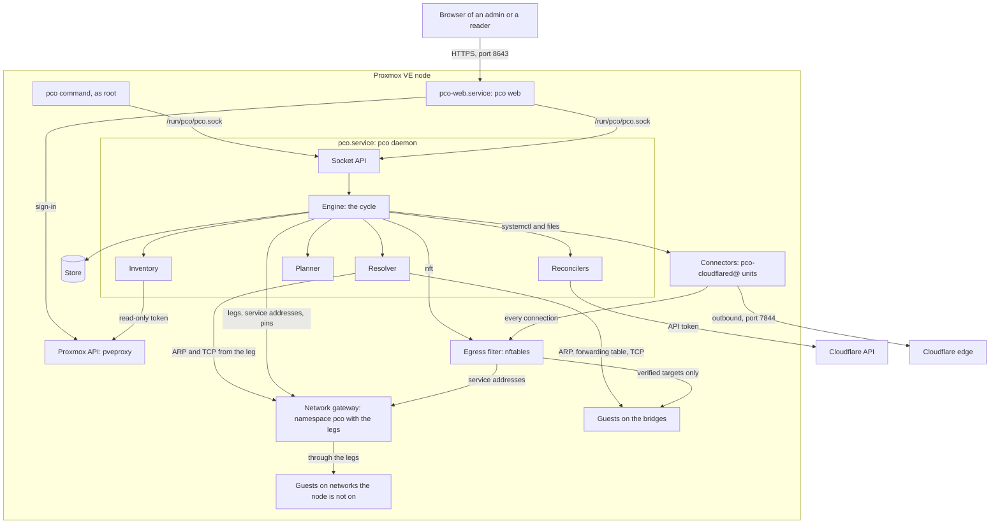
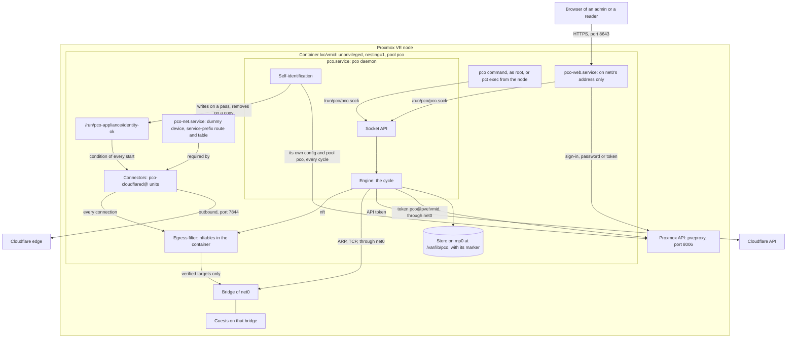
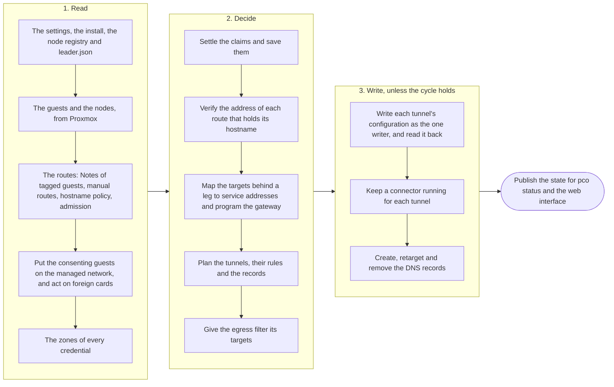
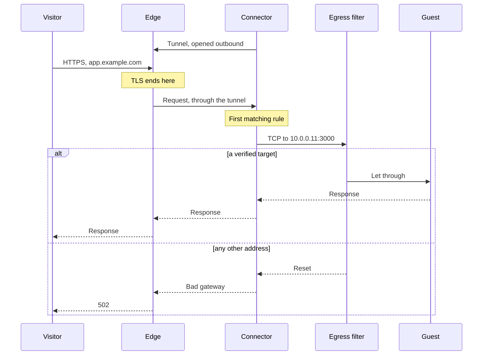
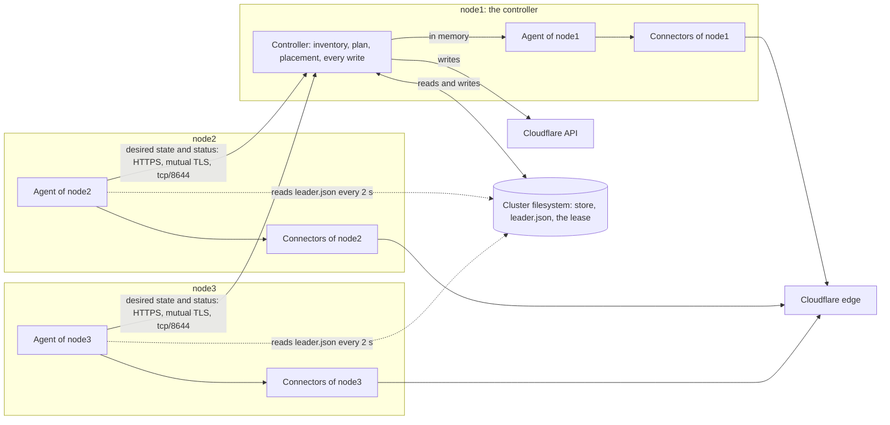
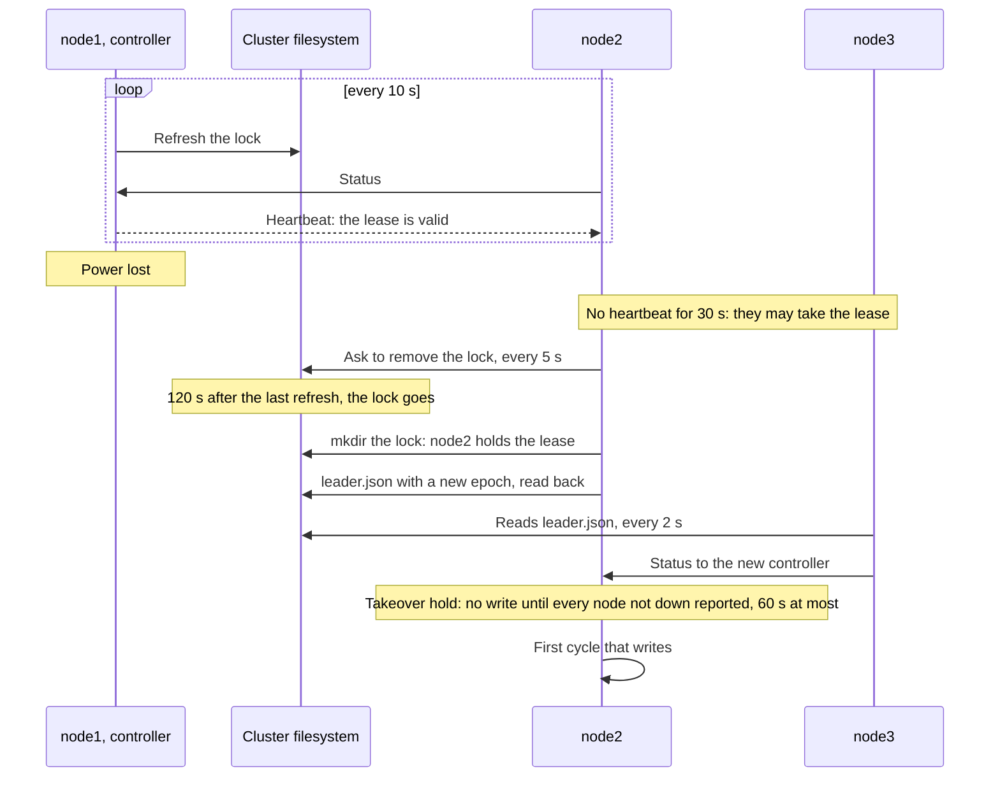
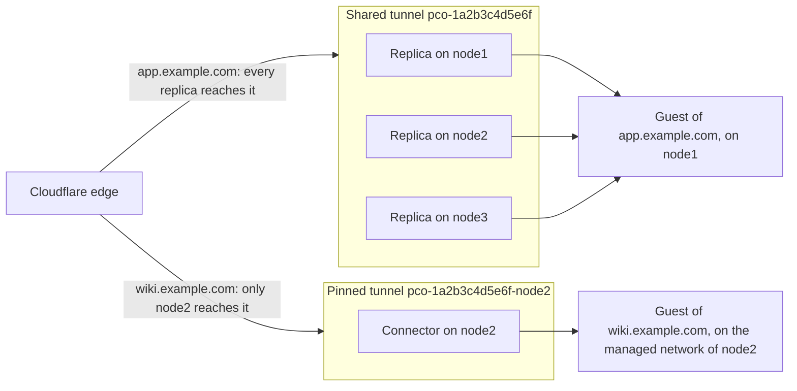
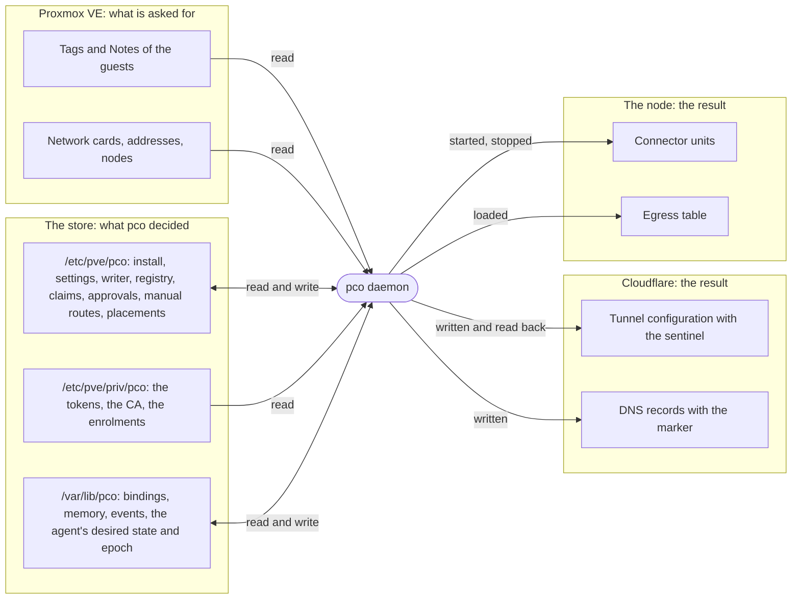

# Architecture

This page says how pco is built: its parts and where they run, what one cycle of the daemon
does, the path of a request, how pco makes sure that one process alone writes to Cloudflare,
how the nodes of a cluster share the work, where its state lives, and what it never touches. It
describes the host profile, and [the appliance](#the-appliance) where it differs;
[Profiles](profiles.md) sets the two side by side. The words in the sense pco gives them are in
the [Glossary](glossary.md).

## The parts

pco is one binary, `/usr/bin/pco`, which runs as three kinds of process on the node: the
daemon, which does the work; the web process, which serves the web interface; and the
command line, which asks the daemon. The connectors are `cloudflared`, run as systemd units
that the daemon starts and stops.

The parts of the host profile, and who asks or writes to whom; an arrow points from the part
that asks or writes to the part it asks or writes to:

| Part | What it does | Code |
|---|---|---|
| Daemon | Runs as root, holds the lock of the node, runs the engine and serves the socket. | `internal/daemon` |
| Engine | Runs the cycle and keeps what the last one found, which every client reads. | `internal/engine` |
| Store | The state in small JSON files under three roots. | `internal/store` |
| Inventory | Reads the guests and the nodes from the Proxmox API. | `internal/inventory`, `internal/pve` |
| Planner | Turns the Notes into routes, settles the claims and plans the tunnels and records, without reading or writing anything itself. | `internal/planner`, `internal/annotation` |
| Resolver | Proves that an address belongs to a guest. | `internal/resolve` |
| Reconcilers | Bring the tunnels and the DNS records at Cloudflare in line with the plan. | `internal/reconcile`, `internal/cfapi` |
| Connectors | One `cloudflared` unit for each tunnel. | `internal/connector` |
| Egress filter | Confines the connectors to the targets pco verified. | `internal/egress` |
| Network gateway | The legs into the networks the node is not on, the service addresses the connectors dial for the guests behind them, and the namespace `pco` of the host or the cards of the appliance that hold them. | `internal/gateway` |
| Managed network | The consent of a guest, the leases, the cards pco adds, the DHCP server and the isolation of the managed network `pconet`. | `internal/managednet` |
| Socket API | JSON over `/run/pco/pco.sock`, for the command line and the web process. | `internal/api` |
| Web process | Serves the web interface and passes its calls on to the socket. | `internal/web` |
| Agent | Runs what the node serves, its connectors, egress filter and gateway, from the desired state of the controller, proves the targets of the node and reports. On a node alone it runs in the daemon's process beside the engine. | `internal/agent`, `internal/agentproto` |
| Lease and agent endpoint | On a cluster: which node is the controller, the registry of the nodes, the CA of the install, and the HTTPS endpoint the agents of the other nodes follow. | `internal/cluster`, `internal/clusterapi` |

### The daemon and its cycle

`pco.service` runs `pco daemon` as root. It takes an exclusive lock on
`/var/lib/pco/daemon.lock`, so that a second daemon on the node refuses to start, reads the
Proxmox token from the store, waiting up to two minutes for the cluster filesystem, and
starts its engine once its socket listens.

The engine runs one cycle at a time: every `pollInterval`, 10 seconds by default, and at once
after `pco sync` and after an admin action that changes what a cycle would do, such as
`pco apply`, an approval or a new credential. Such an action waits for the cycle that runs,
and the next cycle waits for it. [The reconcile cycle](#the-reconcile-cycle) below says what
a cycle does.

Beside the cycle the daemon runs a watch of the neighbour table and of the forwarding tables
of the bridges, which takes an address out of the egress filter as soon as its MAC moves; a
keeper of the egress table, which checks it every 30 seconds and whenever nftables reports a
change, and loads it again when it is gone or changed; and a sampler that reads the counters
of the connectors and of the egress filter every five seconds, for the traffic the web
interface shows. While the web interface is set up, the daemon also keeps its certificate up to
date, and restarts `pco-web.service` when what it loaded is no longer what the files hold.
On a host it also runs the keeper of [the lease](#the-lease), which reads the quorum every two
seconds and refreshes the lease every 10, apart from the cycle, and the agent of the node
([pco on a cluster](#pco-on-a-cluster)). [Operations](operations.md#the-daemon-and-its-units)
has the units.

### The store

The store is a set of small JSON files, one for each object, under three roots:
`/etc/pve/pco` for what is not secret, `/etc/pve/priv/pco` for the tokens, and `/var/lib/pco`
for what belongs to this node alone. [Operations](operations.md#where-the-state-lives) lists
the files.

The first two roots are on pmxcfs, the cluster filesystem of Proxmox VE, so that every node
of a cluster sees the same files: the install, the settings, the writer identity, the claims,
and the node registry that names every node of the install. That is how `pco setup` on a
further node knows that it joins an install. Proxmox keeps `/etc/pve/priv` readable by root
alone.

pmxcfs also sets the terms the store keeps to. It fixes the mode of a file by its path, has no
links, refuses a file over 1 MiB, copies every write to every node, and is read-only on a node
whose cluster has lost quorum. So the store never changes the mode of a file, replaces a file
by a rename within its directory, writes an object only when it changed, and reports a write
that fails as an error of that write while reads go on. The daemon never creates the two shared
roots, only `pco setup` does, and it never takes them for empty when the cluster filesystem is
not mounted.

### The inventory

The inventory is pco's view of Proxmox: the guests with their tags, Notes, network cards and
addresses, and the nodes with their addresses and interfaces. It reads them through the
Proxmox API on `https://127.0.0.1:8006` with the token `pco@pve!pco`, whose role can only
read. A cycle lists the guests and reads the configuration of every guest with the gate tag or
named by a manual route; the others are read again every five minutes, and the addresses a guest
reports are kept for a minute.

What the inventory reads is complete or it is not. A list of guests, a configuration or a node
that could not be read makes it incomplete, and the cycle then holds: a guest missing from an
incomplete inventory proves nothing, so it never leads to a removal.

### The planner

The planner decides what the tunnels serve. It reads nothing and writes nothing, so the same
input always gives the same plan. It collects the routes from the Notes of every guest that
has the gate tag and is not a template, by the [annotation grammar](annotations.md#the-grammar),
adds the manual routes, and applies the hostname policy. It settles the claims, which guest
holds each hostname. From the winners and their verified addresses it builds the plan: for
each account with a zone that has routes, one tunnel with its ingress rules, exact names before
wildcards, a rule that answers 503 for each hostname that is claimed and not served, the
sentinel rule and a last rule that answers 404; and a proxied `CNAME` record for each hostname.

### The resolver

The resolver decides which address of a guest a route may point at, and proves that the
address is the guest's. It asks the kernel of the node: the route to the address, ARP on the
guest's bridge, the forwarding table of the bridge, and a TCP connection to the port.
[Identity](identity.md) is the whole of it.

### The reconcilers

The tunnel reconciler makes the tunnel `pco-<install id>` in each account that needs one,
writes its configuration where it differs from the plan, and reads it back: a tunnel whose
configuration at Cloudflare equals the plan is verified. The DNS reconciler creates, retargets
and deletes the proxied `CNAME` records, touches only the records that carry the marker of this
install, and points a record only at a tunnel that the same cycle verified. A record is deleted
only once its hostname has been unwanted for the whole grace period, and the mass delete guard
holds many deletes until an admin confirms them; see
[Operations](operations.md#grace-periods-and-the-mass-delete-guard). Each credential has its own
budget of requests to Cloudflare. Both reconcilers write only as [the one writer](#one-writer).

### The connectors

A connector is `cloudflared`, run for one tunnel by the unit
`pco-cloudflared@<tunnel id>.service` as the user `pco-connector`, with no capabilities. The
daemon writes its files in `/var/lib/pco/tunnels/`: the run token, a configuration file of pco's
own and an environment file that names the metrics address and the install. It starts the unit,
restarts it when its files change, and stops it when its tunnel is gone. The tunnel is remotely
managed: the connector gets its ingress rules from Cloudflare, not from the node.

The connectors keep running when the daemon stops, restarts or is upgraded, and the hostnames
they serve keep answering. What stops is every decision: new routes, withdrawals and removals.

### The egress filter

The egress filter is the nftables table `inet pco_egress`. It applies to the packets of the
user `pco-connector` alone, and lets a connector reach Cloudflare's edge, the resolvers of the
node, DNS over TLS at 1.1.1.1 and 1.0.0.1, and the targets the daemon gives it, those of manual
routes with `allowNode` among them; nothing else. The daemon gives it the targets in every
cycle, before it writes anything at Cloudflare, and `pco-egress.service` loads it at boot.
[Security](security.md#the-connector-egress-filter) has its rules.

### The network gateway

A network the node has no address in is reached through a leg of pco's own: a foot in the
bridge and VLAN of that network, in the network namespace `pco`, which a veth pair links to
the host. The connectors dial a service address of `198.18.0.0/16` for each target behind a
leg, and the namespace NATs it to the target through the leg; [pco netns](cli/pco-netns.md)
shows and restores it. A service address belongs to the route's owner and the guest it was
made for, a guest that took a deleted guest's VMID being another one: when anyone else takes
the address it forwards to, as after the first guest was deleted while a rule for it is still
at Cloudflare, it is released, so that the old rule reaches nothing, and the newcomer gets a
new one. A service address forwards nothing while no route it was made for is served at the
address it forwards to, even while a rule at Cloudflare still names it.

A leg whose mark passes to another network, to another bridge, to another VLAN or to the
untagged network of its bridge, is made anew and loses the connection tracking entries of its
zone, so that nothing it learned or opened in the old one is kept.
A leg that raises its address announces it with three gratuitous ARP requests a second apart,
so that guests that still hold the MAC of an earlier pair for it reach the new one at once.

The gateway is one interface with two backends. On the host it is the namespace:
`pco-netns.service` brings it back at boot from the cache the daemon writes after every
change, before the guests start, and the daemon keeps it every 30 seconds and on every change
the kernel reports. In the
appliance a leg is a card of the container itself, added through the Proxmox API, and the
translation runs in the container's own ruleset; `pco net load` restores the cards at boot.
The resolver proves a guest behind a leg as any other, with the ARP asked from the leg and the
forwarding table of the bridge read from the node, and the engine maps every winner reached
through a leg to its service address and programs the gateway before anything is written at
Cloudflare, so that a rule never names a service address the gateway does not forward.

The managed network, the SDN vnet `pconet`, is a network behind a leg of its own, with the
rest done by pco: the consent of each guest, from a tag, an approval or the setting
`managed.consent: auto`; a lease of `managed.subnet` for each card, keyed by its MAC; the card
itself, added as root with `qm` and `pct` on a host and through the API in the appliance,
under the configuration's digest; a DHCP server on the leg for the virtual machines; and the
isolation, which on a host is the vnet's isolated ports with a guard table and sticky entries
on the bridge, and in the appliance the guest firewall of each card, proven every cycle as
the level `filtered`. The cards, the leases and the service addresses are made only in a
cycle in which the daemon knows it is the writer; what restricts, a link set down, a card
removed after its grace, a service address released, waits for nothing.
[Networking](networking.md) has all of it.

Each network has a mark, from 1 to 15, and the SNAT through its leg draws its source ports
from a block of 4096 of its own: mark 1 has the ports 1024 to 5119, mark 2 has 5120 to 9215,
and so on. The blocks keep two networks with the same addresses from presenting the same
connection to the node's connection tracking, as they would where the node's firewall sees the
bridged frames. They set two limits:

- **15 networks, in the cluster.** The marks are kept once for the whole cluster, so a node
  reaches no more than the 15 the cluster holds. Fifteen blocks end at port 62463, and a 16th
  would pass 65535; pco refuses a 16th network and says why.
- **About 68 new connections a second to one target**, an address and a port of a guest. A
  guest keeps a used source port in TIME_WAIT for 60 seconds, so a block of 4096 serves 4096 new
  connections a minute to one target. Past that the guest refuses the SYNs, the connector
  retries after 1 and 3 seconds, and a request can time out. A connector keeps its connections
  to a guest open and reuses them, so only a very busy target comes near the limit.

### The socket API

The daemon answers a JSON API on the unix socket `/run/pco/pco.sock`, which is its only
listener on a node alone. On a cluster the controller also listens on TCP port 8644 of its
agent address for the agents of the other nodes ([pco on a cluster](#pco-on-a-cluster)), an
endpoint that answers no command and no user. The socket answers root and, while the web interface is installed, the user `pco-web`, and it
tells them apart by the user id the kernel gives for the other end of each connection. The
commands that show or change the state ask the daemon through it; those that set up or take
down the node, such as `pco setup`, `pco uninstall` and `pco egress`, work on the node directly.
The API never answers with a token. [Security](security.md#the-socket-api-and-who-may-call-it)
says who may call it.

### The web process

`pco-web.service` runs `pco web` as the user `pco-web`, in a systemd sandbox of the same kind
as the connectors'. It serves the web interface over HTTPS on the address `pco setup` gives it,
by default the node's own address on port 8643. A user signs in with what Proxmox VE already
knows of them: the ticket of the Proxmox web interface, or an API token pasted in. `pco web`
checks it with pveproxy on the node; `Sys.Audit` on `/` makes a reader, `Sys.Modify` on `/` an
admin. Sessions live in the memory of the process only. Every call of the page goes through a
table of the calls it may make, each with the role it needs, to the socket of the daemon, and
nothing outside the table is passed on.

## The appliance

The [appliance](appliance.md) is the same binary with the same parts, in an unprivileged
container on the node: the daemon, the connectors, the egress filter, the socket API and the web
process all run inside it, and nothing of pco runs on the node. What changes is where the parts
reach and what they rest on. The parts of the appliance, and who asks or writes to whom; an
arrow points from the part that asks or writes to the part it asks or writes to:

- **Proxmox** is read through the API only, at an address of the node and through the
  container's card, with the token `pco@pve!vm<vmid>`. The appliance verifies the API's
  certificate under a name the installer chose. Nothing in the container can read `/etc/pve`.
- **The resolver** runs as on a host, from the container's network namespace. It has no
  forwarding table of the bridge to read, so every address it proves is at `observed`, and the
  rules of that level apply to every route; see
  [Identity](identity.md#the-appliance-and-observed). The segment of each card is the bridge and
  VLAN of the container's own configuration.
- **The store** has the files of a host, under `/var/lib/pco` on the state volume `mp0`, which
  backups leave out. The daemon refuses to start without the volume's marker. Writes are flushed
  to disk with their directory. `/etc/pco/profile` says `appliance`, which every command reads.
- **Self-identification** proves, at every start and in every cycle, that the container is the
  one installed: the volume mounted at `/var/lib/pco` is a volume of its VMID, and its links
  carry the MACs of its configuration. It also computes, every minute, whether anyone but the
  admins can reach into the container. On a pass it writes the identity flag, which the
  connectors start behind; on a copy, or while a principal can reach in, it removes the flag,
  empties the egress filter and stops the connectors.
- **`pco-net.service`** puts a dummy device, the route of the service prefix `198.18.0.0/16` and
  a table that rejects anything sent to the prefix without a mapping in place before the network
  comes up. The connectors require it.
- **The writer** is bound to the start of the container: the daemon draws a new epoch, the
  generation one up and a new nonce, at each start, once self-identification passed, and only
  then; see [One writer](#one-writer).
- **Upgrades** are `pco upgrade`, inside the container, from the signed release; apt leaves pco
  and `cloudflared` alone. Debian's security updates install themselves.

## The reconcile cycle

A cycle, every `pollInterval` or at once after an admin action, reads, decides and then writes,
in this order; a step that cannot be sure ends the cycle there or keeps it from writing, and the
state the cycle publishes says why:

The rule behind it is that missing information is never taken for an empty answer. A cycle
that holds changes nothing at Cloudflare and nothing on the connectors; the reasons are in
[Operations](operations.md#holding-back). In observe-only mode, until `pco apply`, the tunnel and
DNS steps only read, and every change they would make is shown as held by `observe mode`. A
cycle that holds still lists, when that is due, the connectors Cloudflare shows on each tunnel,
so that a hold does not hide [a connector that is not pco's](security.md#a-connector-that-is-not-pcos).

## The path of a request

A visitor's request for `app.example.com`, served by a guest at `10.0.0.11:3000`, goes from
Cloudflare's edge through the tunnel to the connector on the node, which the egress filter lets
through to the guest only at a verified target; the daemon is not on the path:

The other answers a visitor can get come from the tunnel itself. A hostname that is claimed and
not served has a rule that answers 503, and a name the tunnel has no rule for meets the last
rule, which answers 404; neither reaches a guest. With no connector connected, the edge answers
with its error 1033. [Troubleshooting](troubleshooting.md#what-a-visitor-sees) starts from these.

The connector opened the tunnel itself, with outbound connections to Cloudflare on port 7844.
From the connector to the guest the request is plain HTTP, unless the route says `https`. The
connectors run on when the daemon does not, so a published hostname keeps answering while the
daemon is stopped or upgraded.

## One writer

Only one process may write the configuration of the tunnels and the DNS records of an install.
Two that did would undo each other's work, and one that runs on an old copy of the store would
put back what the other took away. pco keeps to that with three things: on a host, the lease,
which names the one node that may write; a writer identity in the store, drawn anew for each
time a node takes the lease; and a mark of that identity at Cloudflare, which a writer checks
before every write.

### The lease

On a host the node that may write is the one that holds the lease, the lock directory
`/etc/pve/priv/lock/pco-leader` of the cluster filesystem. It is taken and kept the way the HA
manager of Proxmox VE keeps its own locks: a node takes it with `mkdir`, and keeps it by setting
its time again every 10 seconds, which pmxcfs accepts only from the node that made it. pmxcfs
removes the lock for another node only once 120 seconds passed since its last refresh. The holder
writes only while its last refresh is at most a few seconds old, the cluster is quorate and the
process did not stand still in between, and it counts its lease as lost 60 seconds after its last
good refresh. So a holder that cannot refresh any more stops writing a minute before another node
can take the lease. The node that holds it is the controller. A node that stands alone holds it
too, as the cluster filesystem runs in local mode there.

pmxcfs judges whether a lock has expired by the wall clock of the node with the lowest node id
in the cluster, which answers every request to remove one. The clocks of the nodes must be in
step, that node's above all: Proxmox VE asks for that anyway, and pco makes a skew of more than
10 seconds an error of `pco doctor`. A node whose agent still hears a controller with a valid
lease never tries to take it, so a clock that jumps does not move the lease away from a
controller that is alive; were it moved all the same, the old holder finds at its next refresh,
at most a few seconds later, that the lock is not its own any more, and stops writing.

[Operations](operations.md#the-lease) has the timings, and what a clean stop, a crash and a
reboot do to the lease.

### Epochs

The writer identity is `/etc/pve/pco/meta/leader.json`: the install id, a generation, which is a
number, and a nonce, a random string; together they are the epoch. On a host it also names the
node that holds the lease, the boot of that node, since when, and the fingerprint of the
install's CA.

A node that takes the lease draws a new epoch: the generation one above the one `leader.json`
names, and a new nonce. It writes `leader.json`, reads it back, and only then writes anything
else. A daemon that starts again on the node and in the boot `leader.json` names, and finds the
lock still its own, keeps the epoch: a crash, `kill -9` or a restart by the watchdog costs no new
epoch. A clean stop gives the lease back on a node of a cluster, so that another node can take it
within seconds, and the next start draws anew. A node that stands alone keeps its lock when it
stops, as nobody else could take it, and draws one new epoch for each boot.

`pco setup` writes generation 1 for a new install. `pco setup --recover` takes a generation above
every one it finds at Cloudflare and in the store, and `pco promote` above those and every epoch
an agent reported; both start the install in observe-only mode. In the appliance a controller draws a new epoch at each
start of its container, as the last part of this section says.

### The sentinel

Every configuration a writer puts at Cloudflare carries its identity in the sentinel rule, the
last rule but one: `g<generation>.<nonce>.pco-<install id>.invalid`, which answers 404 and, being
in `.invalid`, never resolves. Before it writes the configuration of a tunnel, a cycle reads the
one at Cloudflare and judges the sentinel it finds there:

| Sentinel in the configuration | Verdict |
|---|---|
| None, or one of another install id, or of an older generation | The writer writes. |
| Its own generation and nonce | The writer writes. |
| Its own generation with another nonce | `foreign`: the writer stops. |
| A newer generation, which `leader.json` now names or has gone past | `stale`: the writer stops. |
| A newer generation, which `leader.json` does not know | `foreign`: the writer stops. |

Before it writes, a run checks that `leader.json` still names the identity the cycle started
with, and the DNS run asks again before every single write. If `leader.json` changed meanwhile,
the run is `stale` and stops. If it cannot be read, nothing is written. On a host the gate of the
lease is asked as well, before every write to the store, to Cloudflare and to Proxmox.

A writer that stops changes nothing at Cloudflare for the rest of the cycle, and the `Writer:`
line of `pco status` says `stale` or `foreign`; the daemon goes on watching the connectors.
[Troubleshooting](troubleshooting.md#the-writer-is-stale-foreign-or-unknown) says what to do about
each verdict.

Each tunnel is judged on its own. When two writers run at once, the first configuration written
wins at each tunnel: at least one of the two stops there, which one is not chosen, and they may
split the tunnels of the install between them until one of them is stopped. Inside one cluster
the lease keeps that from happening. What it cannot keep from happening is a second cluster, or a
second part of one cluster, that also believes it holds the lease: a copy of the store promoted
beside a live original, or quorum overrides of corosync (`two_node` without a quorum device,
`expected_votes`, `wait_for_all: 0`) under which two parts of a cluster are quorate at once and
each takes a lease of its own. The sentinel is then the only check left, and `pco doctor` fails
its check `quorum override`.

### A store that goes back

A restored copy of the store carries the `leader.json` of the time it was saved. pco does not
take that as the truth:

- **The agents remember.** The agent of every node keeps the highest epoch it followed, in
  `/var/lib/pco/agent/epoch.json`, and takes desired state only from that epoch or a later one
  of its own install. A controller that learns from an agent of an epoch above its own, before
  it wrote anything in its tenure, is **behind**: the store went back, or another controller
  drew that epoch. It writes nothing, to the store, Cloudflare or Proxmox, until
  [`pco promote`](cli/pco-promote.md) has shown what differs and drawn an epoch above every
  sentinel and every agent. After its first write such a report fences it.
- **The controller remembers.** Every object carries a revision, and a controller remembers the
  revision of each object it wrote in its tenure. One read back at a lower revision, or gone
  though it did not delete it, says that the store was put back under the running controller:
  it writes nothing more until `pco promote` adopts the store as it is.
- **The store knows its cluster.** The install records the fingerprint of the CA of the cluster
  it was made in, `/etc/pve/pve-root-ca.pem`. A store restored into another cluster, or the image
  of a node copied elsewhere, writes nothing until `pco promote` makes this cluster its writer.
  A bundle restored into a new cluster is taken into it by the first node set up, under a new CA,
  so that nothing the nodes of the lost cluster hold is accepted; they enrol again.

The sentinel catches what these cannot see. A copy that draws an epoch of its own beside the
original finds a sentinel of a writer it does not know, `foreign`, or of a newer generation,
`stale`, and stops at that tunnel. On a node that stands alone, whose own agent is the only one
to remember, a restore of the whole node brings back the agent's memory with the store; the
copy then finds the newer sentinel at Cloudflare and says `foreign`, and `pco setup --recover`
or `pco promote` takes a generation above it. Never run a restored copy beside the original.

### Without quorum

Without quorum, pmxcfs is read-only, the lease cannot be refreshed, and the daemon reads
`/etc/pve/.members` every two seconds. A host writes nothing, to the store, Cloudflare or
Proxmox, within five seconds of losing quorum, whether or not it has something to save, and says
`the cluster is not quorate; nothing is written`. An admin action that writes to the store, such
as an approval, fails meanwhile. The connectors, the egress filter and the gateway of every node
keep running as they were: losing quorum never stops a connector. A loss shorter than the two
minutes in which the lock expires costs no new epoch: the holder resumes the epoch it had.

### In the appliance

In the appliance profile the writer identity is bound to the start of its container. Once the
appliance has proven that it is the container it was installed as, from facts a copy cannot
share, it draws a new epoch at each start of the container: the generation one up and a new
nonce. A copy of the container, such as a clone, serves nothing: it stops its connectors, empties
its egress filter and changes nothing at Cloudflare. A snapshot rolled back, or a state restored,
after the container started again carries an older generation than the one at Cloudflare; the
appliance then says `behind` and writes nothing until `pco appliance recover` draws an epoch
above it. A controller container of a cluster is behind as well when more than half of the agent
containers of the other nodes with a fresh report, and at least two, follow a higher epoch than
its own. See [Appliance](appliance.md#snapshots-backups-and-their-limits).

## pco on a cluster

On a cluster pco runs on every node. On a host each node has the package and the same
`pco.service`, and the daemon of each runs an **agent**, which serves that node: its connectors,
its egress filter, its gateway and legs, the DHCP server of the managed network, and the proofs of
the addresses of its guests. One node is the **controller**, the one that holds the lease. It
alone reads the inventory, plans, decides where each route is served, writes the store,
Cloudflare and Proxmox, and issues the certificates of the nodes. Its own agent runs in its
process and takes the same messages in memory. A node that stands alone is a cluster of one: the
controller and its agent, with no listener and no second path through the code.

### The agent channel

The agents of the other nodes follow the controller over the agent channel: HTTPS with mutual
TLS 1.3 on TCP port 8644 at the controller's agent address, one address of the node that the
setting `cluster.agentNetwork` chooses, by default the one its name resolves to. The listener
opens only once a second node is registered, and drops a connection from an address that is not
a registered node's before TLS begins. Each side shows a certificate of a CA of pco's own,
which `pco setup` makes on the first node; [Security](security.md#between-the-nodes-of-a-cluster)
says what each certificate is checked against.

An agent asks for its desired state, a full snapshot of what its node should run: the tunnels
and their run tokens, the targets to verify with the MACs they must answer from, the legs, the
service addresses, the leases of the managed network and the addresses blocked on every node. It
holds the request open for up to 30 seconds, until the snapshot changes. It reports its status
every 10 seconds and within a second of a change: what it verified, its connectors and their
readiness, its egress filter, what its forwarding-table watch saw, its clock and its events. The
answer to a status is the controller's heartbeat. On a host every agent reads `leader.json` every
two seconds and dials the node it names, so the agents follow a new controller within seconds of
its first listen.

When no controller answers, an agent serves on from the last desired state it took: its
connectors run, and it verifies its targets again against the MACs it was given. It only ever
restricts by itself: a target that fails its check leaves its egress filter, a node that is told
it was removed stops its connectors, and a node that heard no controller for a minute, and whose
shared targets have all failed for a minute while another replica was ready, stops its connector
of the shared tunnel until one of them verifies again. Nothing is published, withdrawn or
moved until a controller is back. After a boot an agent starts the connectors of its pinned
tunnels at once, and its connector of the shared tunnel when the controller says the node is
active, or, when no controller answered within two minutes, once a shared target verified.

### A takeover

When the controller's node is lost, the lock expires two minutes after its last refresh, a node
that may be the controller takes the lease, and the agents follow it:

A takeover after a node is lost takes about two and a half minutes to the first write: 120
seconds of the lock, up to 5 seconds of the next try, the few seconds in which the agents find
the new controller, and a cycle. In tests the lock changed hands 123 to 127 seconds after the
last refresh. A clean stop of the controller, a reboot of its node and
[`pco cluster handoff`](cli/pco-cluster-handoff.md) give the lease back, and another node takes
it within seconds. Through all of it the connectors of every other node serve on: pco is never
in the data path, and a takeover changes nothing that runs.

A new controller writes nothing, to the store or at Cloudflare, until the agent of every node
that is neither down nor removed has reported to it once, a minute at most: one of them may
remember an epoch the store does not, and a route must not be withdrawn for a node only because
its agent has not found the new controller yet. [Operations](operations.md#the-lease) says what
that minute bounds.

### Tunnels and placement

Each account with routes has the **shared tunnel** `pco-<install id>`, as on a node alone, and
it runs a replica, a connector, on every active node, or on the nodes `cluster.replicas` names,
at most 25. Cloudflare spreads the requests of every hostname of the tunnel over its replicas, so
every replica must reach a route's target. A route is placed in the shared tunnel only when every
replica has verified its target at the identity minimum and holds it in its egress filter, and
the controller writes the rule only after they all reported that.

A route that not every replica can serve goes to a **pinned tunnel**, `pco-<install id>-<node>`,
whose connector runs on that one node: the route of a guest to the node that runs the guest, a
target of a network that only one node reaches, as on the managed network or an isolated bridge,
to that node always, and a manual route with `allowNode` to the node whose address it names. A
pinned tunnel is made when the first route is placed on its node, and deleted once it served no
route for ten minutes, or its node was removed.

A route moves between the tunnels as a hostname moves between guests: its rule goes into the
tunnel it moves to, its DNS record is switched once that tunnel's connectors run the rule, and
the old rule goes five minutes later. A shared route is pinned once one replica has failed it
for 30 seconds while another reaches it, and goes back once every replica has reached it for
ten minutes; a route that every replica fails is `unreachable`, and does not move. A guest that
migrates takes its pinned routes along to its new node. Placements and moves under way are in
the store, so a new controller moves nothing at a takeover.

### Proofs across nodes

The node that runs a guest resolves its routes: it chooses the address as a node alone does,
and proves it at `port` on its own bridge. Every other replica verifies that address: ARP for it
must be answered by the guest's MACs alone. A replica cannot see the port of a guest on another
node's bridge, so on a host it proves the route at `port (attested)`: the guest's node attests
that each MAC is on the guest's own port, and the replica checks that its own bridge holds the
MAC on an uplink and on no port of a local guest. That is offered only while every node the
cluster lists online runs an agent whose forwarding-table watch runs; otherwise the routes of
guests of other nodes are `observed` and, with the default `identityMinimum`, pinned to their
guests' nodes. [Identity](identity.md#port-attested-on-a-cluster) has the rules. Agents of the
appliance read no bridge, so there every replica proves `observed`, or `filtered` on the
managed network.

When an agent's watch sees the MAC of a published guest on the port of another guest, or leave
the guest's own port while the guest does not migrate, the controller blocks the address on
every node within seconds, until the guest's node attests its card again and no agent reported
it for ten minutes, or an admin ends the block with `pco cluster unblock`.

### The nodes

The registry of the store holds every node of the install, in one of these states:

| State | What it means |
|---|---|
| `joining` | Enrolled and not admitted yet, or back after it was `unknown`, `down` or rebooted. Its agent verifies the shared routes and starts no shared connector: one that still runs, as after only the daemon restarted, is kept while the node reaches every shared route and removed otherwise. A shared route a joining node is not given, as one of a guest on another node while coverage is lost, counts as one it does not reach. |
| `active` | Admitted: it runs a replica of the shared tunnel and its pinned tunnels. |
| `draining` | Taken out of the shared tunnel by an admin, or by Proxmox's maintenance mode: its shared connector is removed, its pinned tunnels go on. |
| `unknown` | Its agent sent no status for 30 seconds. Its placements hold, and nothing is withdrawn for it. |
| `down` | The cluster lists it offline: `/etc/pve/.members` on a host, the API in the appliance. |
| `contested` | An appliance agent whose join token was used twice or by a container that did not match: refused until it is forgotten. |
| `removed` | Forgotten, or uninstalled: its certificate is refused, and an agent told so stops. |

A node is admitted once its agent reported every route of the shared tunnel: the routes it
fails while other replicas reach them move to pinned tunnels first, up to
`cluster.admissionMaxMoves`; past that it stays joining until `pco node admit`. On a host
`pco setup` enrols a node by itself, as root of a node is root of the cluster; an appliance agent
enrols with a join token and is admitted by the fingerprint of its certificate.
[Operations](operations.md#a-cluster) has the commands.

The appliance has the same roles in containers of their own: a **controller** container, which
serves the node it runs on as a combined appliance does and serves the agent endpoint on its
card `net0`, and an **agent** container on each other node. There is no lease: the controller is
one container, which can be made a Proxmox HA resource. See
[Appliance](appliance.md#a-cluster-of-appliances).

## Where the state lives

Each kind of state has one place that is its source of truth, and the daemon brings the others in
line with it:

- **Proxmox** holds what is asked for: the gate tag and the Notes of each guest, which people
  write, and the network configuration of the guests and the nodes. pco only reads it.
- **The store** holds what pco decided and must not forget: the install and its writer, the
  settings, who holds each hostname, the approvals, the acknowledged segments, the manual routes,
  the networks attached with their service addresses, the consents, leases and cards of the
  managed network, and the tokens. On a cluster it also holds the registry of the nodes, where
  each route is placed and the moves under way, the blocks of addresses, the CA of the install and
  the certificate of each node, and the security events of each node; and copies of what the
  controller learnt between its runs, so that a controller on another node knows it too. On the
  node it keeps the verified address of each hostname, what the daemon must still know after a
  restart, the event log, and the cache the gateway is brought back from at boot.
- **The agent of each node** keeps what it was last told and what it must not forget, in
  `/var/lib/pco/agent`: the desired state it took last, with the run tokens of its tunnels, which
  it serves on while no controller answers; the highest epoch it followed, which a restored store
  cannot go below; the actions of the controller it ran, so that a restart runs none twice; and its
  key and certificates. An agent container of the appliance never reads the controller's store;
  it has only what the controller sends it.
- **Cloudflare** holds the result: the tunnel of each account with its configuration, and a
  record for each hostname. pco reads it to compare and to verify, and takes nothing there as a
  wish: a change made to its tunnel in the dashboard is overwritten in the next cycle. What
  Cloudflare does decide is which accounts and zones a token sees.
- **The node** holds the rest of the result: the connector units with their files, and the
  egress table.

## What pco never touches

- A guest, but for one card. The daemon never changes a guest's tags or Notes, and the one
  change it makes to a guest is the card on the managed network, with the guest's consent and
  taken away again after the grace once the consent is gone ([Networking](networking.md#managed)).
  Otherwise only `pco setup`, `pco network managed enable` and `pco uninstall` change Proxmox,
  and only what their manifest lists: the role `PCO`, the user `pco@pve` with its token and its
  grant, the registered tags, and the SDN zone `pco` with its vnet `pconet`.
- The networks of the node. A leg lives in a namespace of pco's own, nothing is written to
  `/etc/network/interfaces`, and a bridge gets one more port, which an `ifreload` leaves
  enslaved.
- A DNS record that does not carry the marker of this install. It stays, and the route waits,
  until an admin runs `pco adopt` for the name.
- A tunnel of another install, or one that is not pco's. pco deletes only tunnels of its own
  install: its tunnel when `pco uninstall` purges Cloudflare, and the probe tunnels a deep
  credential check left behind.
- Anything else at Cloudflare: the settings of a zone, certificates, Access, other records.
- A connector of another install, or one that names no install. It is reported, and never
  stopped or removed.
- Other nftables tables and the Proxmox firewall. The egress filter is a table of its own and
  looks at the packets of `pco-connector` only.
- The traffic. pco is never in the data path.
