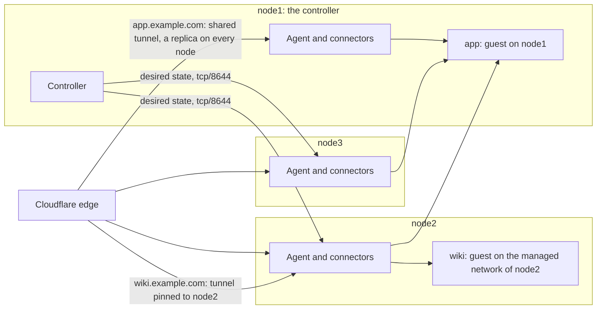

# Run pco on a cluster

This guide puts pco on every node of a Proxmox VE cluster: what each node runs, what to have in
place first, the order to set the nodes up in, how to look after them, and what the loss of a
node costs. The examples use the nodes `node1`, `node2` and `node3`, and the host profile;
[the appliance](#the-appliance) does the same with containers.

## When you need it

Your Proxmox VE nodes form a cluster, and the guests you publish run on more than one of them,
or move between them, and published hostnames should keep answering when a node is down.

## How pco runs on a cluster

Every node runs pco: the package, `pco.service`, and in its daemon an agent, which serves that
node: its connectors, its egress filter, its gateway and the proofs of the addresses of its
guests. One node, the controller, the one that holds the lease on the cluster filesystem, reads
the inventory, decides where each route is served and writes the store, Cloudflare and Proxmox
for all of them. The agents follow it over the agent channel, TCP port 8644.



A hostname that every node reaches is in the shared tunnel, and Cloudflare spreads its requests
over a connector on every active node, so it keeps answering when a node is lost. One that only
one node can reach, as a guest on that node's managed network, is in a tunnel pinned to that
node. The node that runs a guest proves its address at `port`; the other nodes prove it at
`port (attested)`, on the word of that node's forwarding-table watch, as long as every node of
the cluster runs pco. [Architecture](../architecture.md#pco-on-a-cluster) has the details.

## Before you start

- **The cluster is quorate**, and every node you want pco on is a member: `pvecm status`. A
  node that stands alone and runs pco loses its `/etc/pve` when `pvecm add` joins it to a
  cluster: export its install first with `pco export`, or uninstall pco from it, and set it up
  as a further node once it joined.
- **The clocks are in step**: chrony on every node, as Proxmox VE asks anyway, with
  `chronyc tracking` showing a small offset. The cluster filesystem judges whether the lease
  expired by the clock of the node with the lowest node id (`pvecm nodes` lists the ids); never
  step that clock by hand.
- **Two nodes have a quorum device.** Without one a cluster of two loses its quorum with either
  node, and no controller takes over: `pvecm qdevice setup <address>` on a machine outside the
  cluster. The connectors serve on either way.
- **Every node has an address of its own on the bridges and VLANs of the guests it should serve**,
  as for a node alone ([Identity](../identity.md#what-is-checked)). A node that lacks one cannot
  verify the shared routes there, and they move to their guests' nodes.
- **The agent channel can pass.** By default the controller listens on the address each node's
  name resolves to, its management address. To keep that traffic off a network, set
  `cluster.agentNetwork` to the prefix of another the nodes share, and not one of corosync's
  links. With the firewall of Proxmox VE on, setup offers the rule for TCP 8644; accept it.
- **The same release of pco** is on every node before a further node joins.

## Steps

1. **The first node.** Set pco up on `node1` as [Quickstart](../quickstart.md) describes. If
   pco runs there already from an earlier release, upgrade it first: the first start of this
   release writes what a cluster needs beside the old objects, makes the install's CA and draws
   one new epoch, which rewrites the sentinel of each tunnel once.

2. **Each further node, one at a time.** Install the package on `node2` as on `node1`, then run
   `pco setup` there. It finds the install on the cluster filesystem and joins it; nothing
   changes at Cloudflare. Among its lines:

   ```text
   store: install 7f3a9c0d41b2 kept; joining the nodes node1
   certificates: issued the client certificate of node node2 (serial 5c1e..., SHA-256 3b9f...) and the server certificate node-node2.pco-7f3a9c0d41b2.invalid, both until 2027-01-12
   node registry: registered node2 as joining; the controller admits it
   firewall: ipset pco-nodes holds 10.0.0.2 (node2)
   firewall: added the datacenter rule IN ACCEPT -p tcp -dport 8644 -source +pco-nodes
   pco.service: enabled and running
   ```

   It asks for no Cloudflare token: the credentials of the install are on the cluster filesystem
   already, `credentials: 1 stored, nothing needed`. [Add a node](add-a-node.md) has this step in
   full, with what the admission does.

3. **Watch the node become active.** On the controller:

   ```sh
   pco node list
   ```

   ```text
   NAME   STATE    ROLE        KIND  INDEX  ADDRESS   AGENT
   node1  active   controller  host  0      10.0.0.1  heard 1s ago, watching
   node2  joining  agent       host  1      10.0.0.2  heard 2s ago, watching
   ```

   The node is admitted once its agent has reported every route of the shared tunnel, usually
   within a cycle or two, and runs its replica of the shared tunnel from then on. A route it
   cannot reach while the others can moves to the tunnel pinned to its guest's node first.

4. **The rest of the nodes**, the same way, one at a time.

5. **A node that should never be the controller**, a small or remote one, is marked so; it serves
   its guests and the shared tunnel all the same:

   ```sh
   pco node set node3 --controller-eligible=false
   ```

## Check

On the controller:

```sh
pco cluster status
pco doctor --cluster
pco routes
```

`pco cluster status` names every node `active`, with `heard ... ago, watching`, a replica that is
`ready`, and the line `Coverage:    every node watches its forwarding tables`. `pco doctor
--cluster` has no failure, and its checks `clock skew`, `agent channel` and
`replicas <tunnel> in account <id>` pass. On every other node, `pco status` has the lines

```text
Controller:  node1 (10.0.0.1), generation 3
Agent:       hears the controller, heartbeat 4s old; snapshot 42 of generation 3, 7s old; 2 connectors, 5 egress targets
```

## Look after the nodes

- **Run the commands on the controller.** On another node a command that changes the install
  says `this node is not the controller; run it on node1 (10.0.0.1)`, and the web interface
  sends the page to the controller's. `pco status`, `pco agent status` and `pco doctor` answer on
  every node about that node.
- **Before a node's maintenance**, take it out of the shared tunnel, and take it back after:

  ```sh
  pco node drain node2
  pco node undrain node2
  ```

  Proxmox's maintenance mode, `ha-manager crm-command node-maintenance enable node2`, drains it
  by itself while `cluster.followMaintenance` is on, and undrains it when the mode ends. The
  routes pinned to the node go on until their guests migrate.
- **Before the controller's maintenance**, hand the lease to another node, so that it takes over
  within seconds and not two minutes:

  ```sh
  pco cluster handoff --to node2
  ```

  A clean shutdown or reboot of the controller's node does the same by itself.
- **A node that is gone for good** is forgotten, and a node to take out is drained and
  uninstalled: [Remove a node](remove-a-node.md). A node whose disk left your hands:
  [A compromised node](compromised-node.md).
- **Upgrades**, one node at a time, the controller last: [Upgrade and go back](upgrade-and-rollback.md#on-a-cluster).
- **When something is wrong**, [the runbooks of a cluster](cluster-runbooks.md) go from what you
  see to what to do.

## What a node's loss costs

- **A node that is not the controller.** The shared routes go on through the other replicas, as
  soon as Cloudflare sees the lost connector gone. The routes pinned to the node are down until
  their guests run on another node, as high availability of Proxmox restarts them there; the
  controller then moves their routes to the new node's pinned tunnel. The node is `down` in
  `pco node list` at once.
- **The controller's node.** Every connector of the other nodes serves on, from the last desired
  state each was given. Nothing new is published or withdrawn until another node takes the lease,
  about two and a half minutes after the loss; [Controller failover](controller-failover.md) says
  what you see meanwhile.
- **The quorum.** Nothing is written anywhere while the cluster has none, and every connector
  serves on.

A guest that migrates to another node keeps being served: its routes follow it. Its new node
proves it at `port` at once, and the other nodes prove it at `port (attested)` once its MAC has
stayed on its new port for five minutes; with the default `identityMinimum` its routes are served
from the tunnel pinned to its new node meanwhile, and go back to the shared tunnel later.

## The appliance

The appliance has the same roles, in containers: a controller container, which serves the node
it runs on and the agent endpoint, and an agent container on each other node, enrolled with a
join token and admitted by the fingerprint of its certificate. It proves `observed`, as it reads
no bridge. [Install the appliance](appliance-install.md#on-a-cluster) sets it up,
[Appliance](../appliance.md#a-cluster-of-appliances) describes it, and
[Run the appliance's controller as an HA resource](appliance-ha.md) makes its controller fail over.

## Undo

Take the further nodes out, one at a time, as [Remove a node](remove-a-node.md) describes; the
last node left is a node alone again. To remove pco from every node at once,
`pco uninstall --cluster` on the controller ([Uninstall](../uninstall.md#the-whole-cluster)).

## Read on

- [Architecture](../architecture.md#pco-on-a-cluster): the roles, the lease, placement and the
  proofs across nodes.
- [Operations](../operations.md#a-cluster): running a cluster, in the reference.
- [Identity](../identity.md#port-attested-on-a-cluster): `port (attested)` and coverage.
- [Security](../security.md#between-the-nodes-of-a-cluster): what the nodes trust each other with.
- Reference: [pco cluster](../cli/pco-cluster.md), [pco node](../cli/pco-node.md),
  [pco agent](../cli/pco-agent.md).
