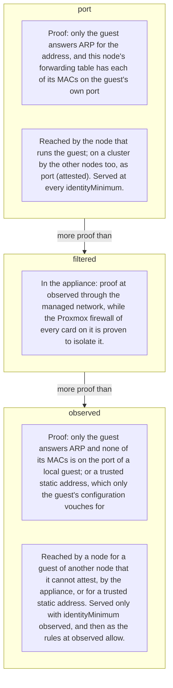
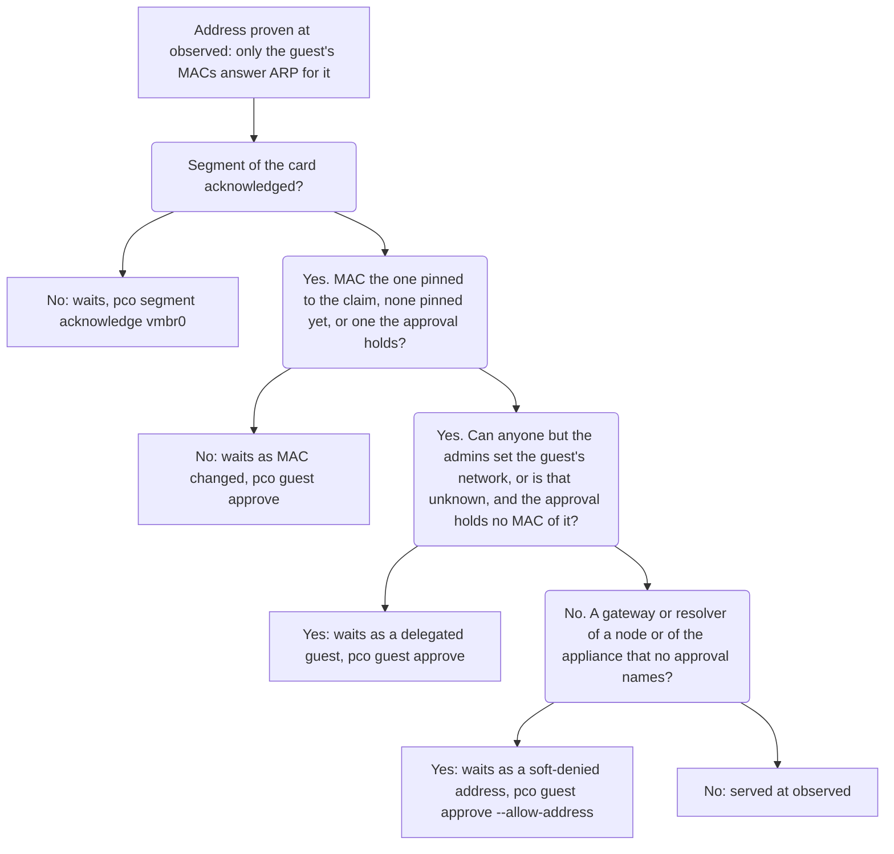
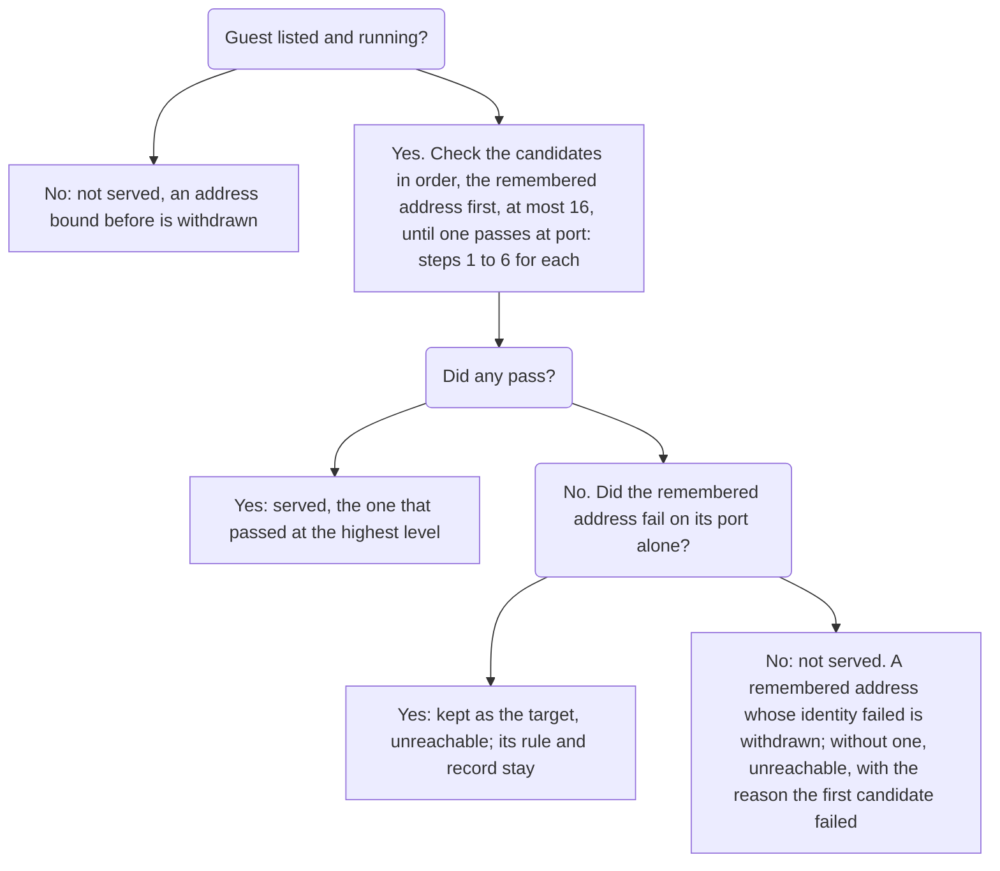

# Identity

pco publishes an address only after it has shown that the address belongs to the
guest whose Notes asked for it. This page says what it checks, in which order, what the
result levels mean, and the one setting that changes how much proof is required.

## Why it checks

The Notes of a guest are written by people, and a guest controls what its guest agent
reports and what it answers on the wire. If pco published whatever the Notes or the
agent say, a guest could name the address of the Proxmox web interface, of the router,
or of another guest, and have it appear on the internet. So neither the Notes nor the
agent is proof. Proof comes from the network the node itself sits on.

## What is checked

For each route, pco makes a list of candidate addresses (see below) and verifies them
one at a time. A candidate is served only if all of the following hold.

1. **It is not forbidden.** It is an IPv4 address, not loopback, link-local, multicast,
   unspecified or broadcast, not an address of any node of the cluster or of this host,
   and not the gateway of an SDN subnet. No setting lifts this. See
   [the denylist](#the-denylist-and-the-node).
2. **The node reaches it directly.** The node has an address of its own in the guest's
   network, on the interface of the bridge (or of the VLAN) that the guest's network
   card is on, and the kernel sends traffic for the candidate out of that interface,
   to the address itself and not through a gateway. The route must not depend on the
   source address either. Otherwise a guest could prove an address on its own bridge
   while the node sends the real traffic somewhere else. A leg of pco's own in the
   guest's network counts as such an interface: for a guest behind an attached network
   or on the managed one, the address is looked up and ARP is asked from the leg, and the
   connection is made through it, while the forwarding table of the bridge is read from
   the node as for any guest ([Networking](networking.md)).
3. **No other running guest has the MAC.** A MAC address that is configured on another
   guest that runs, or may run because Proxmox has not said whether it does, is
   refused. A stopped guest does not count. One guest keeps a MAC that another has too:
   the guest whose address was bound on that MAC before, for as long as the bridge's
   forwarding table still has the MAC on its own port (step 5). A guest that starts with a
   copy of a published guest's MAC therefore does not take its route away, while the
   table places the MAC where it was; once the table moves it, the binding is withdrawn.
4. **Only this guest answers ARP for it.** pco sends its own ARP requests on that
   interface, three of them a tenth of a second apart, and collects for about 600 ms
   every MAC that claims the address: replies, but also requests and announcements that
   name it as their sender. Every MAC must be one of the guest's own network cards on
   that bridge and VLAN. No answer, a stranger's answer, or so many claimants that the
   list is cut short is a failure.
5. **The bridge delivers it to the guest's own port.** This is the forwarding-table
   check, and it needs the guest to run on this node. For each MAC that answered, the
   bridge's forwarding table (per VLAN on a VLAN-aware bridge) must have learned it on
   exactly one port, the port Proxmox made for that guest's card:
   `tap<vmid>i<n>` for a virtual machine, `veth<vmid>i<n>` for a container, or
   `fwpr<vmid>p<n>` when the card has the firewall on. A MAC that the table has on the
   uplink, on another guest's port, or on several ports fails.
6. **The port answers.** pco makes a TCP connection to the address and port of the route,
   and gives it two seconds.

The result of steps 1 to 5 is the identity level. Step 6 is not about identity: a route
whose identity holds but whose port does not answer is kept and shown as `unreachable`.
A trusted static address behind a router is proven in another way, which replaces steps 2,
4 and 5; see [Static addresses behind a router](#static-addresses-behind-a-router).

## The levels

`pco routes` shows the level of each route in the `LEVEL` column.

The levels form a ladder, from the most proof at the top to the least, each with what proves it
and which routes can reach it; a route to an address, with no guest, has the level `manual`,
outside the ladder:

| Level | What was proven |
|---|---|
| `port` | Steps 1 to 5: only the guest answers ARP for the address, and the forwarding table of this node places each of its MACs on the guest's own port. A guest the node reaches through a leg, in an attached network or on the managed one, is proven at `port` the same way, with the ARP asked from the leg. On a cluster, another node proves it as `port (attested)`, which counts as `port`: see [`port (attested)` on a cluster](#port-attested-on-a-cluster). |
| `observed` | Less than `port`, in one of two ways. For a guest on another node of the cluster that this node cannot attest: only the guest answers ARP for the address, and none of its MACs is on the port of a guest of this node, which would be a local guest answering in its name; this node cannot see where the table sends the guest's own frames. For a trusted static address behind a router (see below): neither ARP nor the forwarding table is asked, and only the guest's Proxmox configuration vouches for the address, together with a kernel route to it through a gateway. |
| `filtered` | The level of the managed network `pconet` in the appliance: a proof at `observed` through it, while the Proxmox firewall of every card on it is proven to pin the card to its address and keep it from everything but pco's leg; see [`filtered` in the appliance](#filtered-in-the-appliance). The host profile does not have it. |

A route that names an address and no guest has the level `manual`. Root makes it with
`pco route manual add`, an admin in the web UI, and its address must lie in `manualCIDRs`;
it is kept as a file in `/etc/pve/pco/routes/`, and nothing proves it; see
[Security](security.md). A manual route can also name a guest, with `--guest`: its address is
proven as for a route in the guest's Notes, and its level is one of the ladder.

`port` is the highest level. A node proves it for the guests it runs, and on a cluster of hosts
the other nodes prove it for them as `port (attested)` while every node watches its forwarding
table.
When a route has several candidates, pco serves the one proven at the highest level, and
it stops trying once one reaches `port`; the order below only decides between equals. A
newly bound address is kept for two minutes before pco looks for a candidate that may be
proven higher, unless the address is proven below `identityMinimum`, so that a candidate
whose proof comes and goes does not move the route up and down.

## `identityMinimum`

The setting `identityMinimum` is the lowest level at which an address is served. Its
values are `port`, `filtered` and `observed`, and the default is `port`. It is a setting
of the whole install: there is no minimum per route.

With the default, two kinds of route are not served:

- routes of guests that no node can prove at `port`: on a node alone, a guest of another node
  of the cluster; on a cluster, a guest of a node that runs no pco agent, which another node
  proves at `observed` at best; and
- routes to a trusted static address.

Both can only reach `observed`. A route that the guest's own node proves at `port` and the
other nodes only at `observed`, as while a node of the cluster has no agent whose watch runs,
is not held back: it is served from the tunnel pinned to the guest's node. Such a route is held back: its hostname answers 503, no
DNS record is made for it, and `pco routes` shows it as `unreachable` with the note

    identity level observed is below the required port

`pco status` carries a problem line that says how many routes are held back at which
level and what to do:

    1 route is held back: its identity level is observed, below the required port; guests
    on other nodes and trusted static addresses are proven at observed only: lower
    identityMinimum in the settings to serve them

(The status then exits with 1, because a published route that answers 503 needs you.)

To serve them, set `identityMinimum` to `observed`. Understand what that means first.
At `observed`, ARP consistency is all that is proven, and that can be satisfied by
configuration and not only by forging. A Proxmox user who can set the MAC of a guest's
card and write its Notes can aim a route at any device on the segment whose MAC they
copy. The table in [Security](security.md) spells out which attacker each level stops.
Lowering the minimum does not switch off the forwarding-table check of the guests of this
node: they are still proven at `port` where they can be, and a local guest whose MAC is not
on its own port still fails. What changes is that routes proven at `observed` are served, as
far as [the rules at `observed`](#routes-that-wait-for-an-admin) allow, and the setting is
the same for every guest of the install: any guest that is on another
node that cannot be attested, and any trusted static address, gets the lower proof. If the
guests that need `observed` are on a node without pco, the better answer is to run pco on that
node too.

`filtered` is accepted as a value on both profiles. On the host it is treated as `port`; in
the appliance it serves the routes on the managed network while their isolation holds, and
holds every other route back (see [`filtered` in the appliance](#filtered-in-the-appliance)).

## `port (attested)` on a cluster

On a cluster of hosts the node that runs a guest proves the address of its routes at `port`, as
a node alone does: it chooses the address and checks that its own bridge has each of the
guest's MACs on the guest's own port. The other nodes that run a replica of the shared tunnel
must reach the same address, and a node cannot read the port of a guest on another node's
bridge. A frame from elsewhere can answer that node's ARP with the guest's MAC and talk to it
alone, unseen by the guest's node. Only the forwarding-table watch of the node where such a
device runs can see it. So the other nodes prove a level of its own, `port (attested)`, and only
while all of these hold:

1. **Coverage.** Every node the cluster lists online runs an agent of this install whose
   forwarding-table watch runs, as its last status, at most 30 seconds old, says. A node whose
   agent restarts, or that comes back online, keeps its coverage for 60 seconds, once in ten
   minutes; a second restart or return within ten minutes counts only once its watch has run
   for 60 seconds without a break. An agent that restarts and reports again only after its last
   status went stale, more than 30 seconds later, is uncovered at once, and covered again once
   its watch has run for 60 seconds. On a host `pco.service`
   starts before the guests, so a node's guests do not run before its watch does.
2. **The attestation.** The agent of the guest's node says, in a fresh status, that each MAC
   that answers for the address is learnt on one port of its bridge, on the bridge and VLAN of
   the guest's card, that the port is the guest's own (`tap<vmid>i<n>`, `veth<vmid>i<n>`,
   `fwpr<vmid>p<n>`), and that the MAC has stayed on it for five minutes.
3. **The node's own check.** ARP for the address on this node's interface for the segment is
   answered by those MACs alone, and this node's bridge has each of them on an uplink, a
   physical interface, bond, VLAN or VXLAN port, and on no port of a guest of this node. The
   node pins the neighbour and watches its own uplink for the MAC.
4. **No block.** No block holds for the address, and no other running guest has those MACs
   configured.

`port (attested)` counts as `port` for `identityMinimum`. `pco routes` shows the route's level;
the replicas of each route in `pco status --json` and the page of the route in the web interface
show `port (attested by <node>)` for each node that proved it so. A route's level is the lowest
over the replicas of its tunnel.

When any of these fails, the node proves the route at `observed`, which takes nothing away by
itself. With the default minimum, a route that the other replicas prove only at `observed` is
moved to the tunnel pinned to the guest's node, which proves it at `port`: losing coverage moves
every route of a guest of another node there at once, and when coverage comes back the routes
return to the shared tunnel only after every online node's watch has run for ten minutes
without a break, so that a node whose agent flaps does not move routes back and forth.
`pco doctor` names a node whose watch broke twice within ten minutes.

What this leaves open, by design:

- **A device on the uplink outside the cluster** that copies the guest's MAC and answers one
  replica alone is not seen by any watch. The guest's own node, at local `port`, stops it there.
- **A migration.** A guest whose MAC just appeared on a port, as after a live migration, is
  attested only once it has stayed there for five minutes; until then the other replicas prove
  it at `observed`, and with the default minimum its routes are served from its new node's
  pinned tunnel meanwhile.
- **Without a controller** no attestation and no coverage is refreshed. An attestation proves
  an address only while the node's last heartbeat from the controller is at most 15 seconds
  old, and the attesting node's status was at most 30 seconds old when it was sent. When the
  controller falls silent, or a controller that took over has not heard the guest's node yet,
  a replica keeps an address it served at `port (attested)` on the last word it had: the
  attesting node's status was fresh in the last heartbeat that named it, and the replica's own
  checks find what they found, the same MACs answering ARP and learned on the same uplink port.
  Anything else its checks see, a second MAC, the MAC on a port of its own guests or on another
  port, no answer, withdraws the address at once, and a silence never raises an address to
  `port (attested)` or lets one in. After five minutes without a word the replica shows the
  level as `observed` with `attestation stale` and still serves the address; after 15 minutes
  without a word about the guest's node it withdraws it. A controller that answers again judges
  it afresh, and one that answers and leaves the guest's node out of its heartbeat is no
  silence: the address is withdrawn at once. An agent restarted during the silence has heard
  nothing yet and holds nothing over: it withdraws such addresses until a controller answers.
  A controller that takes over gives each replica back the address and attestation it reported
  it served such a guest on, to that replica alone, while the guest's node, neither down nor
  gone, has not reported to it yet and it has not judged coverage, about a minute after its
  wait for the agents; from then on the guest's node's own word, or the coverage rule, decides.
  A MAC cloned onto a third node meanwhile is blocked by the guest's node and by the node
  it was cloned onto, through their own watches, and not by the other replicas, until a
  controller is back. On a host that takes a cluster without quorum for longer than a takeover.

The appliance offers none of this: its agents read no bridge, so every replica proves
`observed`, or `filtered` on the managed network. [Security](security.md#port-attested-against-the-attackers)
sets `port (attested)` against the attackers.

## Routes that wait for an admin

A proven address can still wait for an admin before it is served. Such a route is
`unreachable` and its hostname stays claimed and answers 503; `pco routes` says what it waits
for, `pco guest list` lists its guest among those that wait, and one problem line of
`pco status` counts the routes held this way.

At `observed`, which is served only while `identityMinimum` is `observed`:

- **The segment.** A route proven by ARP at `observed`, as the route of a guest on another node
  that cannot be attested, is served only on a segment an admin acknowledged: the bridge and VLAN
  of the guest's card, named `vmbr0`, or `vmbr0:20` for VLAN 20.
  [`pco segment list`](cli/pco-segment-list.md) shows the segments that routes were proven on,
  and [`pco segment acknowledge vmbr0:20`](cli/pco-segment-acknowledge.md) serves them from the
  next cycle.
  A trusted static address is on no segment and does not wait for one.
- **The MAC.** The first time an address of a route is verified at `observed`, the MAC it
  answered from is pinned to the hostname's claim. When the address later answers from another
  MAC, the route waits until an admin approves the guest, which records the new MAC.
- **Delegated guests.** When anyone but the admins (`Sys.Modify` on `/`) and pco's own user holds
  `VM.Config.Network` on the guest, the route waits for an approval of the guest. pco reads the
  access control of Proxmox every minute; while the last read that worked is more than five
  minutes old, or none has worked since the daemon started, every route at `observed` waits for
  such an approval.

At any level:

- **Gateways and resolvers.** The address of a guest that is the gateway of an interface of a
  node, or a resolver of a node, is served only once an approval of the guest names it. Such an
  address stays on the list for 30 days after pco last saw it in that role.

`pco guest approve <guest>` shows why the guest waits and what the approval records, the MACs
and the addresses, and records it. It releases these routes in either admission mode;
[Security](security.md#approval-mode) says what else an approval does.

## The appliance and `observed`

The [appliance](appliance.md) runs in a container, which has no forwarding table of the bridge
to read, so step 5 above is not there: an address it verifies through its own card is proven at
`observed` at best, whichever node the guest runs on, and so is one it verifies through a leg,
a card of its own in an attached network. Its `identityMinimum` is `observed` from the
install, and every route it serves is served under the rules of the section above. Each of them
is there because, at `observed`, ARP is all that is proven, and whoever may set the MAC of a
guest's card may aim a route at another device on the segment.

The order in which a route proven at `observed` meets them, and what releases each; each box
begins with the answer that leads to it:

- **Segments and their acknowledgement.** The appliance maps each of its cards to the bridge and
  VLAN of its configuration in Proxmox. A segment is acknowledged once, by an admin, and a new
  one starts unacknowledged. Acknowledge a segment when you would trust every device on it with
  what its MAC can claim: a device that copies a guest's MAC passes ARP as the guest does.
  `pco segment list` shows the segments and their routes, [`pco segment revoke`](cli/pco-segment-revoke.md)
  takes an acknowledgement back. A bridge whose name has a dot cannot be acknowledged, and its routes
  wait.
- **The MAC pin.** The first time an address of a route is verified, the MAC it answered from is
  pinned to the hostname's claim, and stays with the claim across a stop of the guest and a
  withdrawal. The claim goes, and the pin with it, only when the hostname is released after the
  grace period.
- **Renumbering under the pin.** A guest that gets another address, as from DHCP, is served at
  the new one in the next cycle without an admin, as long as the pinned MAC alone answers for
  it. A new MAC is what needs an admin: the route waits with
  `MAC changed from <old> to <new>; approve the guest to accept it`, and the approval records the
  new MAC.
- **Delegated guests.** pco reads the access control of Proxmox every minute and works out, as
  Proxmox does, who holds `VM.Config.Network` on each guest: the one privilege that chooses a
  card's MAC. When anyone but the admins and pco's own user and tokens holds it, through a user,
  a group, a token or a pool, the guest's routes at `observed` wait for an approval, which
  records the MACs it answered from. A clone and a restore are guests of their own and fall
  under the same rule.
- **Access control that cannot be read.** Until the first read after a start, and while the last
  read that worked is more than five minutes old, every guest counts as delegated.
- **Soft deny and `--allow-address`.** The gateways and the resolvers of the nodes and of the
  appliance itself are soft-denied: a guest that is the router or the resolver of a network is a
  common thing to publish, and also the address a route aimed elsewhere would reach for. A route
  to one waits at any level until an approval of its guest names the address:
  `pco guest approve lxc/120 --allow-address 192.0.2.1`. The addresses of nodes and of the
  appliance stay denied without exception. A soft-denied address not seen in that role for 30
  days leaves the list.

`pco routes` shows the reason of each route that waits, `pco guest list` the guests that wait
with why, and a problem line of `pco status` counts the routes held by these rules:

    2 routes are held by the observed rules: segment not acknowledged 2; pco routes says why each is held

**`filtered` and the routes off the managed network.** Only a route on the managed network can
reach `filtered`. With `identityMinimum: filtered` every other route of the appliance is held
back: it shows `identity level observed is below the required filtered` in `pco routes`, and the
problem line counts them and says why `filtered` is not reached.

### `filtered` in the appliance

In the appliance, pco isolates each card it puts on `pconet` with the guest's Proxmox firewall
(the iptables backend, `pve-firewall`): an ipset `ipfilter-net<n>` that holds exactly the card's
address, and rules of its own, commented `pco:<install id>`, first on the card: from pco's leg
the DHCP replies and the published ports, nothing else in; out, the card's own address to the
leg and DHCP requests, nothing else. A card is added with its link down, and its link comes up
once its firewall has been written for 15 seconds, as long as `pve-firewall` may take to
compile its rules, and reads back as written. Each cycle the routes on `pconet` are raised from
`observed` to `filtered` while all of this holds for every card on the vnet; otherwise they are
served at `observed` and the problem line `filtered lost: <why>` says why. The level exists on
the iptables backend of the Proxmox firewall only: with `nftables: 1` in the node's firewall
options the managed network of the appliance is not offered at all, as the nftables preview
installed no guest rules where it was tried. [Networking](networking.md#the-appliance-the-guest-firewall)
has the rules and what drops the level. What the proof rests on, and what it does not cover:

- **Configuration, service and a canary, not the kernel's rules.** The appliance reads the
  firewall through the Proxmox API, which shows what is configured, and the state of
  `pve-firewall`, which shows that it runs. That rules are loaded in the node's kernel is shown
  only by a canary: each cycle a TCP SYN from the leg to a port no route publishes, which must
  meet silence. A check of the node's live rules (`iptables-save`) needs root on the node and
  is not part of this proof yet.
- **A partial write fails safe.** pco writes a new block of rules on top before it removes the
  old one, and the ipset gets the address before anything else leaves it. A write cut off half
  way leaves the card more closed than intended, not more open: its path may be cut for a cycle,
  until the next one puts it right. Rules that still read back otherwise after a write are not
  written again until they change, and `filtered` does not hold for them.
- **An admin's rule above pco's is pushed down.** pco's rules must be the first that apply to
  the card. A rule an admin puts above them is left as it is, and pco's block goes on top of it
  again; the admin's rule then decides nothing for that card.
- **DHCP requests are not bound to an address.** A DISCOVER comes from `0.0.0.0`, and
  `pve-firewall` lets DHCP out in a prelude before its MAC and address filters. pco's DHCP server
  answers only a request whose Ethernet source is the client's `chaddr`. A DECLINE or RELEASE is
  not checked against the guest that sent it; pco reports it and changes no lease for it.
- **The guest firewall's options are the admin's.** pco turns the firewall on only when it was
  off, with accepting policies, and never turns it back on after an admin turned it off; at a
  detach it turns it off again only while nobody changed its policies or added rules since.

**The appliance's own addresses.** The denylist of the appliance holds, besides the addresses of
every node, the addresses of the appliance itself and the gateways of SDN subnets. The addresses
of a node come from the API, which lists those a node is configured with; an address a node
holds only at run time, as one from DHCP, is known only when the installer or a repair saw it
on the node it ran on. Give the nodes static addresses, or run a repair after one changed; see
[Appliance](appliance.md#restore-and-repair).

## Candidates and their order

A route's target says which addresses are candidates.

- An address in the target (`-> http://10.0.0.50:5000`) or `via=<ipv4>`: that address
  and no other. It is placed on the card pco leased it to on its managed network, else on
  the card of the guest that lists it as a static address or that the guest agent reports
  it on, and when none does, tried on every card that has a bridge, in the order of the
  cards. The checks above decide.
- `via=net<N>`: the addresses of that card, the one pco leased it on its managed network
  first, then the static ones from the Proxmox configuration and then the ones the guest
  reports.
- `via=managed`: the addresses of the guest's card on pco's managed network (`pconet`) in
  the same order. A guest without such a card has no candidate.
- Neither: the addresses pco leased the cards on its managed network, then the static
  addresses of every card, in the order of the cards, then the reported addresses of every
  card in the same order. Static means `ipconfig<N>` of a virtual machine (cloud-init) or
  `ip=` of a container. Reported means what the guest agent says for a virtual machine and
  what Proxmox reads from a running container. A reported address counts only for the card
  whose MAC the agent gives it with.

IPv6 addresses are not candidates, and neither are addresses that are unspecified or
multicast. At most 16 candidates are tried for one route in a call.

pco remembers the address it verified for each hostname, with the MAC of the card, the
level, the time and, for a proof at `port`, the bridge and the port the forwarding table
placed the MAC on (the files in `/var/lib/pco/bindings`). That address is verified
first in the next cycle, even when nothing reports it any more, so that a guest agent
that stops answering for a while does not unpublish a route. If the address fails
because its port does not answer, it stays the target for two minutes before other
candidates are tried. If the check could not be made at all, because the host could
not be asked, the old proof stands for five minutes at most, and after that the route
is withdrawn.

`via=` is the way to say which address you mean when a guest has several. Without it,
the remembered address is tried first, and then the first candidate that passes at the
highest level is used.

The way pco finds the address of a route is drawn below. The port is part of the check of
each candidate, so a candidate whose port does not answer is passed over like one whose
identity fails. Each box begins with the answer that leads to it. The drawing leaves out the
two minutes for which a newly bound address, or a bound one whose port fails, is kept without
trying the others, and a check the host could not make:

## When a check fails

A route that was verified and then fails its identity check is withdrawn: its rule
becomes a 503 block, its DNS record stays, and `pco routes` shows the state `withdrawn`
and the reason. The same happens when the guest stops (`guest is not running`) or is
no longer listed. It is served again when the identity check passes again, whatever
the port does. A route that was never verified is `unreachable` and has no DNS record
yet.

A route does not have to wait for the next cycle to be checked again. When the kernel
reports that the MAC of a served address moved, the address leaves the egress filter at
once and the route is verified again, and only a verification that fails withdraws it at
Cloudflare. [Security](security.md) says what is watched and what that does not cover.

The reasons say what failed. `pco diagnose <hostname>` lists every candidate that was
tried and how it fared, in its `identity` step. [Troubleshooting](troubleshooting.md)
has the reasons and what to do about each.

## The denylist and the node

These addresses are never published, for any route, whatever it says:

- an address that is not IPv4;
- loopback, link-local, multicast, unspecified and the broadcast address;
- the address of any node of the cluster, as Proxmox reports it, and every address
  configured on an interface of a node. The addresses are saved on the node, so that a
  node that is offline still counts with the addresses it had.
- an address configured on an interface of this host;
- the gateway of an SDN subnet, as Proxmox lists it.

The reason is the node itself. Without this rule a guest could write the address of the
hypervisor into its Notes and publish the Proxmox web interface on port 8006. A guest
controls its own configuration and its own agent, so the denylist does not trust either
of them. The one exception is a manual route with `allowNode`, which lifts
the two rules about nodes and none of the others; no route from a guest's Notes can.

It is not the only layer. The egress filter of the connectors (see
[Security](security.md)) rejects every connection of a connector to an address of the
node that is not one of its verified targets, and no guest's address is ever one of
those. So someone who edits the tunnel configuration at Cloudflare directly cannot point
the connector at the node either.

## Static addresses behind a router

The check in step 4 needs the node to be on the guest's network. If a guest is reached
through a router, the node has no address next to it and there is nothing to ARP for.
Two settings let such an address through:

- `trustStatic`, a switch, and
- `trustedCIDRs`, a list of IPv4 prefixes.

An address then passes, with a route through a gateway in place of step 2 and without
the ARP and forwarding-table steps 4 and 5, when it is a static address of the guest's
Proxmox configuration, it lies in one of the prefixes, and the kernel's route to it goes
through a gateway and not directly. Step 3 still applies: no other running guest may have
the card's MAC.

Read what that means. Nothing on the wire is looked at, and only the configuration of the
guest vouches for the address, so its level is `observed`, and it is served only if
`identityMinimum` is `observed` as well. Whoever can edit the network configuration of a
tagged guest in Proxmox can give a card the address of any host inside `trustedCIDRs`, and
the route then points at that host. Make the prefixes as narrow as you can; the table in
[Security](security.md) has the attacker this is. Both settings are read when the daemon
starts. [Operations](operations.md) says how to change them.

## What this does not do

The checks are made when pco looks. A cycle, every 10 seconds by default, checks an address
on the wire once however many routes point at it, 32 addresses at a time. While the watch
below runs, a proof at `port` stands in the cycles after it until its address comes due,
once in every `reverifyInterval` (a minute by default) at a time of its own, or at once when
the watch reports a move, the guest's configuration changes or its port stops answering;
[Operations](operations.md) has the details. Between two cycles the daemon watches the
neighbour table of the node and the forwarding tables of the bridges and reacts to a bound
MAC that moves, but that watch has limits:

- The address leaves the filter within tens of milliseconds of the change, not at the same
  instant. [Security](security.md) says what can happen in that time.
- A MAC of the guest's own that appears only in the neighbour table is not a move: a guest
  with two cards on one bridge may answer for its address with either.
- A route proven at `observed` placed no MAC in the forwarding table, so only the neighbour
  table is watched for it, and its address is checked on the wire in every cycle.
- If the watch cannot run, a move is seen at the next cycle only, and the daemon logs it;
  every cycle then checks every address on the wire.

Only IPv4 origins are supported, and the guest must share a layer 2 network with the node or
with a leg of pco's own ([Networking](networking.md)), except for the trusted static addresses
above.
