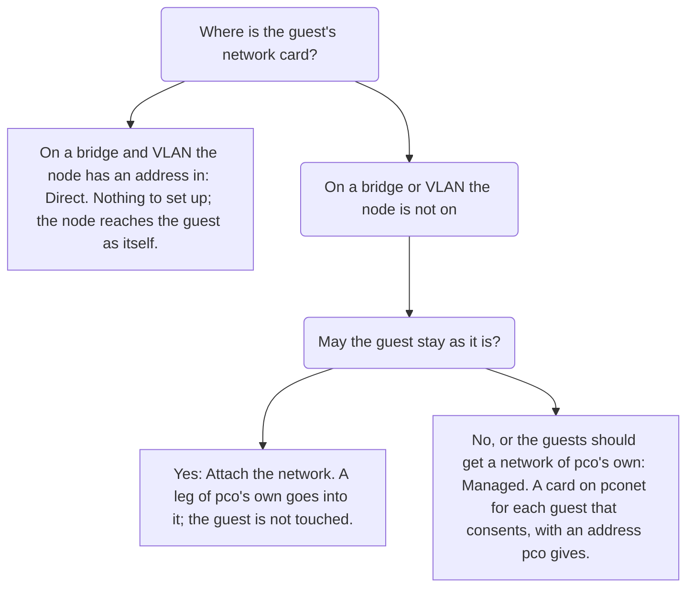
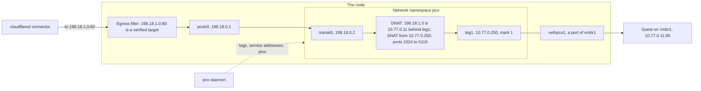
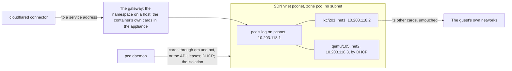

# Networking

pco reaches a guest in one of three ways, and this page is about the two that need something
of pco's own in the guest's network. **Direct** is the way of every other page: the node has an
address on the bridge and VLAN of the guest's card, and reaches the guest as itself. **Attach**
puts a leg of pco's own into a network the node is not on, and reaches the guests there
through it, without touching them. **Managed** gives pco a network of its own, the SDN vnet
`pconet`, and puts the guests that consent on it with a card pco adds, an address pco gives,
and an isolation pco proves. Both work in the host profile and in the appliance.

The page says how to choose, how each works, what it costs and what it proves, what each
profile isolates and where that stops, and what to look at when something is off. The
how-to guides take one task each: [Attach a network](guides/attach-a-network.md),
[Set up the managed network](guides/managed-network.md) and
[the managed network of the appliance](guides/managed-network-appliance.md).

## Which way to a guest



| | Direct | Attach | Managed |
|---|---|---|---|
| The guest's network | The node is on it | The node is not on it; pco puts a leg there | pco's own vnet `pconet`, which the guest gets a card on |
| What changes on the guest | Nothing | Nothing | A network card, `firewall=0` on a host and `firewall=1` with pco's rules in the appliance |
| What it needs of you | An address of the node in the guest's network | A free address of the network for the leg, and a look at who answers there | The consent of each guest, or `managed.consent: auto`, and the SDN vnet once |
| Identity level, host | `port` | `port`, proven through the leg | `port`, proven through the leg |
| Identity level, appliance | `observed` | `observed` | `filtered` while the isolation holds, else `observed` |
| Isolation | The network's own | The network's own | Host: the vnet's isolated ports and pco's guard; appliance: the guest firewall on the card |
| Set up with | nothing | `pco network attach` | `pco setup --managed` or `pco network managed enable`; in the appliance `pco appliance managed enable` first |

Prefer Direct where it is there. Attach where the guests are on a network of their own and
should not be changed for pco: a VLAN of a team, a tenant network, an internal bridge. Managed
where the guests have no network the node should be on, or where a network of pco's own is
what you want: a card that exists for publishing and nothing else, with an address pco keeps,
and an isolation that pco checks. The two can be mixed; a guest reached through a leg of an
attached network does not need the managed one, and `managed.consent: auto` leaves it alone.

Think about the node's management before you give the node an address in a network of guests
([Quickstart](quickstart.md#before-you-start) says what listens on every address of the node).
A leg is one way around that: the namespace it lives in answers nothing of the node.

## Legs and the gateway

A leg is a network card of pco's own in a network the node has no address in: an address of
the guests' prefix, chosen by you for Attach and by pco for Managed, on the bridge and VLAN of
that network. The guests see one more station there, and a request from a connector reaches
them from the leg's address.

### The namespace on the host

On the host every leg lives in the network namespace `pco`, pinned at `/run/netns/pco`. Each
leg is a veth pair: `leg<N>` inside the namespace, with the address, and `vethpco<N>` on the
bridge, enslaved to it like a guest's port. A pair `pcotr0` and `transit0`, the transit link,
joins the namespace to the host, with `198.18.0.1` on the host's end and `198.18.0.2` on the
namespace's. The connectors never see a leg: they dial a **service address** of the prefix
`198.18.0.0/16`, which the host routes over the transit link, and the namespace translates the
service address to the guest's real address and sends the request out of the leg, from the
leg's address.



Each network has a **mark** from 1 to 15, and the leg of mark `N` has its own conntrack
zone, routing table `100+N` and policy rule, and a block of 4096 source ports for the
translation, `1024 + (N-1) * 4096` to `1024 + N * 4096 - 1`. The separate zones and tables are
what let two networks with the same addresses be served at once: a request marked for leg 2 is
routed in table 102 and tracked in zone 2, whatever leg 1 holds. The port blocks keep the two
from presenting the same connection to the node's own connection tracking, which sees the
bridged frames wherever `pve-firewall` runs. The mark also fixes the MACs: `leg<N>` is
`02:50:43:4f:00:<N>` and `vethpco<N>` is `fe:50:43:4f:00:<N>`; the managed network's leg is
`02:50:43:4f:ff:01` on every node, so that its guests see one gateway MAC wherever they run.
The address of a leg is added without a prefix route, so a leg in the management subnet does
not take the node's own traffic away.

The namespace is brought up at boot by `pco-netns.service`, from what the daemon last applied
(`/var/lib/pco/netns/gateway.json`), before `pve-guests.service` starts the guests, so that a
guest behind a leg is reached as soon as it is up. The unit has no stop action: a restart of
it, `systemctl restart pco-netns`, brings back what is missing and leaves the legs, the
translations and the open connections as they are, so an upgrade of the package or a restart
by hand costs nothing. The daemon keeps the namespace after that: every 30 seconds and on every
change the kernel reports, it compares the namespace with what it applied and puts it right.
What it cannot do from its sandbox is make the namespace anew: a namespace that was deleted
stays gone, with the problem line `the gateway namespace was changed outside pco and could not
be brought back: the gateway namespace is not pinned; systemctl restart pco-netns`, until that
restart. `pco netns status` compares everything and exits 1 when anything differs; see
[pco netns](cli/pco-netns.md).

The namespace holds the ruleset `inet pco_gw`: the translations, the per-leg sets, a forward
chain with the policy drop, and an input chain that accepts nothing from a leg but DHCP on the
managed one, so that a guest behind a leg reaches no service of the namespace and none of the
node. The host carries a table of its own, `inet pco_host`, that drops what comes in from the
transit link unasked and what the managed bridge sends to the node, and keeps the node from
routing between the managed network and anything else.

### The cards of the appliance

The appliance has no namespace: a leg is a network card of the container itself, `net1` to
`net9`, which the daemon adds to its own configuration through the Proxmox API, named
`leg<N>` with the leg's MAC and `firewall=0`. The container needs the grant of the network
first, `pco appliance network allow <bridge>[:<vlan>]` on the node, which is
[grant-network](cli/pco-appliance-network-allow.md) in short. Inside the container the
service prefix is routed to the dummy device `pco0` by `pco-net.service`, and the same
translation runs in the container's own ruleset, in the output hook: a connector dials the
service address, the container translates it and sends it out of the leg, with the source
guards that keep a translated packet from leaving `net0` while the table is loading.
`pco net load` restores the legs at boot from the same cache, and `pco net show` says whether
the prefix is kept in. Nine legs is the limit of an appliance: `net0` is its own card, and
admin-added cards count against the nine.

The appliance attaches a VLAN only on a bridge that filters VLANs (a VLAN-aware bridge), never
a `vmbr<X>v<Y>` bridge, and never a bridge it has no grant for. It probes an address only
through a leg it has: before the attach it has no card on the bridge, so `pco network probe`
and `pco network attach` say `is not probed` and why, and the attach goes on. The leg checks
its address when the next cycle raises it, on every bridge, and keeps it off if anyone
answers: `pco network list` then shows `address in use by <mac>`.

### Service addresses

A service address stands for one guest address behind one network: `(network, real address)`,
one of `198.18.1.0` to `198.18.255.255`, given out upward and never twice. `pco routes` shows
it in the `SERVICE` column and the way in `VIA`, `attach:<network>` or `managed`:

    HOSTNAME         STATE   LEVEL  SERVICE                 VIA           OWNER     ZONE
    db.example.com   active  port   http://198.18.1.0:5432  attach:vmbr1  qemu/107  example.com
    www.example.com  active  port   http://10.0.0.11:8080   direct        qemu/101  example.com

The egress filter holds the service address and never the real one: a tunnel rule that names
a guest behind a leg names its service address, and a connector that dials the real address
is rejected like any address outside its targets. The prefix is fixed; there is no setting for
it, and the pool is 65280 addresses, which `pco doctor` watches (`service pool`).

A service address belongs to the route's owner and the guest it was made for, in the identity
the guest had: a guest re-created under the same VMID is another guest. When another guest is
proven at the address a service address forwards to, as after the first guest was removed
while a rule for it is still at Cloudflare, the service address is released and the newcomer
gets one of its own, so that the old rule reaches nothing. A withdrawn route keeps its service
address while a route still names its guest, so that a guest whose MAC changed is published
where it was once its proof is back; it forwards nothing meanwhile. A service address follows
its guest to a new address or another network without a write at Cloudflare.

New service addresses, like the cards and leases of the managed network, are made only in a
cycle in which the daemon knows it is the writer of the tunnel configuration: after a start
one cycle passes first (`service address not allocated: no cycle has run since the start`),
and the ones that exist are used at once. The routes through a leg hold meanwhile and answer
503; [Problems](problems.md#the-gateway-and-service-addresses) lists the reasons.

One thing to know about the translation: a target behind a leg takes about 68 new connections
a second. The leg's block of 4096 source ports serves 4096 new connections a minute to one
address and port, since the guest keeps each used port in TIME_WAIT for 60 seconds. A
connector keeps its connections to a guest open and reuses them, so only a very busy target
comes near that; [Architecture](architecture.md#the-network-gateway) has the arithmetic.

## Attach

Attaching a network puts a leg into a bridge or VLAN the node is not on. Nothing is written to
`/etc/network/interfaces`, no guest is touched, and the network is recorded in the store under
its id, `vmbr1` or `vmbr2.20` for VLAN 20 of `vmbr2`. [Attach a network](guides/attach-a-network.md)
is the guide; this is what each step does.

1. **Candidates.** `pco network candidates` lists the bridges and vnets of the node and the
   VLANs guests are on, with what is seen there: whether a physical port or a bond is enslaved
   (an uplink), the guest addresses seen on it, static or reported, and the prefix they
   suggest, and whether one can be attached.

       SEGMENT   KIND                UPLINK  GUESTS  PREFIX        STATE
       pconet    vnet                no      0       -             refused: pconet is pco's managed network, which is not attached
       pcot1     bridge              no      1       10.50.0.0/24  can be attached
       vmbr0     bridge              yes     0       -             direct: the node has an address here
       vmbr1     bridge              no      1       10.77.0.0/24  attached as vmbr1
       vmbr2:20  bridge, VLAN-aware  yes     0       -             can be attached

   A bridge the node has an address in is `direct`: there is nothing to attach, and an
   attach there is refused with `the node reaches vmbr0 directly; nothing to attach`.
2. **The probe.** `pco network probe <bridge>[:<vlan>] [--address A/len]` asks who answers
   for the address the leg would take, the way the leg checks its own before it raises it: an
   ARP probe from no address, three times. Without `--address` it proposes the highest address
   of the prefix no guest is known to have; without `--prefix` the prefix is the one most
   guest addresses seen there are in, a `/24` around them when one address alone is known,
   and the output says so. The probe goes through the leg when the network is attached, and
   through a port of the gateway's own on the bridge otherwise, `vethpcop`, which is removed
   afterwards. On a bridge with a physical uplink the probe's MAC is seen on that LAN while
   it probes, and the command says so first.
3. **The uplink warning.** A bridge with a physical uplink is a LAN with other stations on it.
   The leg's MAC and address become visible there, and the address has to be one reserved for
   pco: a DHCP server of that LAN must not give it out. `pco network attach` needs
   `--confirm-uplink` for such a bridge.
4. **A prefix that overlaps a route of the node.** A network whose prefix overlaps a route of
   the node on another interface, such as the management subnet, is refused:

       192.168.4.0/24 overlaps the node's route on vmbr0; pass --overlap-ok if the guests there are meant to be reached through the leg

   Pass `--overlap-ok` when that is what you mean: a bridge that carries a copy of the
   management subnet, or a lab bridge with the same addresses as the LAN. The leg keeps the
   node's own traffic where it is: its address has no prefix route, and only the requests
   marked for the leg are routed through it. The network records the choice, and
   `pco network show` says `overlap-ok: yes: attached over a route of the node`. A prefix that
   overlaps the service prefix or `managed.subnet` is refused always.
5. **The attach.** `pco network attach vmbr1 --address 10.77.0.250/24` probes the address,
   shows the result, the uplink warning and the overlap, and asks; a script passes `--yes`.

       10.77.0.250 on vmbr1, in 10.77.0.0/24, is free: nothing answered the probe.
       Attach network vmbr1 with the leg 10.77.0.250/24? [y/N] y
       Attached network vmbr1: the leg leg1 with 10.77.0.250/24, mark 1. The next cycle raises it; pco network list shows how it is.

   The first network of a host enables and starts `pco-netns.service`. The next cycle raises
   the leg, checks that nobody holds its address (an address in use is a leg that is not up,
   with the MAC that answered), and serves the routes of the guests there through it from
   then on: their candidates are proven as any other, by ARP from the leg inside the
   namespace, by the forwarding table of the bridge from the host, and by a connection
   through the leg. A leg that comes up announces its address with three gratuitous ARP
   requests a second apart, so that guests that held an older MAC for it switch at once.
6. **Detach.** `pco network detach vmbr1` shows the routes served through it, asks, removes
   the leg at once, releases its service addresses, and the routes are no longer served that
   way: a guest there is unreachable until another way is found. The last network detached
   disables `pco-netns.service`, which takes nothing down; the namespace stays until
   `pco uninstall`.

`pco network list` shows every network with its leg and how the gateway last found it, and
`pco network show <id>` the leg with its mark and MAC, the service addresses and the routes
served through it. The events of the kind `network` record each attach and detach with who
asked, a leg that came up or did not, and each service address made, moved or released.

## Managed

The managed network is the SDN vnet `pconet` in the zone `pco` of type `simple`, with no
subnet: pco's leg at the first address of `managed.subnet` (`10.203.118.1` by default) is its
only gateway, and the guests that consent get a card on it with an address of the subnet from
the second up, the lowest free first. The card's MAC is `06:50:43:4f:` and the last two
octets of its address, `06:50:43:4f:76:02` for `10.203.118.2`, so that a card and an address
belong together. A container gets a static `ip=` with it, a virtual machine a virtio card and
its address from the DHCP server pco runs on the leg. The guest can reach the leg and nothing
else through that card, and the leg reaches the guest; what the guest publishes is proven on
it like on any other card, and the route's `VIA` says `managed`.



### Setting it up

**On a host**, `pco setup --managed` makes the network after the tags, and
`pco network managed enable` makes it alone later; see
[the guide](guides/managed-network.md). It takes the lock of the SDN configuration, lists the
changes of others that are pending and refuses to go on while there are any, unless
`--confirm-sdn-apply` applies them along, makes the zone `pco` and the vnet `pconet` with
isolated ports where they are missing, asks before it applies (`Apply the SDN configuration?
It reloads the network on every node.`; `--yes` answers it), applies, and stores the network
with the lowest free mark: through the daemon while it runs, itself otherwise. Before the
network is first stored, `managed.subnet` is checked against the routes of every node, the
addresses of every guest and the prefixes of the attached networks, so that pco never puts a
card into a subnet that exists already; change the setting first if it overlaps. The first
network of a host enables `pco-netns.service`. A Proxmox VE 8 has no lock of the SDN
configuration: the command says so and reads the pending changes again right before the
apply. A lock that a run cut short left is released with `pvesh delete /cluster/sdn/lock --force`.

**In the appliance** it takes two steps, as the container may not make SDN objects or grant
itself anything. On the node, as root, with the `pco` of the release
([Commands on the node](appliance.md#commands-on-the-node)):

    pco appliance managed enable --vmid 120

reads the node's firewall first, since in the appliance the guest firewall is what isolates
the managed network, and refuses a node that cannot isolate the guests before anything is
made, each refusal with its fix ([what the isolation needs of the node](#the-appliance-the-guest-firewall)).
Then it shows what it makes and grants, and asks once:

    pco appliance managed enable makes the SDN zone pco and the vnet pconet where they are missing, applies the SDN configuration, and grants pco@pve and pco@pve!vm120:
      role PCOManaged (VM.Config.Network) on /vms/120
      role PCOSDN (SDN.Use, SDN.Audit) on /sdn/zones/pco/pconet
      pveum acl modify /vms/120 --users pco@pve --tokens 'pco@pve!vm120' --roles PCOManaged
      pveum acl modify /sdn/zones/pco/pconet --users pco@pve --tokens 'pco@pve!vm120' --roles PCOSDN
    Make the managed network for lxc/120 and grant these? The SDN apply reloads the network on every node. [y/N] y

The vnet is made without isolated ports there, since the appliance's own card is a port of it
and the guest firewall does the isolating. The zone and the vnet are noted in the appliance's
manifest and in the description of the container before they are made, with a note the node
keeps for itself, so that the uninstall removes them only when all three agree. The grant is
what `pco appliance grant-network` makes for any network: the role `PCOManaged`
(`VM.Config.Network`) on the appliance, so that it can add its own leg, and the role `PCOSDN`
(`SDN.Use` and `SDN.Audit`) on `/sdn/zones/pco/pconet`, for the user `pco@pve` and the token,
as a privilege-separated token holds only what its user holds.
Then, inside the appliance, `pco network managed enable` takes the network into the store, and
the appliance adds its own card on `pconet` in its next cycle.

A guest's card is a change of that guest, which the token may make only where it holds
`VM.Config.Network`. Each consenting guest therefore needs a grant, which `pco managed status`
prints for every guest that waits with `needs-grant`:

    pveum acl modify /vms/203 --users pco@pve --tokens 'pco@pve!vm120' --roles PCOManaged

The attach follows at the next read of the access control, within a minute. The other way is
a pool: `pco appliance managed enable --vmid 120 --pool web` grants `PCOManaged` on
`/pool/web` once, and every guest in that pool, now and later, is writable without a line of
its own, which is how `managed.consent: auto` attaches guests without a grant each. Read what
that hands over: the token can then change the network cards and the firewall of every guest
of the pool, and whoever may put a guest into the pool hands it over too. Nothing is ever
granted on `/`, and `pveum acl delete /pool/web --users pco@pve --tokens 'pco@pve!vm120'
--roles PCOManaged` takes it back. `pco doctor` lists, in `pool grant`, the members of the pool
that have no consent.

### Consent

A guest gets a card only with consent, in one of three forms, which `pco managed status` shows
in the `CONSENT` column:

- **`tag`**: the guest carries the tag `cf-tunnel-managed`. Setup registers it, so that only an
  admin with `Sys.Modify` on `/` can set it, and it counts only while it is registered; a tag
  that anyone may set is not a consent, and `pco managed status` says `cf-tunnel-managed is
  not registered admin-only, so it does not count`. A guest attached by tag is attached
  whether or not it needs the network: the admin said so.
- **`approval`**: `pco managed approve qemu/101`, in the identity the guest has now, as an
  approval of the admission is. A clone and a guest re-created under the same VMID have an
  identity of their own and need a consent of their own, which is what makes an approval
  clone-proof where the tag is not: a clone carries the tag, since Proxmox copies tags. The
  daemon refuses the consent when the guest changed since it was shown. `pco managed revoke`
  takes it back.
- **`auto`**: with the setting `managed.consent: auto`, every guest the gate tag admits that
  needs the network is attached without either. Automatic consent rests on the gate tag
  being registered as admin-only: the setting is refused while it is not, and a `gateTag`
  change to a tag that is not registered is refused while the mode is `auto`.

With `managed.consent: auto` a guest is attached when all of this holds, and `pco managed
status` names, under `Waiting`, the first of them that does not:

- the gate tag is in the registered tags of the datacenter, and they could be read;
- the guest needs the network: none of its network cards other than one on `pconet` is on a
  segment pco reaches, an interface of the node or a leg with an address there, or one of its
  routes says `via=managed`;
- the guest has at least one valid route;
- in admission mode `approve`, the guest's identity is admitted;
- the guest is on this node;
- its Notes do not say `cf-tunnel-managed=off`;
- in the appliance, the token may change the guest (`needs-grant` otherwise), and the firewall
  impact below is confirmed where there is one.

One cycle adds no more than four cards, whatever the consent: each is a `qm set` or `pct set`
of a few seconds, and a node with many guests that switches to `auto` would otherwise run one
cycle for minutes while `pco status` and the web UI show the state from before it. The guests
beyond the four wait with `waits for the next cycle: one cycle adds no more than 4 cards`, and
while the guests left without their card grow fewer from one such cycle to the next, the next
one starts as soon as it ends, so that a node with 40 such guests has them attached within ten
short cycles. Cards that keep failing leave as many guests as before, and those wait for the
cycles of the poll interval. A card that could not be added waits behind the guests that have
not been tried yet.

What consent does not lift: the admission of the guest's routes, the hostname policy, the
claims and the identity level stay what they are. A card on the managed network is a way to
reach the guest, not an approval of what it publishes. And a guest that does not need the
network, as one on a bridge the node is on, is not attached by `auto`; the tag or an approval
attaches it all the same.

When the gate tag loses its registration while the mode is `auto`, automatic attaches stop at
once, with an event and the standing problem line `managed.consent is auto but the gate tag
cf-tunnel is not registered as admin-only; automatic attaches are stopped; attached guests stay
attached`, and `pco status` says `Managed: auto (stopped: ...)`. Nothing is detached: an
attachment made under `auto` goes only on a signal of its own guest, the marker, the gate tag
removed from the guest, the guest gone, or the mode switched to `per-guest`, where the
per-guest rules apply from then on. Registered tags that cannot be read stop the automatic
attaches in the same way, and start no grace. `pco setup --repair` registers the tag again.

### Refusing a card

The word `cf-tunnel-managed=off` in the route text of a guest's Notes, where an entry may
start in a `cf-tunnel` block or on a `cf-tunnel:` line, refuses a card whatever the tags and
the setting say, and starts the detach of a card the guest has. Outside the route text it is
plain prose and does not count: a line that holds only the word, outside every block, refuses
nothing. Write it as `cf-tunnel: cf-tunnel-managed=off`, or as a line of the block:

````text
```cf-tunnel
cf-tunnel-managed=off
app.example.com -> :3000
```
````

The marker is for whoever writes the Notes and does not want pco to change the hardware of
their guest, and it must not fail by a typo: it counts in any case, with any value
(`cf-tunnel-managed=yes` is an error that counts as `off`), and also in a block or an entry
that is dropped for another error. [Annotations](annotations.md#refusing-the-managed-network)
has the grammar.

### The firewall impact, in the appliance

In the appliance pco turns the guest firewall on for the card it adds. A guest whose firewall
is off and whose other card has `firewall=1`, which the GUI sets by default on `net0`, would
then get that card filtered too, by the MAC filter and the connection tracking of the guest
firewall, with the accepting policies pco sets. pco does not decide that for you: such a guest
waits with `needs-firewall-confirmation: turning on the firewall of lxc/204 (gui-4) also
filters net0 (firewall=1); run pco managed approve lxc/204 --accept-firewall-impact, or set
managed.acceptFirewallImpact for every guest`. The per-guest flag goes with the approval; the
setting confirms it for every guest attached by the tag or by `auto`, and changing it is an
event that names who did. A guest whose firewall is on already, or without another card with
`firewall=1`, has no impact and waits for nothing. A host ignores both.

### What the attach does

For each guest with consent the cycle allocates a lease, saves the attachment, and adds the
card at the lowest free index: on the host as root, `qm set <vmid> --net<N>
virtio=<mac>,bridge=pconet,firewall=0 --digest <d>` or `pct set <vmid> --net<N>
name=eth<k>,bridge=pconet,hwaddr=<mac>,ip=<addr>/<len>,firewall=0 --digest <d>`, with the
lowest `eth<k>` no card of the container has; in the appliance through the API with the
configuration's digest, `firewall=1` and the rules below. The digest refuses a write over a
configuration that changed meanwhile, as a `pct set` of yours would; pco reads again and tries
once more. A running container has the card within seconds. A virtual machine without network
hotplug takes it at its next restart: the attachment is `pending-reboot` until the running
configuration shows it, and `pco doctor` warns. A card the attachment lost, removed by hand
or never added because a write failed, is added again, since the add is idempotent; a card
that could not be added or checked this cycle is `attached (unverified)` with the error, and
the next cycle tries again.

The state of each attachment, in `pco managed status` and in the check `managed guest`:

| State | Meaning |
|---|---|
| `attached` | The card is in the guest's configuration with its lease. |
| `attached (unverified)` | The card could not be added or checked this cycle; the detail has the error. |
| `pending-reboot` | A virtual machine without network hotplug takes the card at its next restart. |
| `awaiting-dhcp` | A running virtual machine has had its card for a minute and asked the DHCP server for nothing; see [DHCP](#dhcp-for-virtual-machines). |
| `needs-grant` | In the appliance: the token may not change the guest; the `pveum` line is shown. |
| `detaching` | The consent is gone and the grace runs; the time and the reason are shown. |
| `detach-pending` | The grace ended and the card is removed once the guest's configuration no longer lists it, after a restart of a virtual machine without hotplug. |
| `migrated` | The guest is on another node now, with its card and its address; the managed network does not reach it there. |

### Detaching

A detach is a hardware change, so it waits: the grace `managed.detachGrace`, ten minutes by
default and at least one, starts when the consent is gone (the tag removed or no longer
registered, the approval revoked, the identity changed, the marker written, the mode switched
to `per-guest` for a guest attached by `auto`), and `pco managed status` shows `detaching`
with the time. Consent that comes back within the grace keeps the card, with an event. When it
ends the card is removed, in the appliance with pco's firewall rules and ipset taken off and
the firewall put back as it was, the lease is released once the configuration no longer lists
the card, and the attachment is forgotten, with the event
`<guest> is detached from the managed network; <address> is free again`. A guest that is gone,
or no longer carries the gate tag, is detached the same way.

### Clones and restores

A clone or a restore copies the card on `pconet`, with a new MAC and, for a container, the
original's static `ip=`. A running copy would answer ARP for the original's address and take
its route away. A card on `pconet` that no attachment explains with that index and MAC is
therefore **foreign**, and the cycle acts on it at once: a consenting guest gets the copy
replaced by a card of its own, in one write, with a lease of its own; any other guest pco may
write gets `link_down=1` on it, a restrictive change that waits for no gate (a container that
refuses the option loses the card instead); a guest pco may not write is reported, with the
problem line `foreign card net<n> (<mac>) of <guest>: ...` and the check `foreign card`. A
virtual machine without network hotplug applies `link_down` at its next restart and answers
until then; the state says so.

The tag is inherited by a clone, so in per-guest mode a tagged clone is a consenting guest and
gets its own card and lease; only an approval, which is of an identity, is clone-proof. In
`auto` mode a clone with a route that needs the network is attached like any other guest. Its
hostnames stay in conflict with the original's through the claims, as for any clone.

### How a foreign card is seen

A guest with a card on `pconet` in its configuration is read every cycle, like a tagged
guest. A card put on `pconet` by hand on another guest is seen in its configuration at the next
full sweep, every five minutes, or sooner by two watches: on the managed leg pco listens for
broadcast, multicast and ARP frames from a MAC no lease knows, and such a frame has the guests
of the node read again within a cycle, with the event `a frame from <mac>, a MAC no lease knows,
...`; in the appliance it also drops `filtered` for the vnet at once. A stopped guest with a
foreign card is seen when it starts, as its port appears, or at the sweep. A card that sends
nothing but unicast is not seen by the watch, and is left to the sweep. The watch passes each
MAC on at most once a second and keeps 32 apart; past those it passes one MAC a second, so
that the daemon acts at least once a second while any unknown card speaks. The daemon gives 64
MACs an event of their own, once per MAC in five minutes; past that the frames are counted in
a problem line, and every one still has the guests read again.

### DHCP for virtual machines

A container has its address in its configuration. A virtual machine asks for it, and pco
answers: a DHCP server of its own on the managed leg, inside the namespace on a host and in
the container in the appliance, which answers only a MAC that has a lease, with that lease.
An offer and an acknowledgement carry the message type, the server identifier (the leg's
address), the subnet mask, the lease time of 7 days, the renewal time at half of it (`T1`,
3.5 days) and the rebinding time at seven eighths (`T2`, about 6 days), and nothing else: no
router, no name server, no domain, so the guest takes no default route from it and keeps the
one of its own network. A NAK carries the type and the server identifier only. A request
whose Ethernet source is not the MAC it asks for is dropped and counted as forged; one from a
MAC without a lease is counted as unknown; a guest sends at most one DISCOVER and four other
messages a second, and a flood of made-up MACs costs a counter and a log line a minute. A
DECLINE or RELEASE is not checked against its sender: pco reports it as an event and keeps the
lease, since a guest on the vnet could send one in another's name. The daemon on a host waits
up to ten seconds for the server to listen before it tells systemd it is ready, so that at a
boot the guests find it there; in the appliance the server starts after the first cycle has
proven the container. `pco doctor` has the check `dhcp`, with the unknown and the forged
counts; a server that is not listening is the problem line `the DHCP server is not listening
on the managed leg: <error>`.

The guest has to ask. A running virtual machine whose card has been attached for a minute
without a request is `awaiting-dhcp` in `pco managed status`, and `pco doctor` warns. The card
appears in the guest as one more interface, `ens19` or `ens20` with predictable names, `eth1`
without; `ip link` shows it by its MAC, `06:50:43:4f:...`. What to add depends on the guest:

- Debian with `ifupdown`, in `/etc/network/interfaces`:

      allow-hotplug ens19
      iface ens19 inet dhcp

- `systemd-networkd`, in `/etc/systemd/network/20-pconet.network`:

      [Match]
      MACAddress=06:50:43:4f:76:03

      [Network]
      DHCP=ipv4

- netplan, in `/etc/netplan/60-pconet.yaml`, then `netplan apply`:

      network:
        version: 2
        ethernets:
          pconet:
            match: { macaddress: "06:50:43:4f:76:03" }
            dhcp4: true

- NetworkManager: `nmcli connection add type ethernet ifname ens19 con-name pconet
  ipv4.method auto`.
- A cloud-init image: `qm set <vmid> --ipconfig<N> ip=dhcp` for the index of the card, which
  cloud-init applies at the next boot.

Matching the card by its MAC is the safest, since the index of a hot-added card can differ
from boot to boot. A renewal (`dhclient -r; dhclient ens19`, `networkctl renew ens19`,
`udhcpc -n -i ens19`) is answered by a unicast ACK from the leg's address, `10.203.118.1:67`;
`tcpdump -ni leg1 -e udp port 67` inside `ip netns exec pco` on a host shows the exchange.

### Migration

The managed network reaches the guests of this node. A guest that is migrated to another node
keeps its card and its lease, since leases are keyed by MAC, and is `migrated` in `pco managed
status`, with an event and a problem line; its routes through the managed network are not
served from there. A consenting guest on another node waits with `guest is on node pve2, not
pve1`. Move it back, or reach it another way.

### The vnet and what pco checks of it

Every cycle reads the vnet: that it exists, that its zone is of type `simple`, that
`isolate-ports` is as pco made it (on on a host, off in the appliance), and that it has no
subnet, since pco's leg is its only gateway. Any change holds every attach with the problem
line `the vnet pconet was changed outside pco: <why>`, keeps the cards that exist, and is an
event; back as made is an event too. `pco doctor` has the check `vnet`, which also warns about
the SDN changes of others that wait to be applied, as the next apply by anyone applies them
along.

## What each profile isolates

The managed network exists to give pco a network of its own, so what keeps its guests apart,
from each other and from the node, is the point of it. The two profiles do it in different
places.

### The host: isolated ports and the guard

The vnet is made with isolated ports: a frame from one port of `pconet` is not forwarded to
another port, so two managed guests never see each other at layer 2, and only the leg talks to
all of them. Three things of pco's keep each guest to the card it was given, whatever it sends:

- **The guard table** `bridge pco_guard` on the node. An IPv4 packet or an ARP frame that enters
  `pconet` from a guest's port passes only with the MAC and the address of the card pco gave
  that guest, on that port; a DHCP request and an ARP probe, which have no address yet, pass
  with the card's MAC. Any other IPv4 packet or ARP frame is dropped and counted: `nft list
  counter bridge pco_guard dropped_spoofed`. A guest that sends with another guest's MAC and
  address, from its own port, reaches nothing. Frames of other protocols pass the guard, and
  the isolated ports keep them from reaching another guest. The table is there while the
  managed network has its leg on the node.
- **A sticky forwarding entry** keeps each card's MAC on its guest's port, so that no other port
  can take the frames meant for it: `bridge fdb show br pconet | grep sticky`. Frames to that
  MAC go to that port only, whatever another port sends, so a guest that copies another's MAC
  does not take its traffic. While the guest's port is absent, as while it is stopped, the
  entry waits on the bridge end of the managed leg, `vethpco<mark>`, where frames to the MAC
  end unanswered, and moves to the port as soon as the port joins `pconet`, within
  milliseconds. A guest that starts makes its port a moment before Proxmox puts it on the
  bridge; until then the entry stays where it waits, and that is no change pco reports. A card
  whose firewall flag changes moves its port from `tap<vmid>i<n>` to `fwpr<vmid>p<n>` or back,
  and the guest loses its network until the next cycle moves the entry.
- **The source-MAC watch** on the leg, which has the guests read again when a MAC no lease
  knows speaks, as described above.

The guard fails closed: a guest whose address differs from its lease, as one that set an
address by hand, loses IPv4 on that card.

And the node is unreachable from the managed network. IPv6 is turned off on the bridge
`pconet`, which would otherwise carry a link-local address that reaches `sshd` and `pveproxy`
(the check `pconet`); the table `inet pco_host` drops what the bridge sends to the node and
what the node would route from `pconet` to any other interface, so that a managed guest that
takes the node for its gateway reaches nothing, and keeps a node that forwards or masquerades
for other networks from passing packets into the transit link. The namespace accepts nothing
from a leg but DHCP on the managed one, and the cards pco adds have `firewall=0`: the guest
firewall is not what isolates here, and the managed network of a host runs on either firewall
backend.

A managed guest on a host can send DHCP to pco's leg and nothing else through that card;
pco's leg reaches its published ports. It cannot reach another managed guest, the node, or
anything beyond the leg. Its other cards are untouched.

### The appliance: the guest firewall

The appliance controls no bridge, so the vnet has no isolated ports (the container's own card
is a port of it, and would be isolated too), and the guest firewall of Proxmox is what keeps
the guests apart, at layer 3: the card pco adds has `firewall=1`, and pco writes, with the
comment `pco:<install id>` and scoped to that card, in this order:

    IN ACCEPT -source <leg> -p udp -sport 67 -dport 68      the DHCP replies
    IN ACCEPT -source <leg> -p tcp -dport <port>           one for each published port
    IN DROP
    OUT ACCEPT -source <lease> -dest <leg>
    OUT ACCEPT -p udp -sport 68 -dport 67                  a DISCOVER comes from 0.0.0.0
    OUT DROP

together with the ipset `ipfilter-net<N>` that holds exactly the card's address, which pins
the card to it, and the MAC filter of the firewall at its default. pco turns the guest firewall
on only when it was off, with the policies `policy_in ACCEPT` and `policy_out ACCEPT`, so that
the guest's other cards keep passing what they passed; it never sets the guest-wide `ipfilter`
option, which would filter every card with `firewall=1` to its configured addresses and break
a card on DHCP, and it never changes `macfilter`. What it leaves alone: the other cards of the
guest, their rules, and the options an admin set; a firewall an admin turned off is not turned
back on, and at a detach pco turns it off again only while nobody changed its policies or
added rules since pco turned it on, and says so otherwise.

The level this gives is `filtered`, the level between `port` and `observed`: a proof at
`observed` through the leg, raised each cycle while the firewall of every card on `pconet` is
proven to isolate it. What that proof rests on:

- **The configuration, the service and a canary, not the kernel's rules.** The appliance reads
  each guest's firewall through the API, four reads for each managed guest in each cycle, and
  the state of `pve-firewall` on the node. That the rules are in force in the node's kernel is
  shown by a canary: each cycle a TCP SYN from the leg to the guest's managed address, on a
  port no route publishes (the highest below 1024 that is free, never 67 or 68), which must
  meet silence; a SYN-ACK or a reset means `the firewall is not enforcing on net<N>`. Reading
  the live chains needs root on the node and is not part of this proof. A guest that drops
  the canary with a firewall of its own passes.
- **The enforcement window.** A card is added with its link down, and its link comes up only
  once its firewall has been written for 15 seconds, which is as long as `pve-firewall` may
  take to compile its rules, and reads back as written; `pco managed status` shows `not yet
  enforced` meanwhile. A card whose rules pco just put right is not counted for the same
  time. So a new card, or a repair, drops `filtered` for the whole vnet for about one cycle,
  and a restart of the daemon in the appliance costs the same 15 seconds.
- **An admin's rule above pco's is pushed down.** pco's rules must be the first that apply to
  the card. A rule an admin puts above them is left as it is, and pco's block goes on top of it
  again in the next cycle; the admin's rule decides nothing for that card. The rules of the
  guest's other cards are not pco's and are not touched.
- **A partial write fails safe.** pco writes a new block of rules on top before it removes the
  old one, and the ipset gets the address before anything else leaves it, so a write cut off
  half way leaves the card more closed than meant, never more open: its path may be cut for a
  cycle. Rules that still read back otherwise after a write, as a port range the node
  rewrites, are not written again until they change, with a problem line, and `filtered` does
  not hold for that card.
- **What drops it.** A foreign card, a card with `firewall=0`, a guest firewall that is off,
  `macfilter` off, an ipset that is missing or wider than the lease, pco's rules changed,
  missing or below another rule, a canary that is answered, a changed vnet, or a frame from a
  MAC no lease knows: the routes on `pconet` drop to `observed` with the problem line
  `filtered lost: <why>; the routes on pconet are served at observed`, and with
  `identityMinimum: filtered` they are held back. pco puts its own ipset and rules right in the
  next cycle.

What the appliance's isolation needs of the node, and what happens when it goes away:

- **The iptables backend.** The managed network of the appliance is not supported with the
  nftables firewall backend: with `nftables: 1` in the node's firewall options the preview
  `proxmox-firewall` installed no guest rules at all while it reported itself active, so
  nothing isolated. `pco appliance managed enable` refuses it before anything is made, and
  the cycle reads the option every cycle: when it changes, no card is added, the cards that
  exist stay with their rules, their routes drop to `observed`, and `filtered` is `not offered
  on proxmox-firewall`. Set `nftables: 0` on the node.
- **The datacenter firewall on**, and **`pve-firewall` running** on the node: without either no
  guest rule is in force. The same refusal before setup; later the problem line `the managed
  network cannot run on this node: <why>`, no new card, the existing cards kept and their
  routes at `observed`, and the checks `managed firewall` and `managed` fail.

The limits of layer 3, plainly. ARP passes between managed guests in the appliance, since the
ports are not isolated there: a guest sees the MACs of the others, and it can answer ARP for
the leg's address with its own MAC and poison a neighbour's entry for the leg, so that the
neighbour sends its replies to the poisoner's port instead of the leg. The guest firewall
filters IP packets, not what a neighbour believes of the leg, so nothing of pco's catches that:
the source-MAC watch reports MACs no lease knows and the poisoner's is known, the canary asks
the victim's own address, and the firewall reads see the configuration. What it comes to is a
denial of service and not a read: the neighbour's frames carry the neighbour's address, which
the poisoner's own `IN DROP` discards, so the poisoner reads nothing, and the victim's route
goes `unreachable` with `target is not answering` until the entry expires. On a host the guard
drops such a frame, since its sender pair is not the card's own. The guest firewall does keep
the node's `pconet` bridge device unreachable from a managed guest, which the appliance cannot
do on the node itself: the `OUT` rules let a guest send to the leg and to DHCP only.

## Limits

- **15 networks** in the cluster, the managed one among them: the marks are kept once for the
  whole cluster, and fifteen blocks of 4096 source ports are all that fit below port 65536. A
  16th is refused with the reason, and `pco doctor` warns from the 13th.
- **About 68 new connections a second** to one target behind a leg, as computed above.
- **IPv4 only.** A leg has one IPv4 address; IPv6 is turned off on every leg and on `pconet`,
  and a guest's IPv6 addresses are no candidates anywhere.
- **One node.** Legs and the managed network are of the node that runs pco. A managed guest
  that migrates keeps its card and is not reached; a consenting guest on another node waits.
- **Nine legs in the appliance**, `net1` to `net9`, admin-added cards counted; and the
  appliance attaches a VLAN on a VLAN-aware bridge only, never a `vmbr<X>v<Y>` bridge.
- **The service prefix is fixed** at `198.18.0.0/16`, and `managed.subnet` is a `/16` to a
  `/28`, changed only while the network and its leases do not exist.
- **A service address is never reused**, so a pool that ran out holds new targets until a
  network is detached and set up anew.
- **Linux bridges and SDN vnets.** An Open vSwitch bridge is not a candidate.
- **The managed network of the appliance** needs the iptables backend of the Proxmox firewall,
  the datacenter firewall on and `pve-firewall` running, as above.

## What to check

What an admin, or anyone proving an install, looks at, in the order that finds the fault
soonest:

1. **`pco status`** has a `Managed:` line while the managed network is enabled, `per-guest, 1
   attached`, `auto (stopped: ...)`, `refused: ...` or `vnet changed: ...`, and its problems
   carry every line of [the gateway](problems.md#the-gateway-and-service-addresses) and
   [the managed network](problems.md#the-managed-network).
2. **`pco routes`**: the `VIA` column says how each route is reached, `direct`,
   `attach:<network>` or `managed`, and `SERVICE` shows the service address of a route through
   a leg. A route that is `unreachable` with `service address not allocated` or `service
   address not moved` names the reason.
3. **`pco network list`** and **`pco network show <id>`**: the leg of each network with how the
   gateway last found it (`up`, `address in use by <mac>`, a bridge that is absent), its mark
   and MAC, the service addresses and the routes served through it.
4. **`pco managed status`**: the mode, whether the tag counts, the vnet, the subnet and the
   free addresses, the leg, the pool grant and the isolation of the appliance, then every card
   with its state, every guest that waits with why, and every foreign card with what pco did.
5. **`pco doctor`**: the checks `netns`, `leg <id>`, `networks`, `service pool`, `managed`,
   `vnet`, `pconet`, `dhcp`, `managed guest <owner>`, `foreign card <owner>`, and in the
   appliance `filtered pconet`, `managed firewall` and `pool grant`;
   [Problems](problems.md#checks-of-the-networks) has each.
6. **`pco diagnose <hostname>`**: the `path` step says `attach vmbr1: leg up, service
   198.18.1.5 -> 10.50.0.10 programmed, 10.50.0.10 pinned to bc:24:11:00:00:01`, and the
   `http` step asks the service address from the daemon, which is the connector's exact path.
7. **`pco events --kind network`** and **`--kind managed`**: every attach and detach with who
   asked, every service address made, moved or released, every card given, kept or removed,
   every foreign card, and every change of the isolation.
8. **On a host**, as root: `pco netns status` (everything compared, exit 1 on a difference);
   `ip netns exec pco ip -br addr` for the legs; `ip netns exec pco nft list table inet pco_gw`
   for the translations and the counters: `dropped_oif`, `dropped_leg_in` and
   `dropped_transit` count what the guards dropped, where a leg guest that probes the leg
   raises the second, and the first and the third should stay at 0; `nft list table bridge
   pco_guard` for the cards the guard admits and `dropped_spoofed`; `bridge fdb show br pconet
   | grep sticky` for the entry of each managed guest on its port; `ip -n pco neigh show dev
   leg1` for the pinned MACs; `systemctl status pco-netns` and `journalctl -b -u pco-netns`
   for the boot, whose leg lines come before `Starting pve-guests.service`.
9. **In the appliance**: `pco net show` for the prefix, `pct config <vmid>` on the node for the
   cards `net1` to `net9` of the container, `pct config <guest>` for a guest's card with
   `firewall=1`, `cat /etc/pve/firewall/<guest>.fw` for pco's rules on top and the ipset, and
   on the node `iptables-save -t filter | grep -A8 'tap<vmid>i<n>-IN'` for a virtual machine or
   `'veth<vmid>i<n>-IN'` for a container, the rules in force, which the appliance cannot read
   itself.
10. **From a guest**: the leg answers ARP for its address from the leg's MAC and gives a
    managed guest nothing else but DHCP, since the gateway accepts nothing from a leg; a
    managed guest reaches no other managed guest, not the node on any address, and nothing
    beyond the vnet. What reaches the guest comes the other way: a request from a connector,
    which the guest sees from the leg's address on the published port.

[Troubleshooting](troubleshooting.md#networks-behind-a-leg-and-the-managed-network) goes
through the cases that come up, and [Security](security.md#the-managed-network-against-the-five-attackers)
says what each isolation stops.
