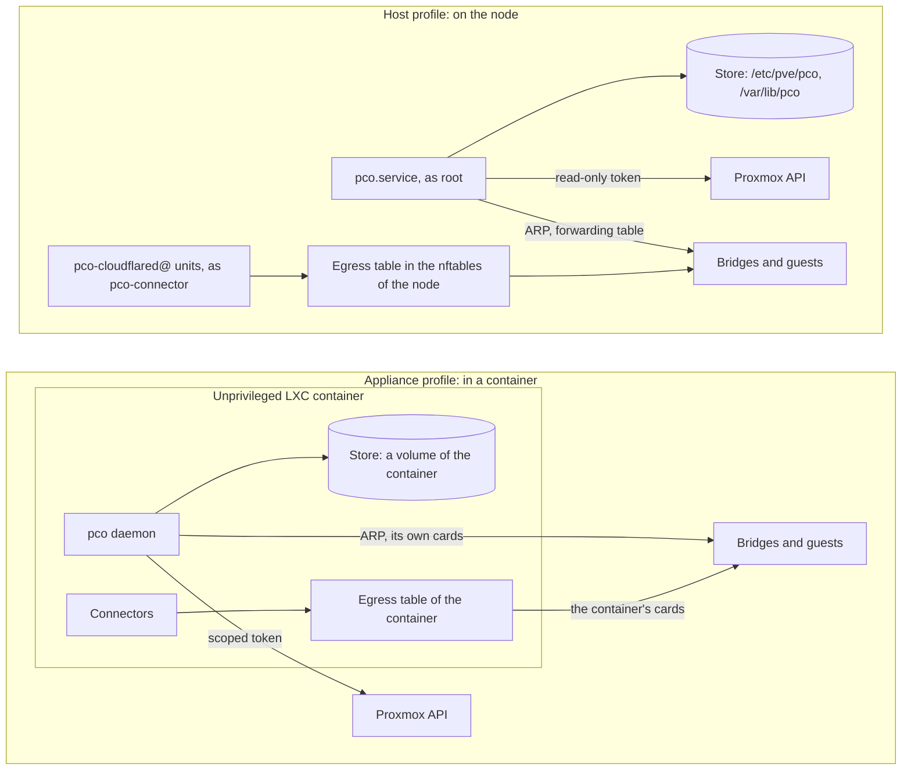

# Profiles

pco runs in two ways, called profiles, from one binary: the host profile, where the daemon and
the connectors run on the Proxmox node itself, and the appliance profile, where they run in a
container that `pco appliance install` makes, and nothing is installed on the node. Both are in
this release. The installer sets up the host profile unless it is told `--appliance`, or is
answered so at its question; then it runs `pco appliance install` from a temporary directory.

The profile of an install is recorded when it is made, and `pco status` shows it:
`Profile: host` or `Profile: appliance`.

## Side by side

Where the parts of pco run in each profile, and how each reaches Proxmox and the guests:

| | Host | Appliance |
|---|---|---|
| Where pco and cloudflared run | systemd units on the node | an unprivileged LXC container with nesting enabled |
| What is on the node | the package, the units, the `pco-connector` user, an nftables table | the container, and a role, a user, a token and a pool in Proxmox |
| How it is installed | `install.sh`, by default, then `pco setup` | `install.sh --appliance`, which runs `pco appliance install` |
| Proxmox access | an API token (read-only) and local root for `pco setup` | the API only, with a privilege-separated token of the same read-only role |
| How guests are reached | as the node itself, through the node's own address on the guest's bridge; a network the node is not on through a leg of pco's own in the gateway namespace `pco` | through the container's network card, on its bridge and VLAN; a network it is not on through a card the appliance adds to itself as a leg |
| Identity level | `port` for guests on the node, through a leg too; on a cluster `port (attested)` for guests of other nodes while every node watches its forwarding table, `observed` otherwise | `observed`; `filtered` on the managed network while its isolation holds |
| Managed network isolation | SDN isolated ports, at layer 2, with pco's guard and sticky entries on the bridge; the node out of reach through its own table | the Proxmox guest firewall on the cards pco attaches, at layer 3; the iptables backend only |
| Where the legs live | the network namespace `pco`, brought back at boot by `pco-netns.service` before the guests | the container's own cards `net1` to `net9`, restored at boot by `pco-net.service` |
| Store | `/etc/pve/pco`, on the cluster filesystem | a volume of the container, kept out of backups |
| Upgrades | apt, with the package | `pco upgrade`, inside the container; Debian's security updates by themselves |
| On a cluster | pco on every node: the agent of each serves its node, and the node that holds the lease is the controller | a controller container, which serves its own node, and an agent container on each other node, enrolled with a join token |
| Control-plane failover | automatic: another node takes the lease about two and a half minutes after the controller's node is lost, within seconds of a clean stop or `pco cluster handoff` | the controller as a Proxmox HA resource, on shared storage automatic, on replicated storage after `pco appliance recover`; without HA, installed again and recovered |
| Data-path availability | a replica of the shared tunnel on every active node; the routes only one node can serve in a tunnel pinned to it | the same |
| Sign-in to the web interface | the ticket of the Proxmox web interface, or a Proxmox API token | a Proxmox VE user and password, with its TOTP or recovery code, checked at the node's API, or a Proxmox API token; `root@pam` only with `PCO_WEB_ALLOW_ROOT=1` |
| Where the web interface listens | the node's address in the cluster status, port 8643, or what `pco setup --web-listen` gives | the address of `net0`, port 8643, and nowhere else |
| The certificate of the web interface | by default a key of its own and a certificate of the cluster CA for 90 days, which the daemon renews; or yours; or pveproxy's | a key of its own and a self-signed certificate of 397 days, which the daemon renews; or yours |

Both run on a node alone or on every node of a cluster ([Operations](operations.md#a-cluster)),
have a command line and a web interface, reach the networks a node is not on through legs of
their own, and manage a network of their own for the guests that consent
([Networking](networking.md)).
[Architecture](architecture.md) describes the parts of each profile, and
[Appliance](appliance.md) the appliance as a whole.

## What they share

Both profiles use the same annotation grammar, planner, inventory, Cloudflare client,
reconcilers, connector units, engine, API and command line, and the same rules at each identity
level, and the same networking: the three ways to a guest, the service addresses, the consent
and the leases of the managed network. What differs is the prober (the host profile can read
the forwarding table of the bridge, the appliance cannot), the network backend (a namespace of
the node, or the container's own cards), what isolates the managed network, the installer and
the way an upgrade is done, boot ordering, the sign-in to the web interface and the store.

## Why there are two

A clean hypervisor, with nothing installed on it that is not Proxmox, is a reasonable thing to
want, and it is what the appliance is for. The appliance keeps pco and cloudflared in an
unprivileged container with an API token that can only read. A compromise of the container is
not a compromise of the node. What it holds instead is a container whose secrets are readable
by whoever can reach into it, which is why it refuses to serve while anyone but the admins
can; [Appliance](appliance.md#who-may-reach-the-appliance) says how.

The host profile exists because it can prove more. A daemon on the node reads the bridge
forwarding table, which says on which port of the bridge a MAC address lives, and so it can show
that an address belongs to the guest that asked for it and that the node's frames for it go to
that guest's own port. That is the `port` identity level. A container cannot read the table,
and its best level on an ordinary network is `observed`, which an admin accepts segment by
segment and which holds a guest whose network others may change until an admin approves it.
[Identity](identity.md) explains the levels, and [Security](security.md) what each stops.

The cost of the host profile is that a root daemon and a systemd unit live on the hypervisor;
[Security](security.md) says what they can do and what confines the connector. The cost of the
appliance is the weaker proof and the rules that make up for it.

Choose the host profile when you can accept a root daemon on the node, and want guests of that
node proven at `port`. Choose the appliance when nothing but Proxmox may be installed on the
node, the guests to publish share a segment with it, and the people who can change their
network cards are few.
