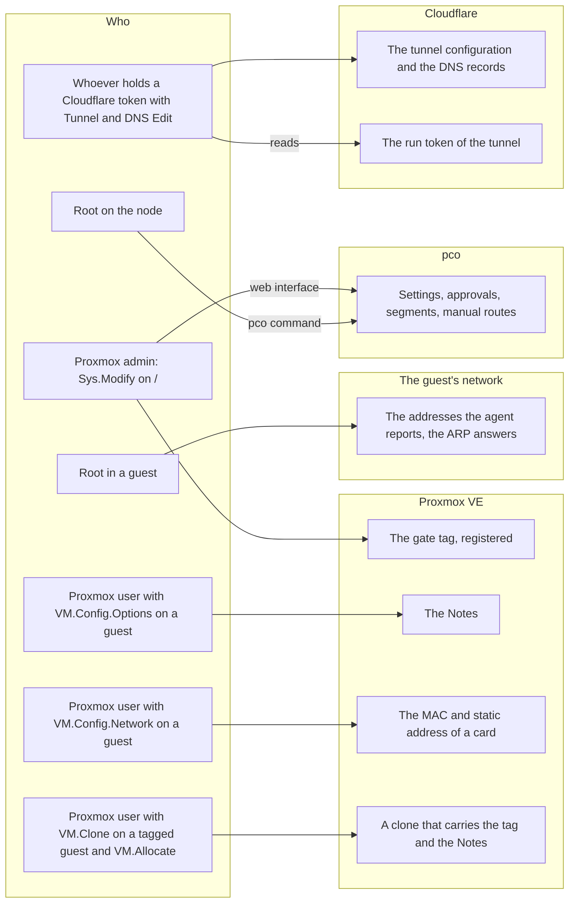
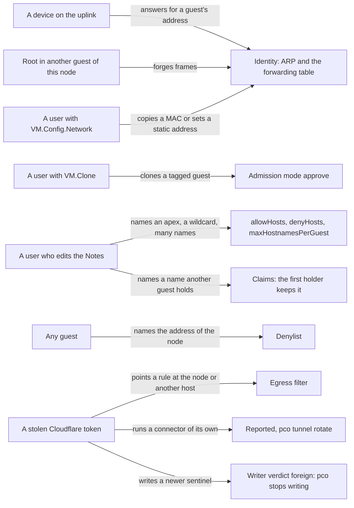
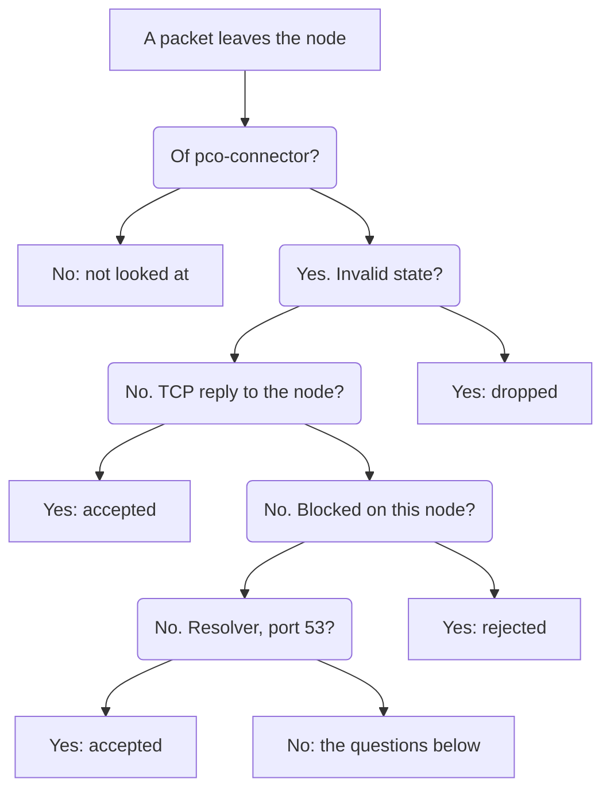
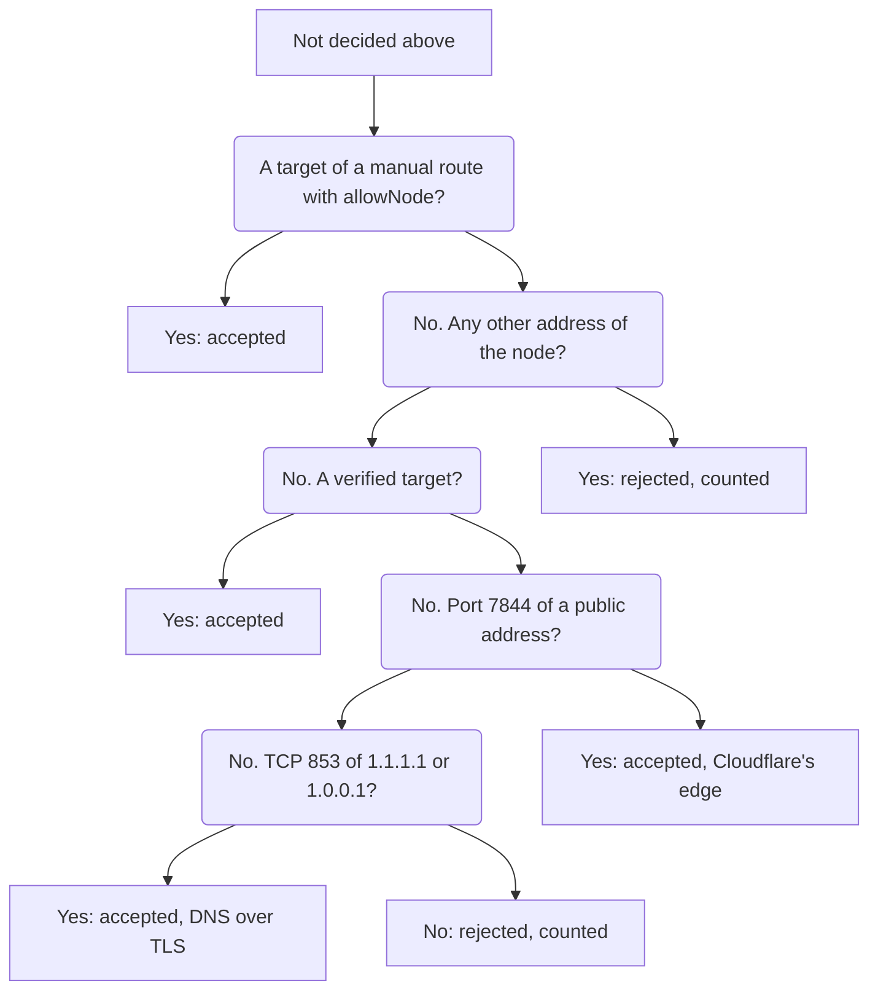

# Security

This page says what pco trusts, what it does not, which parts hold which privileges,
and what each protection stops. It is written for the person who decides whether to run
pco on a node, and who would like to know where the limits are before an incident shows
them.

## Trust boundaries

pco reads what several kinds of people and programs can write, and treats none of it as proof.
Who can write what pco acts on:

The tag says that a guest may publish, the Notes say what it asks for, and an address is
served only once [Identity](identity.md) has shown on the network of the node that it is the
guest's. Against each attacker stands one of the defences this page describes:

How far each holds, and at which identity level, is the rest of this page; the
[table of the five attackers](#identity-levels-against-five-attackers) is the short form.
On a cluster, the nodes trust each other as far as [Between the nodes of a
cluster](#between-the-nodes-of-a-cluster) says: a compromised host node can act as any host
node.

## What runs with which rights

| Part | Runs as | Can |
|---|---|---|
| The daemon, `pco.service` | root | Read Proxmox through its API token, open a raw socket to ask ARP, read the bridge forwarding table through netlink and watch it and the neighbour table for changes, load the egress table with `nft`, run `systemctl` for the connectors and write their files, call the Cloudflare API with the stored tokens. With a network behind a leg: keep the namespace `pco`, its legs and tables, and the sticky entries and the guard on `pconet`; run a DHCP server on the managed leg; and run `qm set` and `pct set` to add, remove or set down the one card of a consenting guest on the managed network, under the configuration's digest. It listens on a unix socket and nowhere else. |
| The connectors, `pco-cloudflared@<tunnel id>.service` | the system user `pco-connector`, with no capabilities | Open outbound connections, which the egress filter confines (below). |
| The web interface, `pco-web.service` | the system user `pco-web`, with no capabilities | Serve HTTPS on its address, ask the node's API whether a user may sign in, and call the daemon on its socket for the users signed in; see [the web interface](#the-web-interface). |
| The `pco` command | whoever runs it | `setup`, `uninstall` and `pco egress` work on the node directly and need root. The others ask the daemon through its socket, which lets in only root and `pco-web`. |

This is the host profile. In the appliance the same parts run in its container, as root of an
unprivileged container and not of the node; [the appliance](#the-appliance) says what changes.

The daemon is a root-equivalent part of the node. It runs as root, has the Cloudflare
tokens, manages systemd units, and answers a socket. Anyone who can make it do things has
the node. Its unit applies a few protections (`ProtectHome`, `PrivateTmp`,
`ProtectKernelModules`, `ProtectControlGroups`, `LockPersonality`, `ProtectProc=invisible`)
and writes no core dump (`LimitCORE=0`), since its memory holds the tokens, but no more,
because it needs systemd, nftables, raw sockets and files under `/var/lib` and `/etc/pve`.

The connector is where the confinement is. Its unit runs as `pco-connector` with
`NoNewPrivileges`, `ProtectSystem=strict`, `ProtectHome`, `PrivateTmp`,
`PrivateDevices`, the kernel-protection options, an empty capability set,
`RestrictAddressFamilies` limited to IPv4, IPv6, unix sockets and netlink,
`RestrictNamespaces`, `RestrictRealtime`, `MemoryDenyWriteExecute`, the system call filter
`@system-service` (a call outside it fails with `EPERM`), and `ProtectProc=invisible` with
`ProcSubset=pid`: in `/proc` it sees no process of another user, so neither the daemon, which
runs as root, nor the Proxmox services, and nothing of the kernel but the processes. The
connectors of the other tunnels run as the same user and stay visible to it; a user of its
own for each tunnel is a later hardening. It cannot see `/etc/cloudflared`, `/usr/local/etc/cloudflared` or
`/root/.cloudflared`, and it is started with a configuration file of pco's own, so that
cloudflared reads no configuration of the host. Its token is handed to it as a systemd
credential and read from a file, so it never appears on a command line or in the
environment.

A connector listens on 127.0.0.1 for its metrics, on a port from 20300 up. A local user who
listens on that port first keeps it from starting: it exits and systemd starts it again,
over and over. The daemon reads that from the connector's journal, says
`metrics port 20300 is held by another process` as a problem, and moves the connector to a
port of its own in the next cycle that keeps it running, which is the next one in enforce
mode; the problem says when. The port that was taken is not given out again for an hour.

The Proxmox side is read-only. Setup makes the role `PCO`, the user `pco@pve` and the
token `pco@pve!pco`, and the role holds `VM.Audit`, `Sys.Audit`, `SDN.Audit`,
`VM.GuestAgent.Audit` (`VM.Monitor` on Proxmox VE 8.4) and `Pool.Audit`, granted on `/`.
pco reads the pool of each guest from `/cluster/resources`, which shows it only to a
token with `Pool.Audit`, and the SDN zones and vnets from their listings, which `SDN.Audit`
on `/` opens (a single zone is answered only to `SDN.Allocate`, which the role does not
hold). The daemon never changes a tag or a Notes field, and changes a
guest in one way only: with the guest's consent it adds a card on the managed network, on a
host as root with `qm set` and `pct set`, and removes it again after the grace once the
consent is gone ([Networking](networking.md#managed)); the token writes nothing. Otherwise only
`pco setup`, `pco network managed enable` and `pco uninstall` change Proxmox, as root, and
what they change is listed in the manifest: the SDN zone `pco` and vnet `pconet` among it.

The Cloudflare side is not read-only: the token can edit DNS records and tunnels in the
zones and accounts you chose. Scope it narrowly; see
[Cloudflare token](cloudflare-token.md).

## The gate tag, and what it proves

A guest is published only if it carries the gate tag, `cf-tunnel` unless the setting
`gateTag` says otherwise, and its Notes hold routes. What does the tag prove?

When the tag is a registered tag, which setup arranges unless you decline, only a user
with `Sys.Modify` on `/` can set or remove it. The tag then proves that such a user tagged
that guest at some point. It does not prove more:

- It is not an approval of the hostnames. Whoever may edit the Notes of the guest
  (`VM.Config.Options`) chooses what the guest publishes, within the hostname policy
  (`allowHosts` and `denyHosts` in [Operations](operations.md)). Two kinds of name are kept
  out unless `allowHosts` names them: the apex of a zone, and a wildcard, which would answer
  every name of the zone that has no record of its own, with a valid certificate. And one
  guest names at most `maxHostnamesPerGuest` hostnames, 32 by default; one that names more
  publishes none. Set `allowHosts` to the names you mean to publish when the people who edit
  the Notes are not the people who run the node.
- It is not tied to what the guest is. A clone and a restore keep the tags and the Notes.
- If you decline to register the tag (`--no-registered-tags`), it proves nothing about
  who set it: whoever can edit the guest can tag it. Setup then warns, naming the gate
  tag, unless it is registered already, and `pco setup --repair` registers it later.

Setup registers `cf-tunnel` and `cf-tunnel-managed`, and the gate tag of the settings
when that is another one. If you change `gateTag` afterwards, run `pco setup` again, or
`pco setup --repair`, to register the new tag as well. Until you do, the new gate tag is
one that anyone who may edit the options of a guest can set. `cf-tunnel-managed` is the
consent of a guest to a card on the managed network, and it counts only while it is
registered: a tag that anyone may set is no consent to a change of a guest's hardware, and
`pco managed status` says so. [Networking](networking.md#consent) has what the consent lifts
and what it does not.

### Clones and restores

A clone of a published guest carries the tag and the Notes, and so asks for the same
hostnames. It does not get them. The first guest to claim a hostname keeps it for as long
as it keeps asking, so the clone's route is in the state `conflict` and serves nothing.
Identity alone never moves a claim, and neither does a new guest that is created under the
VMID of an old one: the claim belongs to the guest `qemu/101`, and the new one inherits it.

Naming a hostname early wins nothing. A guest takes no claim on a name in a zone this install
never served, nor on an apex or a wildcard that `allowHosts` does not name. Once the zone is
served and the name allowed, the guests that name it then get it as any free hostname: the
first in owner order. A holder whose name comes to be rejected loses its claim at once, also
when a broken entry in its Notes still names it. The claims in a zone the install served are
kept as they are while the zone is in doubt, left out or gone from its listing.

A guest restored to a different VMID is a different owner and is in conflict while the
original exists. A guest that is restored or created again under the VMID of a published
guest publishes the same hostnames, without anyone approving it again, as long as it
carries the tag and the Notes. Admission mode `approve` closes that for a guest that comes
back with a new identity, and not for one that keeps its identity (see below).

A clone is also how a user who may not set the tag gets a tagged guest. Whoever holds
`VM.Clone` on a tagged guest, or on a tagged template, and `VM.Allocate` where the clone goes
makes a guest that carries the tag, and once its Notes are theirs to edit, it publishes the
hostnames they write there that nobody holds yet. A registered tag does not stop that:
Proxmox copies the tags of the source. In admission mode `tag` it is published at the next
cycle; in mode `approve` it waits, because a clone has an identity of its own. `pco doctor`
warns in its `admission` check while the mode is `tag` and any guest carries the gate tag:
the check does not look at who holds `VM.Clone` on them, so it cannot tell whether anyone
but the admins may clone them. Use `approve` when anyone but the admins holds `VM.Clone` on a tagged guest.

### Approval mode

With the setting `admission` set to `approve`, a tagged guest is published only after an
admin has approved it:

    pco guest list
    pco guest approve qemu/101
    pco guest revoke qemu/101

An approval is of the identity the guest has when it is approved: for a virtual machine its
SMBIOS UUID, or else its creation time, or else a hash of the MAC of its first card; for a
container a hash of the MAC of its first card. A clone has another identity, and so has a
guest that is created again with a new UUID, or, for a container, a new MAC: each needs an
approval of its own. The daemon refuses an approval when the guest has changed since it was
shown.

A guest that keeps its identity keeps its approval. A guest restored from a backup of
itself keeps its UUID and its MACs unless the restore is asked to make new unique
addresses (`--unique` of `qmrestore` and `pct restore`), and a container that is created
again with the same MAC has the same identity. Approval mode does not close those.

A guest that waits for approval is not published. A hostname it already holds stays
claimed and answers 503, so nobody else gets it. `pco status` shows how many guests wait
(the `Approval:` line), `pco guest list` which, and `pco doctor` has a warning for each.
Changing the mode to `approve` takes the routes of every guest that is not approved off the
air at the next cycle: their hostnames answer 503.

Approval mode is recommended when the people who can edit the guests are not the people who
administer the node. It is off by default. The default is `tag`.

## Identity levels against five attackers

[Identity](identity.md) describes the checks. This table says what each level stops. Every
row but the first assumes a guest that carries the tag: a user cannot tag their own guest
when the tag is registered, unless they may clone one that has it (the last row).

`port` is what a guest on this node gets. `observed` is what a guest on another node of the
cluster gets, what an address behind a router gets when you trust it, and what every guest of
the [appliance](appliance.md) gets; on a host only if `identityMinimum` is lowered to
`observed`. `filtered` is what a guest on the managed network of the appliance gets while its
isolation holds; [the managed network against the five attackers](#the-managed-network-against-the-five-attackers)
has it. A guest reached through a leg of an attached network gets `port` on a host and
`observed` in the appliance, as any other.

A route at `observed` is served under the rules of [Identity](identity.md#routes-that-wait-for-an-admin):
on an acknowledged segment only, with the MAC pinned to its claim, and only after an approval
when anyone but the admins may change the guest's network. The `observed` column says what the
level stops with those rules.

| Attacker | `observed` | `port` |
|---|---|---|
| A device on the uplink, outside Proxmox | Stops a device that answers for a guest's address with its own MAC. Once the route is served, a stranger's MAC that the kernel learns for the address is noticed as well (see below). Does not stop a device that copies the guest's MAC too: ARP cannot tell the copy from the guest, and for a guest on another node this node cannot see where the table sends its frames. That is what an admin accepts when acknowledging a segment. | Stops both. The bridge must have learned the guest's MAC on the guest's own port and on no other, and a MAC the table has on the uplink fails. A device that starts using the guest's MAC after the check makes the bridge learn it on the uplink: the daemon is told at once, takes the address out of the egress filter within tens of milliseconds, verifies the route again at once, and withdraws it at Cloudflare if that fails. Limit: the tens of milliseconds between the table changing and the filter following. |
| Root in another guest of this node | Stops a guest that answers with its own MAC, and a card configured with a MAC that a running guest has. On a host, frames forged with the MAC of a guest of another node put that MAC on the port of the attacker's guest, which `observed` notices when it checks. The appliance reads no forwarding table and does not notice that: a guest that forges the MAC of a published guest is the device of the row above. | Stops forged frames as well. They move the entry to the attacker's port, so the address leaves the filter within tens of milliseconds, the verification fails, and the victim's route is withdrawn (503). It is not taken over: that is a denial of service for the victim, not a hijack. Limit: the same. |
| A Proxmox user with `VM.Config.Network` on another guest | Stops it until an admin approves. The user can give their guest the MAC of a device on the segment that is not a running guest, and aim a route at that device from its Notes. But the guest is delegated, so its routes wait for an approval, which shows and records the MACs they answer from; a MAC changed after the approval waits for a new one. An admin who approves a guest that answers with the MAC of another device lets the route through. | Mostly stops it. To pass, the table has to have the device's MAC on the user's own port, which it has only after the user's guest sent a frame with that MAC and before the device sent its next one. That next frame moves the entry back to the uplink, which the daemon sees at once, and the address leaves the filter within tens of milliseconds. A user who keeps transmitting can get the check to pass again, and what the device can then be asked for is limited to the moment after each of its frames. It is not a complete defence. |
| A Proxmox user with `VM.Config.Network` on the published guest | Stops it. The user could give a card of the published guest the MAC of a device and its static address, which is tried before the reported ones. The grant makes the guest delegated, so its routes wait for an approval from the next read of the access control, within a minute; and the new MAC is not the one pinned to the claim, so the route waits for an approval in any case. An address changed while the MAC stays is answered by the device's own MAC, which fails ARP. | Mostly stops it, with the same race and the same watch as in the row above. |
| A Proxmox user with `VM.Clone` on a tagged guest and `VM.Allocate` | Does not stop it. The clone carries the tag, and its address is the clone's own, so it passes. Its Notes publish what the user writes there, within the hostname policy, and nothing that another guest holds. | Does not stop it either, for the same reason. Admission mode `approve` does: the clone has an identity of its own and waits for an admin. |

What this table shows is that `port` stands on its own and `observed` leans on the admin: on the
segments acknowledged, on the approvals given, and on who holds `VM.Config.Network`. If you
serve routes at `observed`, give `VM.Config.Network` and Notes access on tagged guests only to
people you would trust with the whole segment, keep the tag registered, read what an approval
records before you give it, and consider `admission: approve`.

### Trusted static addresses

`trustStatic` and `trustedCIDRs` let an address behind a router through (see
[Identity](identity.md)). Such an address is proven by the guest's Proxmox configuration
alone: pco asks neither ARP nor the forwarding table. It checks that the address is one of
the static addresses of the guest's card, that it lies in a trusted prefix, and that the
kernel routes it through a gateway.

Whoever may change the network configuration of a tagged guest can therefore point its
routes at any host inside `trustedCIDRs`, by giving the card that host's address as its
static address. There is no race to win, as in the last row of the table, because nothing
on the wire is looked at. The level is `observed`, so such a route is served only while
`identityMinimum` is `observed`. Keep `trustedCIDRs` as narrow as you can: the prefixes
of the hosts you mean to publish, and nothing wider.

### Manual routes

The daemon also reads route files from `/etc/pve/pco/routes/`. `pco route manual add` and
`pco route manual remove` write them (root only), and so does the web UI (admins only). Both
accept an address only inside `manualCIDRs` of the settings, which is empty until you fill it,
so that nobody can aim a route at an address you did not name. A file that root writes by hand
is not checked against it. A manual route to an address names no guest, so nothing proves it:
its level is `manual`, and only the denylist, the addresses of the nodes and a connection
to the port apply. A manual route with `allowNode` may even point at an address of a node:
that lifts the rules that keep the addresses of nodes out, and no other, and the prefix of the
node has to be in `manualCIDRs` as well. A manual route to a guest (`--guest`) has its
address proven as a route in the guest's Notes does, at `port` or `observed`, so
`manualCIDRs` does not apply to it, and it never has `allowNode`. Keep `manualCIDRs` to the
networks of the services you mean to publish, and treat the directory as part of root's
configuration of the node.

### Through a leg

A leg of pco's own in a network the node is not on ([Networking](networking.md)) is one more
station of that network, and what it exposes is bounded by the namespace it lives in. The
leg's MAC and address are seen on the network, on a bridge with a physical uplink by every
station of that LAN, which is why `pco network attach` asks for `--confirm-uplink` there and
the address has to be one reserved for pco. The leg answers ARP for its address and nothing
else: the namespace's input chain accepts nothing from a leg but DHCP on the managed one,
its forward chain drops everything, and the host drops what comes in from the transit link
unasked, so a station behind a leg reaches no service of the node, and not another network
behind another leg. Each leg has its own connection tracking zone and routing table, so two
networks with the same addresses never see each other's flows. A request from a connector
reaches the guest from the leg's address; the real address of the guest is never in the egress
filter, and a tunnel rule written at Cloudflare that names it reaches nothing.

A restart of `pco-netns.service`, `systemctl restart pco-netns`, is safe: the unit has no stop
action, and the restart brings back what is missing and leaves the legs, the translations and
the open connections as they are. Nothing of the legs is in `/etc/network/interfaces`; a port
that a bridge lost, as an `ifreload -a` can leave it, is put back on its bridge by the daemon,
which sees the change at once and keeps what the leg learned.

### The managed network against the five attackers

A guest on the managed network is reached through pco's leg on `pconet`, with a card pco
added, and the network exists for that alone. What keeps a managed guest to its card, apart
from the others and away from the node, differs by profile, and so does what it stops:

| Attacker | Host: `port`, isolated ports and the guard | Appliance: `filtered`, the guest firewall |
|---|---|---|
| A device on the uplink, outside Proxmox | There is none: `pconet` is an SDN vnet of the cluster with no physical port. | The same. |
| Root in another managed guest | Stopped at layer 2. The ports of the vnet are isolated, so it sees no frame of another guest; the guard table admits from its port only the MAC and address of its own card, so a frame forged with another's MAC or address is dropped and counted; and the sticky entry of each card's MAC on its guest's port keeps its traffic there whatever the attacker sends. ARP from one guest never reaches another. | Stopped at layer 3 for IP, not for ARP. Its card is pinned to its address by the ipset, and its rules let it send IP to the leg alone; the MAC filter of the guest firewall keeps it to its MAC. Limit: the ports are not isolated, so its ARP reaches the other guests, and it can poison a neighbour's ARP entry for the leg with its own MAC. Nothing of pco's catches that: the watch reports MACs no lease knows, the canary asks the victim, the firewall reads see the configuration. It gains a denial of service and not a read: the neighbour's frames, with the neighbour's address, are dropped by the poisoner's own `IN DROP`, and the victim's route goes `unreachable` until the entry expires. The proof drops to `observed` when a frame from a MAC no lease knows is seen. |
| A Proxmox user with `VM.Config.Network` on another guest | Stopped. A card the user puts on `pconet` is foreign: pco sets its link down where it may write the guest, reports it where it may not, and has the guests read again within a cycle of the card's first frame; the guard drops what it sends meanwhile, since no lease admits its MAC and address. | Stopped, and `filtered` is lost for the vnet at once when such a card speaks, until pco has acted on it; its routes are served at `observed` meanwhile. The user cannot give the card pco's rules. |
| A Proxmox user with `VM.Config.Network` on the managed guest | Changing the card's MAC or address cuts the guest off: the guard admits the pair pco leased and nothing else, and the sticky entry stays with the leased MAC. Removing the card loses the guest its route until pco adds the card again. | The same through the ipset and the MAC filter; the firewall options and rules of the card are read every cycle and put right, and a rule above pco's is pushed down. A user who turns the guest firewall off takes `filtered` away, and pco does not turn it back on: the routes are served at `observed`. |
| A Proxmox user with `VM.Clone` on a tagged guest and `VM.Allocate` | A clone copies the card, with a new MAC, and is foreign: a consenting clone gets a card of its own, any other has its link set down. The tag `cf-tunnel-managed` is inherited by a clone, so a clone is consenting in per-guest mode; only an approval, which is of an identity, is not inherited. Its hostnames stay in conflict with the original's. | The same. |

In both profiles the node is out of reach from the managed network: on a host IPv6 is off on
the bridge `pconet`, the table `inet pco_host` drops what the bridge sends to the node and what
the node would route from it to any other interface, and the namespace accepts nothing from the
leg but DHCP; in the appliance the `OUT` rules of each card admit the leg and DHCP only, which
keeps the node's `pconet` bridge device, which the appliance does not control, unreachable all
the same. The DHCP server answers only a MAC that holds a lease, with that lease, and drops a
request whose Ethernet source is not the MAC it asks for; a DECLINE or RELEASE is reported and
changes no lease, as it is not checked against its sender.

What consent does not change: the admission of the guest's routes, the hostname policy, the
claims and the identity level are what they are for any guest. The marker
`cf-tunnel-managed=off` in the route text of a guest's Notes refuses a card whatever the tags
and the setting say, in any case and with any value, so that whoever edits the Notes can keep
pco off their guest's hardware without a typo letting it through. In the appliance, the token
changes only the guests it holds `VM.Config.Network` on: one `pveum` line for each, or a pool
grant, whose reach [Its rights in Proxmox](#its-rights-in-proxmox) says.

### Between two cycles

The checks in [Identity](identity.md) are made when pco looks: in each cycle, 10 seconds by
default, while the watch below is not running, and while it runs, once in every
`reverifyInterval` (a minute by default) for an address proven at `port`, and at once when
the watch reports a move. Between two cycles the daemon watches two tables of the kernel
through netlink and acts on a change at once:

- The forwarding table of the bridge, for every route proven at `port`: the MAC of the
  guest, or any other MAC of the same guest, learned on a port that is not the guest's own.
- The neighbour table of the node, for every served address: the kernel learns a MAC for
  the address that is neither the one the proof found nor another MAC of the same guest.

When one of them changes, the address leaves the egress filter on every port, within tens
of milliseconds. The routes on it are verified again as soon as the cycle lock allows, at most
once every five seconds for an address. If they all pass, the address comes back. If one
fails, the address stays out and a cycle is asked for, which withdraws the route at
Cloudflare (503). `pco events` shows both outcomes under the kind `egress`.

What this leaves:

- The tens of milliseconds between the kernel changing its table and the daemon taking the
  address out of the filter. The watch sees the change in under a millisecond; the rest is
  the run of `nft` that removes the address.
- A MAC of the guest's own that shows up only in the neighbour table is not a move: a guest
  with two cards on one bridge may answer for its address with either.
- A route whose proof placed no MAC in the forwarding table, which is every route at
  `observed` (a guest on another node, a trusted static address), is watched in the
  neighbour table only.
- The watch can fail. When the daemon cannot subscribe, it logs that watching the network
  for bound addresses that move failed, tries again after a minute, and until then sees a
  move only at the next cycle. A subscription that overflowed under a burst of
  notifications is made again after a second and compares both tables as they are, so a
  move in the gap is not missed.

## The connector egress filter

A tunnel is configured at Cloudflare. Whoever can write that configuration, with a stolen
API token or in the dashboard, can make a connector open connections to anything the node
can reach, including the Proxmox web interface on port 8006. Checking addresses in pco does
not help against someone who writes the configuration behind its back. The egress filter
does: it confines the connector processes on the node, whatever the configuration says.

The filter is not all a stolen token with the permissions of pco's can do, and the rest is
not confined on the node:

- It can run a connector of its own for the tunnel, which receives a share of the requests
  to every hostname of the tunnel. pco reports it; see
  [A connector that is not pco's](#a-connector-that-is-not-pcos).
- It can point a hostname elsewhere. What pco puts back in its next cycle, ten seconds
  later by default, and not before: the tunnel's configuration, a record of pco's that was
  deleted, and a record of pco's whose target was changed but that still carries its
  marker. What it does not: a record changed to another type, or stripped of its marker,
  is no longer pco's. `pco status` shows it as a conflict, or as a name that lost its
  marker, and the hostname is not published there until `pco adopt <name>` takes it back.
  Until then the requests go where the token sent them.
- It can write a sentinel rule of a newer generation of this install into the
  configuration. pco then takes the writer for one it does not know, says
  `writer verdict is foreign`, fails the `writer` check of `pco doctor` and stops writing, so
  that whatever the token wrote stays. The connectors are still watched while it holds. When
  no other node runs pco with this install, the verdict is a forgery, and this order puts it
  right:
  1. Replace the token: add a new one with `pco credential add`, revoke the old one at
     Cloudflare, then `pco credential remove` it.
  2. `pco tunnel rotate`, which works while the cycle holds: the connector that the token
     made loses its session for good.
  3. `pco setup --recover` on this node: it takes a writer generation above every one in
     the tunnels, and leaves pco in observe-only mode.
  4. `pco apply`. The next cycle writes the configuration again, with its own sentinel.

### What a connector can reach

The filter is the nftables table `inet pco_egress`. Its chain sits on the output hook at
priority -10, after connection tracking and the destination NAT, before the filter chains
of the Proxmox firewall, and it applies only to packets of sockets that belong to the user
`pco-connector`. The uid is looked up by name, because it differs from node to node. Every
other process is untouched.

The decision the filter makes for a packet that leaves the node, from the first question to
the last; each box begins with the answer that leads to it. First what is decided before the
targets:

Then the rest, for a packet none of these decided:

For a connector's packet the chain does the following, in this order, and the first rule
that matches decides:

1. A packet in an invalid connection state is dropped.
2. Replies of TCP connections to an address of the node itself are accepted. That is how
   the daemon reads the `/ready` endpoint of a connector on 127.0.0.1.
3. An address on the block list of this node is rejected on every port.
4. Two rules count a new TCP connection to a target and decide nothing: a connection in the
   new state opened to an address and port in the `flows4` or `flows6` set is counted in the
   element of that set, and the packet goes on to the next rule.
5. The resolvers of the node are accepted: the `nameserver` lines of `/etc/resolv.conf`, TCP
   and UDP port 53.
6. The targets of manual routes with `allowNode` are accepted: a TCP connection to an
   address and port in the `allownode4` or `allownode6` set. Root wrote those routes to
   publish a service of the node itself.
7. Anything else addressed to the node itself is rejected and counted. That includes a
   verified target that has become an address of the node since it was verified, as a
   virtual address that fails over to the node does: it is refused at once, and not only
   once the next cycle has taken it out of the set.
8. The targets are accepted: a TCP connection to an address and port in the targets set,
   which holds the origins the daemon verified.
9. TCP and UDP port 7844 to a public unicast address is accepted. That is Cloudflare's
   edge. The rule excludes the ranges that are not the public internet (private, shared,
   link-local, loopback, benchmark, documentation, translation prefixes, 6to4, Teredo,
   multicast and reserved ones, for IPv4 and IPv6) rather than list Cloudflare's addresses,
   so there is no list to keep up to date.
10. TCP port 853 to 1.1.1.1 and 1.0.0.1 is accepted: the DNS over TLS fallback of cloudflared.
11. Everything else is rejected and counted. TCP is answered with a reset and the rest with
    ICMP administratively prohibited, not dropped, so that a connection to a withdrawn target
    fails at once instead of waiting for a timeout.

The block list, the counting sets and the targets are matched by the address the
connection was opened to, before any address translation. A guest that pco reaches through
a leg of its own is in the targets set by its service address, which the gateway translates
to the guest's own address; a connector that dials the guest's own address is refused. A
connection that nothing translates is matched by its own address. The rules on the
addresses of the node match the address a packet goes to, so a service address translated
to an address of the node is refused all the same.

A connector can therefore reach Cloudflare's edge, the resolvers, and the verified targets,
and cannot reach the management ports of the node or any other host. A rule written at
Cloudflare for `http://10.0.0.1:8006` gets a refused connection.

The filter decides where a connector connects, not what it sends. Two of the ways out are
wide on purpose: port 7844 to any public address, since the edge's addresses are not
listed, and port 53 to the resolvers, which pass a name on to anyone's name server. A
connector process that is itself taken over, as through a flaw of cloudflared, can send
what it has to a host of its choosing on port 7844, or in the names it asks the resolvers
for. A rule at Cloudflare cannot make cloudflared do that; only code running as
`pco-connector` can. Keep cloudflared up to date (`pco doctor` warns about one older than
ten months).

The daemon's own checks, among them the request that `pco diagnose` makes, come from the
daemon and not from a connector, so the filter does not confine them.

### How the daemon keeps the targets

The daemon gives the filter the whole set of targets in every cycle. The set holds the
address and port of every route that holds its hostname and whose address the cycle has
just verified, and every target that a tunnel configuration last confirmed at Cloudflare
still sends a connector to. From it the daemon takes the addresses that lost their proof in
this cycle, and those whose MAC moved and have not been verified again. The order of
changes follows from that:

- A target enters the set before the tunnel configuration with its rule is written, so a
  rule never sends a connector to a target it cannot reach.
- A target leaves the set one cycle after a tunnel run has confirmed a configuration
  without it. The rule goes first, then the target.
- A target whose proof is lost leaves at once, in the cycle that finds it and before
  anything is written at Cloudflare: its identity fails, its guest stops, or the guest is
  gone. A target whose MAC moves leaves at once, between cycles (see above).
- A cycle that holds because the store cannot be read leaves the set as it is. When the
  filter cannot be given the set, the cycle writes no tunnel configuration and says so in
  the problems, with the text `setting the egress filter: ...; no tunnel configuration is
  written until it is set`.
- The set, and the configurations that Cloudflare last confirmed, are kept in
  `engine-memory.json` (see [Operations](operations.md)), so that a restart of the daemon
  does not cut the routes that were being served.

The filter looks at every packet of a connector and not only at the first of a
connection, so a connection that is open to a target that leaves the set is reset at its
next packet.

### The table at boot

`pco-egress.service` loads the table with the resolvers of the node and no targets. Every
connector unit requires it and starts after it, so starting a connector, at boot or at any
other time, starts the unit first, and a table that fails to load keeps the connector from
starting. Setup enables and starts the unit, so the table is loaded at every boot, also
while there is no connector yet, and the daemon loads it too whenever it finds it gone.
Uninstall disables it and removes the table.

After a reboot a connector reaches Cloudflare's edge and the resolvers, and nothing else,
until the daemon's first cycle gets through. That cycle needs a complete listing from
Proxmox, verifies the routes, and then gives the filter the targets: the ones it verified,
and those of the tunnel configurations it last confirmed at Cloudflare, which it remembers.
Visitors get a 502 for a published hostname until then. How long that takes grows with the
number of addresses, which are verified up to 32 at a time.

The table is loaded in one nft transaction, so it is whole or not there. The commands that
read it check not only the targets but the whole table, its chains, rules and counters, and
say when it is not what pco loads.

### Keeping the table in place

The daemon checks the table every 30 seconds, and whenever the kernel reports a change of
the nftables ruleset, after waiting 200 milliseconds for a burst of changes to pass. The
check compares the whole table, its flags, chains, rules, sets and counters, with what pco
loaded. A table that is gone, dormant, or not the one pco loaded is loaded again with the
targets the filter was last given, at most once every five seconds. The daemon then writes
the event

    the egress table was changed or removed outside pco and was loaded again

and `pco status` carries it as a problem, with what differed in brackets. If the daemon
cannot load the table, the `Egress:` line of `pco status` reads `not loaded: the connectors
are not confined` or `not the one pco loads: the connectors may not be confined`, the
command exits 1, and the cycle writes no tunnel configuration until a check finds the table
in place.

`nft flush ruleset`, and an enabled `nftables.service` whose configuration begins with
`flush ruleset` (which the Debian default does) when it is started or reloaded, remove the
table. The connectors are not confined from then until the daemon loads it again. That is
normally a fraction of a second, since the daemon is told by the kernel; if the
notification does not arrive, it is the 30 seconds of the timer at most. `pco doctor` warns
while `nftables.service` is enabled, in its `nftables` check.

### The `pco egress` commands

They work on the node directly, without the daemon, and need root.

| Command | What it does |
|---|---|
| `pco egress show` | Says whether the filter is on, off, not loaded, or loaded but not as pco loads it (it then names what differs). Lists the targets, those of `allowNode` marked so, the resolvers, the addresses blocked on this node, and what the table rejected since it was last loaded in full, in packets: to addresses of this node, and to anything else. Exits 1 when the filter is off, gone or changed. |
| `pco egress block <address>` | Puts the address on the block list of this node and takes its entries out of the table at once. The list is kept in `/var/lib/pco/egress-blocked.json` and is subtracted from every set the daemon loads, until `unblock`. It needs no daemon and no Cloudflare. |
| `pco egress unblock <address>` | Takes the address off the list. If it is still a verified target, the daemon puts it back at its next cycle. |
| `pco egress off` | Removes the table and writes `/var/lib/pco/egress-off.json`. While that file exists, neither the boot unit nor the daemon loads the table. The connectors are not confined. |
| `pco egress on` | Removes the switch and loads the table, with the resolvers and no targets unless the table is there as it should be. The daemon gives the targets back as soon as it notices, within a second or so, or at its next check, which is 30 seconds at the longest. |
| `pco egress load` | Loads the table when it is gone or not as it should be, and leaves an intact one with its sets as they are. It is what the boot unit runs. The text of `pco egress --help` names it; the list of commands there does not. |

An example of `pco egress show` on a node with three targets and one blocked address:

    The egress filter is on.

    Targets:
      10.0.0.5:80
      10.0.0.5:8080
      10.0.0.6:443
    Resolvers:
      192.0.2.53

    Rejected since the table was last loaded in full:
      to addresses of this node  3 packets
      to anything else           12 packets

    Blocked on this node:
      10.0.0.9

### The off switch

`pco egress off` exists for the case that the filter is itself the fault, and for nothing
else, because with it the connectors can reach everything the node can. It is local root
only: no request of the daemon's API can switch the filter off, and the switch is a file
that only root can write. While it is off, `pco egress show` says that the filter is off,
since when, and exits 1. `pco status` starts with a warning, shows `Egress: off: the
connectors are not confined` and exits 1, `pco doctor` fails its `egress` check, and
the daemon records the switch off and the switch on as events.

### If the table disappears

The daemon loads it again by itself, as described above. When it cannot, or is not
running, run

    pco egress load

(`pco egress on`, which `pco egress show` suggests, loads it too, unless the filter was
switched off.) Do not restart `pco-egress.service` for that. The connector units require it,
and a restart of a unit that others require restarts them as well, so every connector would
drop its connections to Cloudflare. For the same reason, do not stop it. `pco egress load`
is the way to reload: it loads the table when it is gone or changed, and does nothing to one
that is intact.

## A connector that is not pco's

Anyone who holds the run token of a tunnel can run a connector for it anywhere, and
Cloudflare then spreads the requests to every hostname of the tunnel over all its
connectors. A stolen Cloudflare token with `Cloudflare Tunnel: Edit`, which pco's own token
needs, reads the run token with one request. Whoever runs that second connector receives
part of the traffic of every published hostname, in the clear, and answers it as they like.

The daemon looks for that. Every five minutes, and every 30 seconds while a rollout or a
finding is pending, it lists the connectors Cloudflare shows on each tunnel and holds their
ids against the id that the `/ready` endpoint of its own connector reports. It does so in
every cycle, also one that holds, as a cycle whose writer is not in order does: a hold must
not hide that connector. A connector it does not know is an error event the first time it
is seen, and a problem line in every cycle while it is listed:

    tunnel pco-abc123 in account 0123abcd is served by connector 6f2d... from 198.51.100.7
    (cloudflared 2026.8.0), which pco does not run on this node: it takes a share of the
    requests to every hostname of the tunnel; unless you run it, rotate the tunnel secret
    with pco tunnel rotate --account 0123abcd

`pco status` exits 1, and `pco doctor` fails its `rogue connectors` check. The address and
version are what Cloudflare reports. While the daemon's own connector is not ready it cannot
tell its own id, so it compares nothing until it is; and an id its connector had within the
last ten minutes counts as its own too, because Cloudflare lists a connector that restarted,
or died without saying goodbye, under its old id for a while.

The comparison is by id. A connector that someone changed to give itself the id of pco's
would pass for pco's. The listing could tell it apart, by more connections under that id than
pco's own holds and an origin address of its own, but connections come and go with
reconnects and may come from both an IPv4 and an IPv6 address, so pco does not compare them in
this release.

pco does not cut the other connector off by itself in this release. A second connector of
the same tunnel is how a replica on another node of the cluster will run, which a later
release brings, and a lockdown that guessed wrong would take the hostnames off the air. What
to do is up to you:

1. If you run that connector, nothing. pco keeps reporting it.
2. If you do not, run `pco tunnel rotate` (with `--account` when the install has tunnels in
   several accounts). It gives the tunnel a new secret at Cloudflare, ends the connections
   of all its connectors, and restarts pco's connector with the new token at once. The other
   connector loses its session and cannot connect again with the token it has. Every
   published hostname of the tunnel is unreachable for the few seconds the connector on the
   node takes to reconnect. Only root may run it. It works while the cycle holds, for a
   tunnel the last cycle did not check, as long as its id and credential are known; a tunnel
   left as it is for a reason of its own, as in a frozen account, is refused, held or not.
   It is also refused while pco is in observe-only mode, as it changes things at Cloudflare;
   run `pco apply` first.
3. Replace the Cloudflare token that leaked: add a new one with `pco credential add` and
   remove the old one, then revoke it at Cloudflare.

The daemon also follows a secret that was rotated elsewhere, in the dashboard or with the
API: it reads each run token again every five minutes, and at once when its connector logs
that Cloudflare refuses the token, and restarts the connector with the new one. A read that
fails while the refusal lasts is tried again every 30 seconds, and the problem line says
when.

## Secrets and where they live

| What | Where | Notes |
|---|---|---|
| The secret of the Proxmox API token `pco@pve!pco` | `/etc/pve/priv/pco/meta/pve-token.json` | Read by the daemon when it starts. |
| Cloudflare API tokens | `/etc/pve/priv/pco/credentials/<id>.json` | One file for each credential. |
| Tunnel run tokens of the connectors | `/var/lib/pco/tunnels/<tunnel id>.token` | Mode 0600 in a directory of mode 0700. Passed to cloudflared as a systemd credential. |
| The key of the web interface's certificate | `/etc/pco/web/tls.key` | Mode 0600 in a directory of mode 0700, root only. Passed to `pco web` as a systemd credential. In the mode `pveproxy` a link to the key of `pveproxy`. |
| Sessions of the web interface, and the Proxmox tokens and tickets they hold | the memory of `pco web` | Never written to disk; a restart of `pco-web` ends them all. |

In the appliance the first three are on its state volume, below `/var/lib/pco`; see
[the appliance](#the-state-volume-and-its-copies).

`/var/lib/pco` is mode 0700. `/etc/pve` is the cluster filesystem, and Proxmox keeps
`/etc/pve/priv` readable by root alone. On a cluster it is replicated to every node, so
every node holds these files. Anything that backs up `/etc/pve` or `/var/lib/pco` copies
the secrets with it: protect those backups as you protect the tokens.

pco never takes a token from an argument or the environment, and prints or encodes it as
`[redacted]` when it must show a value. The daemon's API does not return tokens, error
messages from Cloudflare have the token blanked out, and a token file that others can read
makes the command that reads it warn.

The daemon talks to the Proxmox API on `https://127.0.0.1:8006`. Port 8006 is not a
privileged port, so while `pveproxy` is down any local user could listen on it and be handed
the token. To prevent that, pco does not trust the name on the certificate: it requires the
loopback API to present, byte for byte, the certificate that this node serves, which it reads
from `/etc/pve/local/pveproxy-ssl.pem` or else `pve-ssl.pem`. A certificate that no longer
matches the one pco read is read again before it is refused, in case you replaced it.

The rest of the state (the install id, the writer identity, the settings, the claims) is not
secret; [Operations](operations.md) lists it.

## The socket API and who may call it

The daemon answers on the unix socket `/run/pco/pco.sock`. It has no network listener. The
directory `/run/pco` has mode 0750 and the socket 0660, both owned by root; the group is
`pco-web` when that group exists, and root's group otherwise. The daemon also reads the
user id of the process on the other end of every connection from the kernel and answers only
root, and the user `pco-web` if there is one. The user and the group `pco-web` count only
while the web UI is installed, that is while `/usr/lib/systemd/system/pco-web.service` is
there: anyone who may add a user could otherwise make a `pco-web` that the daemon answers.
Without the unit the daemon ignores both, and says so in a warning at its start when either
exists. The daemon decides this when it starts: after the web package is installed or
removed, restart it (`systemctl restart pco`). Anyone else gets a refusal that says nothing
about which requests exist. `pco` run as another user reports that it must run as root and
exits 2.

The daemon refuses to make its socket directory unless it is named `pco`, lives in a
directory that only the daemon's user can write, and is not a link. The check is there so
that a socket path cannot be pointed at a directory such as `/tmp` whose mode and owner the
daemon would then change.

Everything a request can do is what the CLI shows: read the state, ask for a cycle, apply,
adopt, add and check and remove credentials, resolve claims, approve guests, acknowledge
segments, save the settings, make and remove manual routes, rotate the secret of a tunnel,
diagnose, run the doctor, and restart the daemon; [API](api.md) lists every route. Rotating a
secret restarts every connector of the tunnel, so the daemon answers that request for root
only, and not for `pco-web`. A request cannot read a token or switch the egress filter off. It
changes the targets of the filter only as a cycle does, by changing what is published: whoever
may use the socket may publish what the guests ask for, add a credential of another account,
and confirm deletes, so treat `pco-web` as an admin of pco.

## The web interface

`pco web` serves the web interface over HTTPS and passes the calls of the page on to the
daemon's socket. It adds a way into pco that the command line does not have, from a browser,
for every user of Proxmox VE with `Sys.Audit` on `/`. This section says what it can reach, what
it holds, and what keeps a browser from doing more than its user may.

### The process and what it can reach

`pco-web.service` runs `pco web` as the system user `pco-web`. Its unit has no capabilities
(`CapabilityBoundingSet=` empty), `NoNewPrivileges`, `ProtectSystem=strict` with `/run/pco`
the one path it may write, `ProtectHome`, `PrivateTmp`, `PrivateDevices`, the kernel-protection
options, `ProtectClock`, `ProtectHostname`, `RestrictNamespaces`, `RestrictRealtime`,
`RestrictSUIDSGID`, `LockPersonality`, `MemoryDenyWriteExecute`, `ProtectProc=invisible` with
`ProcSubset=pid`, and `UMask=0077`. Its system calls are limited to `@system-service` without
`@privileged` and `@resources`, native ones only, and a call outside them fails with `EPERM`. Its
sockets are limited to IPv4, IPv6 and unix sockets, so it cannot even list the network cards of
the node.

It reaches three things: the browsers on its address, the daemon's socket, and the API of
Proxmox VE, which on a node is pveproxy on `127.0.0.1:8006` and in the appliance the node's API
as the appliance's daemon reaches it. It cannot read `/etc/pve`: the certificate, its key and
the certificate pveproxy serves reach it through `LoadCredential` of its unit, which systemd
hands it in a directory of its own. It writes nothing to disk: sessions live in its memory.

Since the daemon answers `pco-web` as an admin, a process that took over `pco-web` can do on the
socket what an admin can do in the page, and no more: it cannot rotate the secret of a tunnel,
read a Cloudflare token, or switch the egress filter off. It also sees the tickets and tokens of
the users who sign in while it is taken over, and in the appliance their passwords.

### The certificate

The web interface has a key of its own, chosen by `pco setup --web-cert`:

| Mode | Key and certificate | Trusted by |
|---|---|---|
| `ca`, the default | A key made for it, and a certificate for the node's names and addresses signed by the cluster CA of Proxmox VE, for 90 days. The daemon makes a new pair 30 days before the end, and at once when another CA signed it or it lacks a name or address the node has now, the listen address and `PCO_WEB_HOSTS` among them. | browsers that trust the cluster CA, as they must for port 8006 without a certificate of a public CA |
| `own` | Yours, from `--web-cert-file` and `--web-key-file` or `pco web cert import`, checked and copied in. pco does not renew it; `pco doctor` warns 30 days before it ends. | whoever trusts its issuer |
| `pveproxy` | Links to the pair pveproxy serves, which the daemon follows when it changes. | whoever trusts port 8006, ACME certificates included |

The certificate of mode `ca` lives 90 days because the CA of Proxmox VE has no revocation: a
stolen certificate is good until it ends, and a short life is the only bound on it. It is made
for `serverAuth` alone and cannot sign another certificate, so a chain through it fails. Only
root reads the key of the cluster CA: `pco setup` and the daemon make the certificate, never
`pco web`. `pco web cert renew` makes a new key and certificate at once, as after a suspected
leak.

Whatever the mode, the key is good for the node's names, and a browser that trusts it takes it on
any port of those names. Whoever controls `pco-web` could pose as the node on another port, or on
port 8006 while pveproxy is down, and collect the passwords and codes of Proxmox VE that users
type into a page made to look like its sign-in. With the mode `ca` that lasts as long as the
certificate, and `pco-web` never holds the key of the CA. With the mode `pveproxy` the key is
pveproxy's own, trusted by every browser that trusts the node, and is in `pco-web`'s hands: setup
says so when it is chosen. Choose it only when you accept that.

The appliance has a key of its own and a self-signed certificate of 397 days, which its daemon
makes at the first start and again 30 days before the end; a browser trusts it by the
fingerprint. [Appliance](appliance.md#the-web-interface) has the rest.

### Signing in

A user signs in with what Proxmox VE knows of them, and pco web asks Proxmox VE every time, never
a store of its own: on a node with the ticket of the Proxmox VE interface, in the appliance with
the user's password, and anywhere with an API token. [Web interface](web-ui.md#signing-in) has
the way of each. pco web asks pveproxy only when it presents, byte for byte, the certificate
pveproxy serves, as the daemon does, since another process could listen on port 8006 while
pveproxy is down and collect the tickets; in the appliance it verifies the node's API as the
appliance's daemon does. `Sys.Modify` on `/` makes an admin and `Sys.Audit` a reader, and every
request asks again within 30 seconds for a ticket and a minute for a token, so taking a privilege
away takes effect within that time.

A session is bound to its user and to the way it signed in. With a ticket, each request is
checked with the ticket that request carries, and the answer is kept for 30 seconds under the
SHA-256 of the ticket, never the ticket itself; a renewed ticket of the same user goes on, a
ticket of another user or none ends the session. A token, and in the appliance the ticket the
password obtained, are kept in the memory of `pco web` for the session.

Every sign-in makes a new session id, so an id planted in a browser beforehand is worth nothing.
The session cookie, `__Host-pco-session`, is `Secure`, `HttpOnly` and `SameSite=Strict`, has no
`Domain` and dies with the browser. A session idles out after 30 minutes and ends after 12
hours, 8 for a token; a user holds five at most. Sign-ins, sign-outs and refusals go to the
journal of `pco-web` with the user, the method and the client's address, never a ticket, a token
or a password.

The ticket of the Proxmox VE interface is a cookie that its page sets from script, so it is not
`HttpOnly`: a script that runs in any page of the node's host name, on any port, can read it.
A flaw that let script run in pco's pages would hand out the tickets of the cluster's users, so
what protects them is pco's own page: a Content-Security-Policy that lets it load its own files
only and run no inline script or style, `require-trusted-types-for 'script'`, and every text that
comes from a guest, from Cloudflare or from the daemon shown as text, never as HTML, with control
and bidirectional characters made visible.

### On a node that is not the controller

On a cluster, a node that does not hold the lease answers a page asked for with `GET` or `HEAD`
with a redirect to the controller's web interface before any sign-in, so whoever reaches port
8643 of a node learns the controller's agent address from the `Location` of that answer,
signed in or not. That is accepted: the address is one of the cluster's own nodes, on the
network the nodes already name each other by in `/etc/hosts` and in the members file of
Proxmox VE, and the firewall rule for port 8643 decides who reaches the page at all. Nothing
else is disclosed: not the node's name, the lease or the state, which the page shows only after
a sign-in. The address comes from the registry of the install, as the daemon reads it with
`leader.json`, never from a request, and a browser is sent only to an address of another node,
never to a loopback, unspecified, multicast or zoned one. The calls of the page are not
redirected, and an action asked on such a node is refused by the daemon with the controller's
address in the answer, after the sign-in and the checks every call gets.

### Requests

The page talks to `/api/...` only, and every answer carries `Content-Security-Policy`,
`X-Content-Type-Options: nosniff`, `Referrer-Policy: no-referrer`,
`Cross-Origin-Opener-Policy` and `Cross-Origin-Resource-Policy: same-origin`, a
`Permissions-Policy` that turns off the camera, the microphone, the location, USB, payments and
reading the clipboard, and `X-Frame-Options: DENY`. No answer is cached but the page's own files,
and no answer has a header of CORS.

`SameSite` does not keep apart the sites of one host name or of one registrable domain, so a
request that changes something must carry, besides the cookie: `Content-Type:
application/json`, which a form of another site cannot send; an `Origin` of `https://` and the
host of the request; `Sec-Fetch-Site: same-origin` when the browser sends it; and `Pco-Csrf`,
the token the session got at sign-in, compared in constant time. The host must be one of the
names pco web answers to, which also stops DNS rebinding. Diagnosis and the doctor, which probe
guests, the node and Cloudflare, are `POST` at pco web for the same reason.

pco web passes on the calls of one table, each with the role it needs, its largest body and its
timeout, and nothing else; [API](api.md#through-the-web-interface) has the table and the way of
a call. It makes a new request to the socket with the body and none of the browser's headers but
`Content-Type` and `If-None-Match`, and names the user in `Pco-Actor`, so that the events say
who did what. The rotation of a tunnel's secret is not in the table.

Nothing stands in front of `pco web`: there is no reverse proxy in this design, and the client
is the address of the connection. `X-Forwarded-For` and its like are what the client wrote, and
are read neither for the limits nor for the log. Ten sign-ins a minute are allowed from one
address, or one `/64` of IPv6; a diagnosis runs one at a time for each user, six a minute, the
doctor twice a minute, and a session holds three streams, 200 in all.

`Strict-Transport-Security` is off unless `PCO_WEB_HSTS=1`: it holds for a host name and not for a
port, so one visit would make a browser use HTTPS for every service of the node's name for a
year; see [Operations](operations.md#the-web-interface).

### What a reader sees, and its limit

A reader sees the guests it holds `VM.Audit` on and what belongs to the cluster as a whole, and
pco web filters every answer of the daemon to that before it leaves; the filter decides each field
of the state by name, and a field the daemon adds is refused by a test until it has a decision.
It does not filter free text: the problems of a cycle, the reason a cycle held, the message of an
event, the reason of a route and the steps of a diagnosis may name a guest the reader does not
see. [Web interface](web-ui.md#what-a-reader-sees) lists what a reader gets.

### The password sign-in of the appliance

The appliance cannot use the ticket of the Proxmox VE interface: the browser keeps it for the
node's name, not the appliance's address. So users type their password of Proxmox VE into the
appliance's page, and `pco web` hands it to the node's API in one call and drops it when the call
returns. That is one identity, with the realm's own second factor and limits, and no account
store in pco, at a price: an appliance whose `pco web` was taken over could read the passwords and
codes of the users who sign in while it is. What stands against that, and against guessing:

- The sandbox of the unit, the appliance's own key, and the password living for one call.
- `root@pam`, the account most worth guessing, may not sign in with a password unless
  `PCO_WEB_ALLOW_ROOT=1`.
- The page listens on the address of `net0` only and refuses to start on any other: the other
  cards lead into the networks of guests, which could otherwise reach it and try the passwords
  of the cluster through it. `pco doctor` checks it in `web listen`.
- A lock of pco's own: five failures of an account lock it at pco for a minute, doubling to 15
  minutes. It is per account, so anyone who knows a user name can lock that user out of pco for
  up to 15 minutes, not out of Proxmox VE; the API token goes past it. A restart of `pco-web`
  forgets it.
- Proxmox VE's own limits: on Proxmox VE 9.2 a wrong password is answered after about three
  seconds and never locks the user; eight wrong TOTP codes in a row lock the user's TOTP until a
  recovery code is used or `pveum user tfa unlock` runs; after 100 failed second-factor attempts
  every factor is locked for an hour. [Web interface](web-ui.md#in-the-appliance) has the details.
- The API token, for whoever would rather not type a password into the appliance.

The realms of the node are listed on the sign-in page of the appliance to anyone who reaches it,
as the sign-in page of Proxmox VE lists them.

## A managed guest and its card, on the host

On a node without the appliance, three things keep each guest on the managed bridge `pconet` to
the card pco gave it:

- **The guard table** `bridge pco_guard` on the node. An IPv4 packet or an ARP frame that enters
  `pconet` from a guest's port passes only with the MAC and the address of the card pco gave that
  guest, on that port; a DHCP request and an ARP probe, which have no address yet, pass with the
  card's MAC. Anything else is dropped and counted (`nft list counter bridge pco_guard
  dropped_spoofed`). A guest that sends with another guest's MAC and address, from its own port,
  reaches nothing. The guard is there while the managed network has its leg on the node, and goes
  with it.
- **A sticky forwarding entry** keeps each card's MAC on its guest's port, so that no other port
  can take the frames meant for it (`bridge fdb show br pconet`). Frames to the MAC go to that
  port only, whatever another port sends. While the port is
  absent, as while the guest is stopped, the entry waits on the bridge end of the managed leg
  (`vethpco<mark>`), where frames to the MAC end unanswered, and moves to the port as soon as it
  appears.
- **The source-MAC watch** on the managed leg. A card no lease knows that sends a broadcast or an
  ARP frame has the guests of the node read again within a cycle, and an event. It sees broadcast
  and multicast frames and untagged ARP only: a card that sends nothing but unicast frames other
  than ARP is not seen by it, nor a VLAN-tagged ARP frame unless it is a broadcast (the guard drops
  what such a card sends). A card that copies a lease's MAC is the guard's to stop, not the
  watch's, which takes the MAC for the lease's.

The entries and the guard cover the guests of this node. A managed guest on another node of a
cluster has neither on this node. [Networking](networking.md#the-host-isolated-ports-and-the-guard)
says what else keeps the node out of reach from `pconet`.

## The appliance

The [appliance](appliance.md) runs the daemon and the connectors in an unprivileged container,
and the rules above hold inside it as on a node: the egress filter confines the connectors, the
daemon writes only as the one writer, and the identity checks run on the container's card.
What differs is where the rights and the secrets are.

### Its rights in Proxmox

The appliance has one Proxmox token, `pco@pve!vm<vmid>`, privilege-separated, with role `PCO` on
`/` for the token and for its user, the read-only role of the host profile, whose privileges
[What runs with which rights](#what-runs-with-which-rights) lists. A privilege-separated token
holds only what its user holds as well, so every grant goes to both. The token lacks
`Sys.Modify`, `VM.Allocate`, `Permissions.Modify` and every `VM.Config.*`, `VM.Snapshot*` and
`VM.PowerMgmt`: it cannot change a guest, an ACL, or the appliance itself, nor take a snapshot
of it, which is why `pco upgrade` asks you for one. The one way it gains a right is `pco
appliance grant-network`, run by root on the node, which grants `VM.Config.Network` on the
appliance and `SDN.Use` with `SDN.Audit` on one network, for the card of a leg the appliance
attaches there ([Networking](networking.md#the-cards-of-the-appliance)); `pco appliance managed
enable` makes the same grant for the managed vnet `pconet`. Nothing is granted on a whole zone,
and nothing beyond the read-only role on `/`. A guest's card on the managed network is a change
of that guest, which the token may make only where it holds `VM.Config.Network`: on the guest
itself, by the `pveum acl modify /vms/<vmid> ... --roles PCOManaged` line `pco managed status`
prints for a guest that waits with `needs-grant`, or on a pool, below.

`pco appliance managed enable --pool <pool>` grants role `PCOManaged` (`VM.Config.Network`) on
`/pool/<pool>`, so that the appliance can attach the managed network to the guests of that pool
and turn their firewall on. A pool grant covers every guest that is in the pool, now or later,
whoever administers it: anyone who may put a guest into the pool hands its network cards and its
firewall to the appliance. Grant a pool whose members you would let the appliance change, and
keep `Pool.Allocate` on it to the admins. The grant goes to the user `pco@pve` as well as to the
token, as privilege separation needs, and the user is the same for every appliance of the
cluster: the token of another appliance holds only what is granted to it as well, and stays
without the pool, but a token of `pco@pve` without privilege separation would hold it, and pco
makes none. `pveum acl delete /pool/<pool> --users pco@pve --tokens 'pco@pve!vm<vmid>' --roles
PCOManaged` takes the grant back.

The appliance reaches the API through its card, at an address of the node, and verifies its
certificate under the name the installer chose, against the cluster CA it pushed or the system
roots. It never takes a certificate on trust. When the certificate stops verifying, it holds its
writes until `pco appliance repair` probes it again; see
[Appliance](appliance.md#the-api-endpoint-and-its-certificate).

The container itself is unprivileged, with `nesting=1` and no other feature. Its root has no
password and no SSH server runs in it. It has no `/etc/pve`: never bind-mount the cluster
filesystem into it, and never map the node's `www-data` group into it. A bind mount shows the
container the names of the nodes and guests even where it reads no file, and with `www-data`
mapped it reads `pve-www.key` and the node's `pve-ssl.key`, the key of its certificate.
`pco doctor` fails its `etc-pve` check when `/etc/pve` is there.

### Who can reach into it

Whoever can reach into the appliance can read its secrets, so it refuses to serve while anyone but
the admins can. The privileges that count, on the appliance or on a path above it, are those that
open its console, change its configuration, start or stop it, copy, move or replace it or its
volumes, or let a principal grant itself any of them;
[Appliance](appliance.md#who-may-reach-the-appliance) lists them. The installer refuses while
another principal holds one, and adds a `NoAccess` line for it only when you say yes at its
question, whose default is no, or pass `--deny-access`; `--yes` never does. The daemon makes the
same computation every minute, and while such a principal exists it serves nothing: it removes the
flag its connectors start behind, empties the egress filter, stops the connectors and holds every
write, with a line for each principal and the command that keeps it out. It never changes an ACL
itself. [Appliance](appliance.md#who-may-reach-the-appliance) says how `NoAccess` and the pool of
the appliance interact.

The console is why `VM.Config.*` and `VM.PowerMgmt` are on that list. With `VM.Console` alone the
console of the appliance is a login on a tty whose root has no password; but any one of
`VM.Config.Disk`, `VM.Config.CPU`, `VM.Config.Memory`, `VM.Config.Network` or `VM.Config.Options`
can set the console mode to `shell`, which the next start of the container turns into a root
shell without a password, with the tokens in reach. `pco doctor` fails its `cmode` check on
such a mode, in the running configuration and in the pending one.

### The state volume and its copies

The secrets of the appliance, the Proxmox token, the Cloudflare tokens and the run tokens of its
tunnels, are on its state volume `mp0` at `/var/lib/pco`. They reach it in one file, pushed with
`pct push` and removed as soon as it is read, and never through the configuration of the
container or its environment, which `VM.Audit` reads. The volume has `backup=0`, so backups
leave it out; a backup holds the root filesystem, with the key of the web interface's
certificate and none of the tokens. The daemon refuses to start when `/var/lib/pco` is not a
volume of its own carrying the marker of pco, so that it never writes secrets onto the root
filesystem.

Everything else that copies the container copies the volume, with every secret on it:

| Copy | Carries the secrets | Who can read them |
|---|---|---|
| A snapshot (`pct snapshot`) | Yes | Whoever can clone from it (`VM.Clone`), root on the node, and whoever reads the storage. `VM.Snapshot` makes one, and rolls the state back to it. |
| A clone | Yes, with a connector for each tunnel enabled | Whoever made it and whoever can reach into the clone. |
| Storage replication to another node | Yes | Root on that node, and whoever reads its storage. |
| A backup (`vzdump`) | No: `mp0` is left out | Whoever reads the backup gets the key of the web interface. |

`pco doctor` warns about every snapshot but one taken before an upgrade, less than 7 days old,
and about a replication job. Keep these privileges, and access to the storages and backup
targets of the appliance, to people you would give its tokens.

A copy never serves and never writes. The appliance proves at every start that it is the
container it was installed as, from facts a copy cannot share, before it draws a writer epoch;
until then no connector starts, and a container that finds itself a copy stops and disables its
connectors, empties its egress filter and writes nothing at Cloudflare. See
[Appliance](appliance.md#copies).

### A guest with the appliance's MAC

A guest configured with a MAC of the appliance, on the appliance's segment, takes its traffic
away: the bridge sends the frames for that MAC to whichever of the two spoke last. The requests
the appliance makes keep mostly working, but what comes to it unasked is lost: inbound
connections, and the data Cloudflare pushes over the connectors' open connections. Proxmox
accepts such a MAC without a word, and the MAC filter of its firewall does not help. Putting a
guest on a segment takes `SDN.Use` on it, so keep `SDN.Use` on the segment of the appliance's
`net0` to the admins: `pco doctor` warns in its `segment access` check when anyone else holds
it. The appliance names such a guest outside its pool, rejects its routes, and goes on writing;
the data path is what it cannot protect.

### The appliance against the five attackers

Every route of the appliance is at `observed`, under the rules of the table above, but for the
routes on the managed network, which are at `filtered` while its isolation holds
([the managed network against the five attackers](#the-managed-network-against-the-five-attackers)).
The appliance reads no forwarding table, so the row of root in another guest is the row of the
device on the uplink: a guest that forges a published guest's MAC passes ARP as that guest. The
rows of `VM.Config.Network` hold as the table says, which is why the appliance holds a delegated
guest until an approval, and why it refuses to serve while anyone but the admins can reach into
the appliance itself, where `VM.Config.Network` would be enough to read its tokens.

## Between the nodes of a cluster

On a cluster, one node's controller drives an agent on every node over HTTPS on tcp/8644,
with mutual TLS under a CA of pco's own (never Proxmox's `pve-root-ca`).

- The listener drops a connection from an address that is not a registered node's or agent's
  before the TLS handshake starts. One address holds at most 16 connections open, and the
  body of a request must arrive within 15 seconds.
- Each request is checked against the registry. The client certificate is verified again
  under the CAs of that moment, so a connection does not outlive its certificate's expiry, or
  the ten minutes in which a CA rotation still accepts the previous CA. A host node's
  certificate must also be the one in its enrolment file. An appliance agent's certificate
  must be the one the registry holds.
- An agent that is refused is told only the kind of refusal (removed, contested, not enrolled,
  another install, another address, protocol versions). The detail goes to the controller's
  log.

### Join tokens

An appliance agent joins with a token that `pco` prints once. It is bound to one node, the
install and the CA, and expires after 15 minutes. pco keeps only the SHA-256 of its secret
and compares it in constant time. A token is good for one join. Its use is recorded before
the controller answers, so of two joins with one token only the first gets a certificate, and
the second holds the node contested until an admin decides. **A join uses up its token even
when it then fails**, for example when the container's facts do not match what Proxmox says.
Make a new token to try again. One address may try at most ten joins a minute.

### What the enrolment protects, and what it does not

Every host node of a cluster can read the CA's key, which is in `/etc/pve/priv`, and can
write the cluster filesystem, where the enrolment files live. A host node an attacker has
taken over can therefore issue a certificate in any other host node's name and write that
node's enrolment. **A compromised host node can impersonate any host node.** Root on one
node of a Proxmox cluster is root on the cluster anyway, through the cluster filesystem and
the API. The enrolment pin protects against something narrower: a certificate signed with the
CA's key somewhere else, such as from a copy of a backup, is refused, because it is not the
one the node's own enrolment holds. Against a rogue host node, the remedy is to forget it
with `--compromised`, which rotates the CA.

Appliance agents are on the other side of that line. They never hold the CA's key. An
appliance agent pins the CA it got with its first certificate and the controller's server
name, so it only follows a controller of its own install.

## What Cloudflare sees

- The hostnames you publish, and the addresses and ports of the guests behind them. They are
  in the ingress rules of the tunnel, such as `http://10.0.0.11:3000`.
- The install id, in the names of the tunnel and the marker of the DNS records, and the
  writer's generation and nonce in the sentinel rule.
- API requests from the node's address, with the user agent `pco/<version>`.
- The connector's outbound connections from the node's address.
- The traffic of every proxied hostname, as for any proxied hostname at Cloudflare: it ends
  at Cloudflare's edge in the clear, and from the connector to the guest it is plain HTTP
  unless the route says `https`.

It does not see the Proxmox token, the other guests, the Notes beyond the hostnames and
route options, or anything that is not published.

A hostname you publish is public, as is the tunnel it points at (the CNAME holds the
tunnel's id). pco puts nothing in front of it: no Cloudflare Access policy, no login. What
protects an application is the application, or whatever you configure at Cloudflare for the
hostname yourself.
