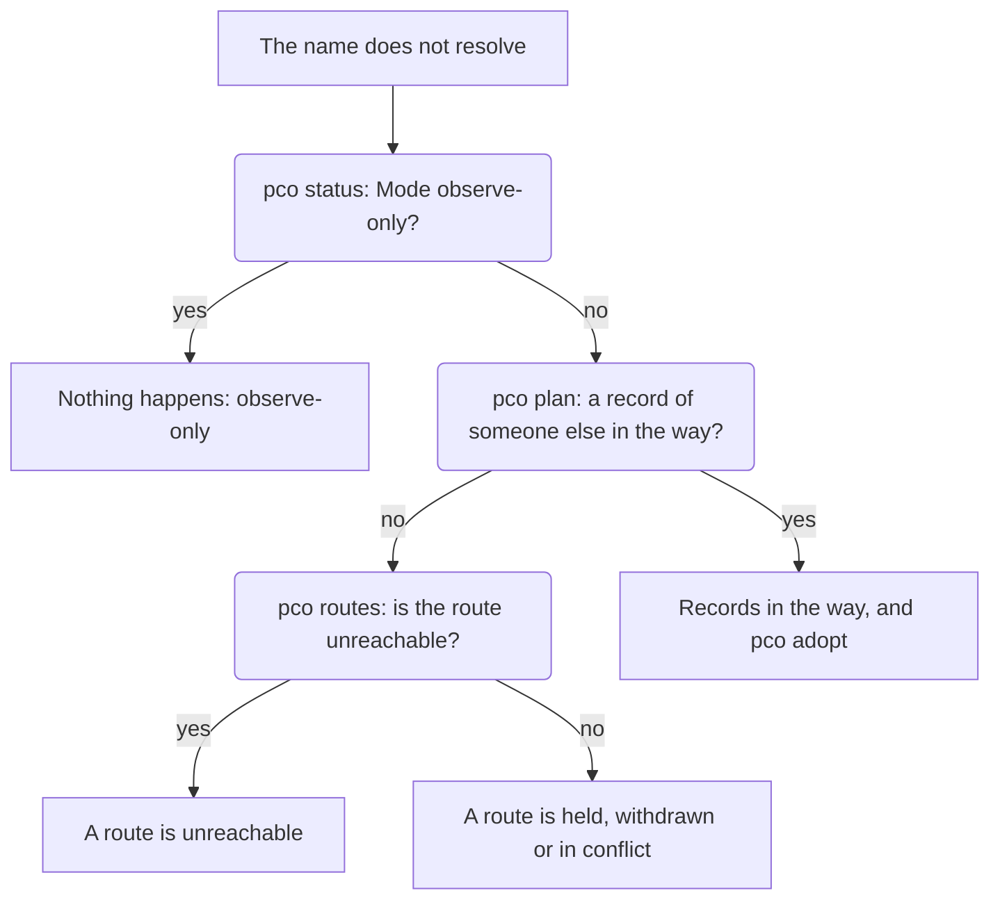
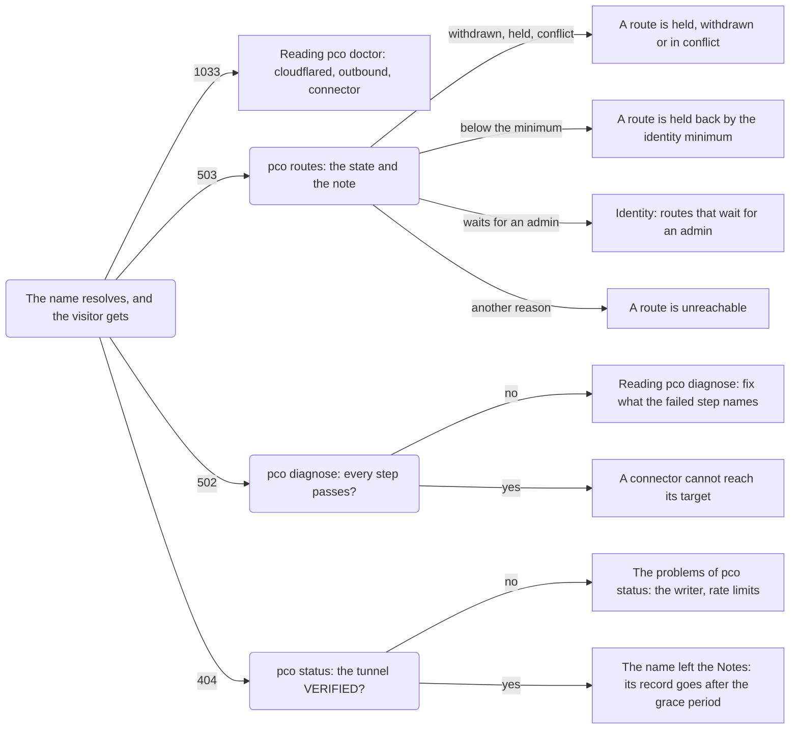

# Troubleshooting

Start with the three commands that say what pco thinks: `pco status`, `pco doctor` and
`pco diagnose <hostname>`. This page says how to read them, and then goes through the
problems that come up, from what a visitor sees to what the daemon reports. [Problems](problems.md)
lists every problem line, event kind and doctor check, with its cause and what to do.

Commands run as root on the node. `pco` exits with 2 when it cannot ask the daemon:

    pco: cannot reach the pco daemon at /run/pco/pco.sock: is it running?

Start with `systemctl status pco` and `journalctl -u pco`. A refusal that says
`permission denied on /run/pco/pco.sock: run as root` is the socket telling you who may
use it.

`pco doctor` is the one command that still has something to say when the daemon is not
running, if you run it as root. It makes the checks that need no daemon, on the node itself:
whether `pco.service` and `pco-egress.service` run and start at boot, the store, `cloudflared`
and the egress table. A `daemon` line says that the rest was not made, and the exit status is
by what it found: 1 when `pco.service` does not run or another of these checks fails, 0 when
there are warnings only, as for a daemon that is still starting. Run it again once the
daemon answers.

## A hostname does not answer

Where to look when a published hostname does not answer, from what the visitor gets to the
section of this page that deals with it. When the name does not resolve:

When it resolves, by what the visitor gets, an empty 503 or 404 being the tunnel's own answer:

The sections the two point at:

- [Nothing happens: observe-only](#nothing-happens-observe-only)
- [Records in the way, and `pco adopt`](#records-in-the-way-and-pco-adopt)
- [A route is `unreachable`](#a-route-is-unreachable)
- [A route is held, withdrawn or in conflict](#a-route-is-held-withdrawn-or-in-conflict)
- [Reading `pco doctor`](#reading-pco-doctor)
- [A route is held back by the identity minimum](#a-route-is-held-back-by-the-identity-minimum)
- [Routes that wait for an admin](identity.md#routes-that-wait-for-an-admin), in Identity
- [Reading `pco diagnose`](#reading-pco-diagnose)
- [A connector cannot reach its target](#a-connector-cannot-reach-its-target)
- [The writer is stale, foreign or unknown](#the-writer-is-stale-foreign-or-unknown) and
  [Rate limits](#rate-limits)
- [What a visitor sees](#what-a-visitor-sees), the same in a table

## Reading `pco status`

    Mode:        enforce
    Profile:     host
    Inventory:   complete
    Writer:      ok
    Egress:      on
    Routes:      active 3, unreachable 1
    Last cycle:  2026-10-01T14:00:00+02:00
    Tunnels:
      NAME        ID        VERIFIED  CONNECTOR
      pco-abc123  0a1b2c3d  yes       active, ready, 4 connections
    Credentials:
      LABEL  STATE   NOTE
      main   usable  token expires 2026-10-13T14:00:00+02:00 (in 12 days)
    Issues:      none
    Problems:    none

- **Mode** is `observe-only` until `pco apply`, then `enforce`. `unknown` means no cycle has
  run yet.
- **Profile** is `host` or `appliance`.
- **Identity**, in the appliance only, is what the last self-identification found:
  `ok (lxc/120 on node1)`, or why not; see [the appliance](#the-appliance).
- **Inventory** is `incomplete` when Proxmox could not be read in full. The cycle holds, and
  the problems say what was not readable.
- **Writer** is `ok`, or `stale`, `foreign` or `unknown`, and in the appliance `behind`; see
  [the writer](#the-writer-is-stale-foreign-or-unknown).
- **Egress** is the filter that confines the connectors, as the daemon last found it:
  - `on` is as it should be.
  - `off: the connectors are not confined` means an admin switched it off with
    `pco egress off`. The output then starts with a warning that says since when.
  - `not loaded: the connectors are not confined` and
    `not the one pco loads: the connectors may not be confined` mean the table is gone or
    changed. The daemon loads it again by itself, so a state that stays means it could not;
    see [the filter](#a-connector-cannot-reach-its-target).
  - `not checked yet` is what it says in the first seconds after the daemon started, half a
    minute at most.
- **Routes** counts the routes by state: `active`, `unreachable`, `withdrawn`, `conflict`,
  `no-zone`, `held`, `rejected`, `frozen`. It says `none` when there are no routes.
- **Managed** appears only while the managed network is enabled: the consent mode and the
  counts, as `per-guest, 1 attached`, `auto, 5 attached, 2 waiting, 1 foreign card`; `auto
  (stopped: ...)` while automatic attaches are stopped, and `refused: ...` or `vnet changed:
  ...` while no card can be added. `pco managed status` has the detail; see
  [below](#networks-behind-a-leg-and-the-managed-network).
- **Segments** appears only when routes at `observed` wait for a segment to be acknowledged,
  as `1 not acknowledged (pco segment list)`.
- **Approval** appears only when guests wait for an approval, in approve mode or for a route
  at `observed`, as `2 guests wait (pco guest list)`.
- **Tunnels** lists the tunnels of the install, with the first eight characters of the id.
  `VERIFIED` is `yes` when the configuration at Cloudflare was read back and equals the plan,
  `no` when a write was held or failed, `held` when the tunnel is left as it is on purpose
  (the account is frozen, no credential sees it), `unknown`, or `unchecked` when the last
  cycle held and did not look at Cloudflare at all: the line is then what an earlier cycle
  found. `CONNECTOR` is `inactive`, `active, not ready`, `active, ready, N connections`, or
  `none` when the state has no connector for the tunnel: it has no id yet, or none was found.
- **Credentials** shows `usable`, `problem` or `unknown` for each, with the first failed
  check or the expiry in the note.
- **Issues** are the mistakes in the Notes and the settings, with a position (see
  [Annotations](annotations.md)); the first ten are listed.
- **Problems** are what the daemon found wrong in the last cycle. Most of them say what to do.

The exit status is 1 when there are problems, or the inventory is incomplete, or the writer is
not in order, or the egress filter does not confine the connectors, and 0 otherwise.

## Reading `pco doctor`

`pco doctor` checks the installation as a whole and prints a line for each check, with what to
do about it when it is not fine:

    ✗ cloudflared       cloudflared does not run: exec: no such file
                        fix: install cloudflared from the package repository of Cloudflare
    ! credential cred1  not checked yet
                        fix: pco credential check cred1
    ✓ mode              enforce: changes are applied
    ✓ store             the store is mounted and set up

    1 failure, 1 warning.

`✓` is fine, `!` is a warning and `✗` a failure. Only a failure makes the exit status 1. The
checks are:

| Check | Fails or warns when |
|---|---|
| `cycle` | The last cycle is more than three poll intervals old (warning) or six (failure): the daemon is stuck. `journalctl -u pco` says why. |
| `cloudflared` | It does not run, did not answer in time, or is more than ten months old; the age counts from the first day of the month in its version number. |
| `outbound` | TCP to `region1.v2.argotunnel.com:7844` cannot be made. A warning when every connector is connected anyway, because they may be on UDP. Allow outbound TCP and UDP to port 7844. |
| `proxmox` | The Proxmox API does not answer with the token of pco, or the version is older than 8.4. |
| `egress` | The egress filter is switched off, or its table is not loaded or not the one pco loads: a failure, because the connectors are then not confined. A warning while the daemon has not checked it yet. |
| `nftables` | `nftables.service` is enabled. When it starts or restarts, the rules it loads flush the egress table with the rest, and the connectors are not confined until the daemon loads it again, within 30 seconds. `systemctl disable nftables.service`, or keep its rules from flushing the whole ruleset. |
| `store`, `node lock` | The cluster filesystem is not mounted or pco is not set up; this daemon does not hold the lock of the node. |
| `unit pco.service`, `unit pco-egress.service`, `daemon` | Only while the daemon is not running, as root. The unit does not run (failure), or runs and does not start at boot (warning); `daemon` is a warning that says the checks that need the daemon were not made. |
| `mode` | A warning in observe-only mode. |
| `inventory`, `writer`, `problems` | The inventory is incomplete, the writer is not in order, or the last cycle reported problems. |
| `conflicts`, `lost markers` | Records of someone else stand in the way, or records of this install lost their marker; `pco adopt <name>`. |
| `waiting` | Something waits for `pco apply --confirm-deletes`. |
| `credential <id>` | A token is not checked, unusable, expired, or expires in less than 30 days. A warning, `the token could not be checked`, when Cloudflare did not answer the check; it says nothing about the token. |
| `approval <owner>` | A guest waits for approval. |
| `tunnel <name>`, `connector <name>` | A tunnel is not verified or does not exist yet; a connector is not running, not connected, or was not found. |
| `netns`, `leg <id>`, `networks`, `service pool` | Only with a network behind a leg. The namespace `pco` is gone or not as pco left it, or `pco-netns.service` would tear it down on a restart, is not enabled, or starts after `pco.service` (`systemctl restart pco-netns`; reinstall the package for old unit files); a leg is not up; the networks near the 15 a cluster holds; the service addresses near the end of their pool. [Networks behind a leg](#networks-behind-a-leg-and-the-managed-network) goes through them. |
| `managed`, `vnet`, `pconet`, `dhcp` | Only with the managed network. It cannot run on the node, its leg is down, automatic attaches stopped, its consent tag is not registered, few addresses are free; the vnet was changed, or others' SDN changes wait to be applied; IPv6 is on on `pconet`; the DHCP server is not bound. |
| `managed guest <owner>`, `foreign card <owner>` | A guest's card waits for a restart, DHCP, a grant or a confirmation, goes after its grace, or the guest moved to another node; a card on `pconet` that no attachment explains is still there. |
| `filtered pconet`, `managed firewall`, `pool grant <owner>` | In the appliance: the guests on `pconet` are not proven isolated; the node's firewall cannot isolate them; a note, not a warning, for a guest of the granted pool without consent. |

## Reading `pco diagnose`

    pco diagnose app.example.com

walks the chain from the route to the origin and stops at the first step that fails; the steps
after it say `skipped`. A connector that fails stops nothing: the daemon asks the target from
the node without one, so the steps after it still say whether the path and the origin work.

| Step | What it asks |
|---|---|
| `route` | Which guest holds the hostname and in what state. A conflict or a held name fails here. |
| `zone` | Whether a zone of a credential serves the hostname. |
| `dns` | Whether a record at the hostname points at the tunnel, and whether one is waiting to be made. A record of someone else, or one that lost its marker, fails here and names `pco adopt`. |
| `ingress` | Whether the tunnel's configuration has a rule for it and was verified. A rule that answers 503 fails here unless the target is the cause, in which case the next steps say more. |
| `connector` | Whether a connector runs for the tunnel and is connected to Cloudflare. |
| `identity` | Which address was verified for the route, at which level, and from which source. When there is none, every candidate that was tried and why it failed. |
| `path` | How the node reaches the address: `direct`, or through the leg of a network, as `attach vmbr1: leg up, service 198.18.1.5 -> 10.50.0.10 programmed, 10.50.0.10 pinned to bc:24:11:00:00:01`, where the connector dials the service address and the gateway forwards it to the guest, whose address it holds to the MAC the proof found. A leg that is not up, a gateway that could not be programmed, or a pin to another MAC fails here; a missing pin warns, as another guest that answers for the address could then take its requests, and the next cycle pins it. Pins last verified longer ago than pins stand, five minutes, say only what held then: the step warns and names that time instead of passing or failing. |
| `tcp` | Whether the port answers. |
| `http` | The answer of a request that the daemon makes to the origin with the Host header and TLS settings of the route; for a guest behind a leg, to its service address, as the connector asks it. |

The `http` step comes from the daemon, as root, and not from the connector. It tells you what the
origin answers, and does not tell you what the connector can reach. That is the difference
the egress filter can make (see [the filter](#a-connector-cannot-reach-its-target)).

If the last cycle held and did not look at Cloudflare, the `dns`, `ingress`, `connector`,
`tcp` and `http` steps say so and show a warning instead of an answer.

## What a visitor sees

| Visitor sees | Meaning | Look at |
|---|---|---|
| Cloudflare error 1033 | The tunnel has no connected connector. | `pco status` connector column, `systemctl status pco-cloudflared@<tunnel id>`, `journalctl -u pco-cloudflared@<tunnel id>`, `pco doctor` for `cloudflared` and `outbound`. |
| 502 Bad Gateway | The tunnel is connected, and the connector could not get an answer from the origin. | `pco diagnose` for `tcp` and `http`. The service is down, listens on 127.0.0.1 only, speaks TLS where the route says `http`, has a certificate that does not verify (`sni=` or `no-tls-verify`), or the egress filter refuses the target: for every target after a reboot, until the daemon's first cycle has loaded them, and for a target whose MAC just moved. |
| An empty 503 | The tunnel's own block rule: pco withdrew the route, or holds the hostname, or the guest waits for approval, or its identity is below `identityMinimum`. | `pco routes`: the state and the note. |
| An empty 404 | The name resolves to the tunnel, and the tunnel has no rule for it. | The tunnel's configuration is not verified (`pco status`), or the hostname is no longer in the Notes of a tagged guest and its record waits out the grace period. |
| The hostname does not resolve | There is no record for it. | In observe-only mode pco makes no record and no rule, so the name does not resolve at all and there is no 404: `pco plan` shows what `pco apply` would create. A record of someone else may be in the way. |

For a 502, `pco diagnose` can say what to change in the route. When the origin speaks TLS and the
route says `http`, the `http` step says `origin speaks TLS: use https:// in the route`. When the
certificate does not verify it says
`TLS verification failed (name mismatch): set sni=<name> in the route when the certificate is of
another name, or no-tls-verify`.

## A route is `unreachable`

`pco routes` shows the reason in the note. For a route that has never been served, the tunnel gets
a 503 rule for the hostname and no DNS record is made. For a route that was served and whose port
stops answering, the rule and the record stay, and visitors get a 502.

The reasons come from the checks in [Identity](identity.md). `pco diagnose` lists them for each
candidate.

| Reason | What it means and what to do |
|---|---|
| `no candidate address` | pco found no IPv4 address for the guest. For a virtual machine, enable the guest agent in its options and run it in the guest, or give the address in the route, or set it in the cloud-init `ipconfig`. For a container, start it. |
| `guest is not running`, `guest not found in inventory`, `guest state unknown` | The guest is stopped, is gone, or Proxmox has not said. The route is withdrawn. |
| `node has no address on vmbr0 in the guest's network` | The node has no address of its own in the guest's network, on that bridge or VLAN interface (`vmbr0.20` for a tagged card). Give the bridge an address in that network, or for a network behind a router see `trustStatic`. Read the warning below before you give the node an address. |
| `route to <address> leaves through <interface>, not <interface>`, `... leaves through a gateway`, `node has no route to <address>`, `route to <address> changes with the source address` | The kernel does not reach the address directly through the guest's bridge. A more specific route on another bridge, a gateway, or a policy rule on the source address does it. Fix the routes of the node. |
| `no ARP answer on vmbr0` | Nothing answered ARP for the address within the window. The address is not configured in the guest, is on another VLAN, or the guest is quiet or not up yet. |
| `<address> answered by <MAC>, which is not this guest` | Another machine claims the address: a duplicate address, or a device on the network. Find it and fix the address. |
| `too many stations claim <address> on vmbr0` | 64 or more MACs claim it. Something is flooding the network. |
| `MAC <MAC> not seen on bridge vmbr0` | The bridge has not learned the guest's MAC. The guest has not sent anything yet. `bridge fdb show br vmbr0 \| grep <MAC>` shows the table. |
| `MAC <MAC> is on several ports: ...`, `MAC <MAC> is on port <port>, not on the guest's own port` | The bridge puts the MAC somewhere else, or in two places: a copy of the MAC, a guest that was moved, or a device that forges frames. For a route that was being served, the daemon sees the move as it happens and takes the address out of the egress filter at once; `pco events` says so. |
| `MAC <MAC> is on local port <port> but the guest runs on <node>` | A guest of this node sends frames with the MAC of a guest of another node. |
| `MAC <MAC> is also configured on qemu/<id>` | Two running guests have one MAC, as after a clone or a restore. Change the MAC of one of them in its network device. |
| `port 3000: ...` | Identity holds but the connection failed: `connection refused` when nothing listens on that address and port, a timeout when a firewall drops it. |
| `identity not confirmed for 5m0s`, `identity proof is dated in the future` | The proof of a bound address is too old and could not be renewed. The route is withdrawn. |
| `ARP on vmbr0: ...`, `forwarding table of vmbr0: ...`, `route to <address>: ...`, `listing host interfaces: ...` | The host could not be asked, which proves nothing either way. The error that follows says why; the daemon needs to run as root. |
| `address of this node`, `address of a cluster node`, `loopback address`, `link-local address`, ... | The address is never published. The target is the node, or something that cannot be a guest. |
| `identity level observed is below the required port` | The route is held back by `identityMinimum`; see [Identity](identity.md). |
| `guest has no net1`, `guest has no network card on pconet`, `address <address> is not a usable IPv4 address`, `guest has no network interface` | The route's `via=` or address names something the guest does not have. For `via=managed`, the guest has no card on the managed network yet: `pco managed status` says whether it waits and why. |
| `service address not allocated: <reason>`, `service address not moved: <reason>; the rule is kept and reaches nothing until it is` | The guest is proven through a leg and has no service address yet, or its service address cannot follow it to a new address; a new one is made only in a cycle in which the daemon knows it is the writer. Usually one cycle after a start. [Problems](problems.md#the-gateway-and-service-addresses) has every reason. |
| `node has no address on vmbr1 in the guest's network`, with `pco network list` showing `vmbr1` | The network is attached but its leg is not up, so the guest is reached neither directly nor through the leg; see [below](#networks-behind-a-leg-and-the-managed-network). |

Before you give the node an address in a guest's network, think about who is in it. The
web interface and API of the node (`pveproxy`, port 8006), `spiceproxy` and `sshd` listen on
every address of the node by default, so an address on a bridge or VLAN puts the node's
management in reach of every guest there. Restrict that first: with the Proxmox firewall
(datacenter or node rules that allow ports 8006 and 22 only from your management network),
or with `LISTEN_IP` and `ALLOW_FROM` in `/etc/default/pveproxy`. The egress filter does not
help here: it confines the connectors, and these are the guests.

## A route is held back by the identity minimum

A route whose note says `identity level observed is below the required port` has passed its
identity check, and the check proves less than the settings ask for. The hostname answers 503 and
has no DNS record, and `pco status` carries a problem line that names how many routes this is. It
happens for guests on other nodes of the cluster and for trusted static addresses, which can only
reach `observed`.

There are three ways out:

1. Move the guest to the node that runs pco, where it can reach `port`.
2. Lower `identityMinimum` to `observed` in the settings, knowing what that gives up for every
   guest of the install: [Identity](identity.md) says what it is, and the table in
   [Security](security.md) what it no longer stops.
3. Leave the route held back, if you did not mean to publish it.

In the appliance with `identityMinimum: filtered`, every route off the managed network is held
back with `identity level observed is below the required filtered`, and one on the managed
network while its isolation is not proven: the problem line then ends with why, as `filtered
lost: <why>`, which [the managed network](problems.md#the-managed-network) lists. `pco managed
status` shows the isolation under `Filtered` with every reason.

## Networks behind a leg and the managed network

[Networking](networking.md) says how a leg and the managed network work; this is what goes
wrong, with where it shows and what to do. `pco network list`, `pco network show <id>` and
`pco managed status` are the three commands to start with, and `pco doctor` has a check for
each part ([Problems](problems.md#checks-of-the-networks)).

### The leg is not up

`pco network list` shows the leg's state, and a leg that is not up is a problem line,
`network <network>: the leg is not up: <why>`, and a failed `leg <id>` check:

- **`address in use by <mac>`**: another station holds the leg's address; the leg is raised
  only once nobody answers for it. A DHCP server of that network gave the address out, or a
  machine was given it by hand. Find the station by the MAC, free the address, or detach the
  network and attach it with another address.
- **The bridge is absent**: `vmbr2v20`, the bridge Proxmox makes for VLAN 20 of a bridge that
  is not VLAN-aware, exists only while a guest with that tag runs; the leg waits and is
  attached when the bridge appears. A bridge removed from `/etc/network/interfaces` leaves the
  leg with its elements, and the network is one to detach.
- **`no carrier, DAD not run`**: a warning on a bridge whose physical uplink has no carrier;
  the leg is up and its address could not be checked against the LAN.
- **In the appliance, the card could not be added**: every slot `net1` to `net9` is taken, the
  token lacks the grant of the bridge (`pco appliance network allow`), or the bridge is not
  VLAN-aware for a tagged attach.

### The gateway could not be programmed, or the namespace is gone

`programming the gateway: <error>; no tunnel configuration is written until it is programmed`
holds every tunnel run, since a rule must not name a service address the gateway does not
forward. On a host the usual cause is a namespace that is gone, `the gateway namespace is not
pinned`, after `ip netns del pco` or an unmount of `/run/netns/pco`: `systemctl restart
pco-netns` brings it back, with the legs and the service addresses, and stops nothing. `pco
netns status` says what differs, and `pco doctor` fails `netns`. A `pco-netns.service` whose
loaded unit file has an `ExecStop` line, from before an upgrade, tears the namespace down on a
restart: reinstall the package and `systemctl daemon-reload` first, as the check says. Changes
made by hand in the namespace are put back within 30 seconds, with the event `the gateway
namespace was changed outside pco and was brought back`.

### A route through a leg answers 503 after a start

`service address not allocated: no cycle has run since the start` is one cycle long: a new
service address is made only once the daemon knows it is the writer, and the routes whose
service address exists are served at once. A reason that stays names what to fix;
[Problems](problems.md#the-gateway-and-service-addresses) has them all. A route that moved
to another address while no service address could be made keeps its rule and reaches nothing
until the next cycle lets the service address follow.

### A card waits for a restart

`pending-reboot`: a virtual machine without network hotplug (`qm config <vmid>` shows no
`network` in its `hotplug`) takes its card at its next restart, and `qm pending <vmid>` lists
it. Restart the guest, or give it `qm set <vmid> --hotplug network,disk,usb` first for the
next one. The same holds for a card that goes: `detach-pending` until the restart, and
`link_down` on a foreign card.

### No DHCP seen

`awaiting-dhcp`: a running virtual machine has had its card for a minute and asked for
nothing. The card is there, as one more interface, and the guest has to ask: add the
interface to its network configuration and bring it up;
[Networking](networking.md#dhcp-for-virtual-machines) has the lines for `ifupdown`,
`systemd-networkd`, netplan, NetworkManager and cloud-init. Inside the guest, `ip link` shows
the card by its MAC, `06:50:43:4f:...`; a card whose link is down in the appliance (`link_down=1`
in its configuration) comes up by itself once its firewall has been in force for 15 seconds.
On the node, `ip netns exec pco tcpdump -ni leg<N> -e udp port 67` shows the requests and the
answers; a guest that asks and gets nothing has a MAC other than the lease's, as after a MAC
changed by hand, and the check `dhcp` counts such requests. `the DHCP server is not listening
on the managed leg: <error>` means the leg is gone or down: `pco netns status`, and
`systemctl restart pco-netns` brings the leg back, after which the server binds again by
itself. Containers do not use DHCP: their address is in their configuration.

### The guest waits for a grant

`needs-grant`, in the appliance: the token may not change the guest. `pco managed status`
prints the line to run on the node, `pveum acl modify /vms/<vmid> --users pco@pve --tokens
'pco@pve!vm<app>' --roles PCOManaged`, and the card follows at the next read of the access
control, within a minute. A pool grant covers every guest of the pool;
[Networking](networking.md#setting-it-up) says what it hands over.

### The guest waits for the firewall confirmation

`needs-firewall-confirmation`, in the appliance: turning the guest's firewall on for the card
would filter its other card with `firewall=1` as well. `pco managed approve <owner>
--accept-firewall-impact` confirms it for that guest, `managed.acceptFirewallImpact: true` for
every guest attached by the tag or by `auto`; or set `firewall=0` on the other card if it was
never meant to be filtered.

### `filtered` is lost

In the appliance, `filtered lost: <why>; the routes on pconet are served at observed` says
what the proof of the isolation lacks, for the whole vnet; the routes on `pconet` are served
at `observed` meanwhile, and held back with `identityMinimum: filtered`. The reasons, and what
each means:

- **`not yet enforced: pco wrote its firewall <time> ago`**: a new card, or one whose
  firewall pco just put right, counts only 15 seconds after the write; it passes by itself.
- **The guest firewall is off, `macfilter` is off, the ipset is missing or wider than the
  lease, pco's rules are changed, missing or below another rule**: someone changed the guest's
  firewall. pco puts its own ipset and rules right in the next cycle, and pushes its block on
  top of a rule put above it; a firewall an admin turned off is not turned back on. Look at
  `/etc/pve/firewall/<vmid>.fw` on the node.
- **`the firewall is not enforcing on net<N>`**: the canary from the leg, a SYN to a port no
  route publishes, was answered. The rules are configured but not in force on the node:
  `pve-firewall` restarted and has not compiled them, or the backend is not the iptables one.
  `iptables-save -t filter | grep tap<vmid>i<n>-IN` on the node shows what is loaded.
- **The backend, the datacenter firewall or `pve-firewall`**: `the managed network cannot run
  on this node: <why>`, with the fix in the line, on the node. No card is added while it
  lasts, and the cards that exist stay.
- **A foreign card, a changed vnet, or a frame from a MAC no lease knows**: the sections
  below.

### Automatic attaches are stopped

`managed.consent is auto but the gate tag <tag> is not registered as admin-only; automatic
attaches are stopped; attached guests stay attached`: the gate tag left the registered tags
of the datacenter, or they could not be read. Nothing is detached, and nothing new is
attached until `pco setup --repair` registers the tag again or the read works. `pco status`
shows `Managed: auto (stopped: ...)` meanwhile.

### A foreign card

`foreign card net<n> (<mac>) of <guest>: <why>`: a card on `pconet` that no attachment
explains, as a clone or a restore copies one, or a card put on `pconet` by hand. What pco did
is in the line: a consenting guest got a card of its own in its place; a guest pco may write
had its link set down (a container that refuses `link_down` lost the card); a guest pco may
not write was only reported, and the card is yours to remove: `qm set <vmid> --delete net<n>`.
In the appliance a foreign card drops `filtered` until it is dealt with. A card that is set
down on a virtual machine without network hotplug stays up until its restart.

### The vnet was changed

`the vnet pconet was changed outside pco: <why>`: a subnet was added to it, `isolate-ports`
was flipped, its zone is not of type `simple`, or it is gone. No card is added while this
stands, and the cards that exist stay. Put it back as `pco network managed enable` makes it,
zone `pco` of type `simple`, `isolate-ports` on on a host and off in the appliance, no
subnet, and apply; `pco doctor` fails `vnet` with what differs, and warns about the SDN
changes of others that wait to be applied, which the next apply by anyone applies along.

### The attach is refused for an overlapping route

`192.168.4.0/24 overlaps the node's route on vmbr0; pass --overlap-ok if the guests there are
meant to be reached through the leg`: the prefix of the network is one the node routes on
another interface, and a leg there would be the second way to those addresses. Pass
`--overlap-ok` when the guests of that bridge are meant to be reached through the leg, as on
a bridge that carries a copy of the LAN's addresses; the node's own traffic stays on its
interface, since the leg's address has no prefix route and only the requests marked for the
leg are routed through it. A prefix that overlaps the service prefix `198.18.0.0/16` or
`managed.subnet` is refused always.

### A guest cannot reach another through the managed network

That is what the network is for. On a host the ports of `pconet` are isolated, the guard
admits from each port only the MAC and address pco leased to that guest, and the node drops
what `pconet` sends it; in the appliance the guest firewall lets a card send to pco's leg and
to DHCP only. A guest that changed its address by hand loses even the leg, since the guard
and the ipset admit the lease alone: `nft list counter bridge pco_guard dropped_spoofed` on a
host counts what it dropped. A managed guest that should reach something else needs a card
of its own on that network.

### A guest migrated with its card

`migrated`: the guest took its card and its address to another node, where the managed
network does not reach it; its routes through it are not served from there. Move it back, or
publish it another way. A consenting guest on another node waits with `guest is on node
<node>, not <this node>`.

## A route is held, withdrawn or in conflict

- **`held`**: the hostname is claimed and nobody serves it. The note says why: the holder still
  names it in its Notes without a route (a broken entry, or the hostname left in a comment), or
  no longer asks for it and the grace period is running. It answers 503 meanwhile.
- **`withdrawn`**: the route was served and lost its identity, or the guest stopped. It answers
  503 and its DNS record stays, and it is served again when the check passes.
- **`conflict`**: another guest holds the hostname. `pco claims list` shows the holder and who
  waits. To hand the hostname over on purpose, `pco claims resolve <hostname> <owner>`; the
  owner is a guest, as `qemu/102`, and has to claim the hostname itself. The holder then waits for
  it, in the place its claim gives it in the line.
- **`rejected`**: the hostname is the apex of a zone or a wildcard, which a guest publishes only
  when an `allowHosts` pattern names it. The note names the pattern to add, as
  `add "*.example.com" to allowHosts`. Add it to the settings if the name is meant to be
  published, or take the name out of the Notes. A rejected route holds no claim, a claim its
  guest had goes at once, and a record pco made for it is left alone. A guest whose Notes
  name more than `maxHostnamesPerGuest` hostnames has no route at all, and an issue says so.
- **`no-zone`**: no credential serves the zone of the hostname (`no Cloudflare zone for this
  hostname in any credential`: the token does not see it, or the zone is not active), or two
  credentials see it (`pin it to one`, see [Cloudflare token](cloudflare-token.md)), or the
  hostname is reserved. In a zone this install never served, the route takes no claim: when
  the zone is served, the guests that name the hostname then get it as any free one.
- **`frozen`**: the account of the zone is left as it is, because a zone is in doubt. The note
  says which; for a zone whose DNS its token cannot read, see
  [the next section](#a-served-zone-whose-dns-is-refused).

## A served zone whose DNS is refused

The check of a token reads the DNS of every active zone. When a zone pco serves is refused,
its account is frozen: its routes have the state `frozen`, nothing is changed at Cloudflare
for it, and what was published keeps serving. `pco status` has the problem line, and the note
of each route in the account gives its reason. The line says which of two steps this is.

**The first refusal**, which can be Cloudflare's own mistake:

    the token of credential a1b2c3d4 could not read the DNS of zone example.org, which it
    serves; account acc1 is left as it is, checking again at 14:15

The time is the local time of the node, at most 15 minutes ahead, and `pco events` has a
warning for it. If the next check reads the DNS, the account is served again and nothing was
changed. `and the check waits for the store` stands in place of the time while the store
cannot be read or written, because no token is checked then: look for the problem that says
why the store is held, and at `pco doctor`.

**The second one in a row**, which is taken as a permission that is gone:

    credential a1b2c3d4 can no longer read the DNS of zone example.org, which it serves: grant
    it Zone > DNS > Edit there; account acc1 is left as it is until a check finds it readable
    again or pco apply --confirm-deletes lets the zone go

Three things end it:

- Grant Zone > DNS > Edit on the zone to the token, and `pco credential check <id>`. The
  account is served again in the next cycle.
- `pco apply --confirm-deletes` lets the zone go. `pco plan` lists it among what waits, with
  what the confirmation does: its hostnames are taken off the tunnel, and its records stay
  as they are, as pco cannot read them. Its routes then say `no-zone`.
- When another credential can read the zone, the line says `a pin gives the zone to credential
  <id>, which can read it`. Pin the zone to it in `zonePins` (see
  [Cloudflare token](cloudflare-token.md)). The zone, and its hostnames on the tunnel, then
  pass to that credential, as they do on a confirmation.

A zone that appears in a listing after the last check of its token has no verdict yet, and
the account is frozen for it in the same way until a check has looked at it:

    zone example.org is listed by credential a1b2c3d4, whose last check did not look at it;
    account acc1 is left as it is, checking again at 14:15

The check is made as soon as the cycle that listed the zone ends, and the next cycle serves the
zone or says why not. When Cloudflare does not answer that check, the line stays until the time
it names.

## Records in the way, and `pco adopt`

When a DNS record that pco did not make already holds the hostname, pco does not touch it. The
route waits, and `pco plan` lists the record:

    Records of someone else that stand in the way (pco adopt replaces one):
    NAME              ZONE         TYPE  CONTENT
    shop.example.com  example.com  A     192.0.2.10

To let pco take the name over:

    pco adopt shop.example.com

It shows the conflict first and asks. The replacement is made by the next run in which the
tunnel is verified and its connector is ready, and it first keeps a copy of the record it
replaces in `/etc/pve/pco/adopted.jsonl`. The request is dropped after five minutes if no run
could make it.

`pco adopt` takes back a record of this install that lost its marker as well. `pco plan` lists
those as `Names that point at the tunnel but lost the marker of this install`. A record that
has the marker and an unexpected type, or that is not a CNAME, is not replaced: it is reported as
a conflict.

## Nothing happens: observe-only

A new install does not change anything at Cloudflare. `pco status` says `Mode: observe-only` and
its last line says `Run pco apply to start publishing.` `pco plan` lists what the daemon would do,
each action held by `observe mode`. Run `pco apply` when it is what you expect.

## Rate limits

pco keeps to `cloudflareBudget` requests in 5 minutes for each credential, 1000 by default,
and to what Cloudflare says is left of the 1200 it allows a user. When that is spent, a cycle
stops writing, and `pco status` says what waits in one line: `11 changes wait for
Cloudflare's rate limit`, or, while not even a read is left, `the tunnel of account <id> and
the listing of zone <name> wait for Cloudflare's rate limit`. The cycles after Cloudflare
starts its count again go on. A first start of many routes does this once; see
[Operations](operations.md).

If Cloudflare answers 429 anyway, pco stops calling for as long as Cloudflare asked, and the
calls that fail say `not sent: holding back after an earlier 429`. Nothing is lost: the cycle
tries again. If it recurs, raise `pollInterval` in the settings, lower `cloudflareBudget`
when other tools use the same Cloudflare user, or check that no other program uses the same
token.

## A connector cannot reach its target

If `pco routes` shows a route `active` and `pco diagnose` passes every step, but visitors get a
502, the filter on the connector may be refusing its target, because `diagnose` asks from the
daemon and the filter confines the connector only. Start with `pco status`: its `Egress:` line
and its problems say what the daemon knows. Then, on the node:

    pco egress show

- **`its table is not loaded`**, or **`not as pco loads it`**: the connectors are not
  confined, or confined by something else. The daemon checks the table every 30 seconds and
  whenever nftables reports a change, and loads it again by itself; if `pco status` still
  says so, its problems and `journalctl -u pco` say why it could not. `pco egress load`
  loads the table by hand. Do not restart `pco-egress.service`: every connector restarts with
  it.
- The target is not under `Targets`. Then it is not in the table, and the counter
  `to anything else` rises when the connector tries it. The daemon puts a target in the table
  in the cycle that verifies its address, so look at why it is not: `pco routes` and the
  `identity` step of `pco diagnose`. Right after a reboot or a restart of the daemon, the
  targets come with its first cycle. A cycle that cannot give the filter its targets says
  `setting the egress filter: ...; no tunnel configuration is written until it is set` in the
  problems of `pco status`.
- The target was there and is gone: `pco events` has the kind `egress`. `the MAC of
  10.0.0.11 moved; the connectors do not reach it until it is verified again` is the daemon
  taking an address out at once because its MAC moved. If the verification that follows
  passes, the event `10.0.0.11 was verified again after its MAC moved; the connectors reach
  it again` follows. If it fails, the address stays out and its routes are withdrawn
  (`10.0.0.11 did not pass its verification after its MAC moved`, with the reason); the route
  shows that reason in `pco routes`. Look for a second guest or device with the same MAC, a
  card whose MAC was changed, or a guest that was migrated.
- The target address is under `Blocked on this node`: `pco egress unblock <address>`. The
  daemon puts it back at its next cycle, if it is still a verified target.
- The filter is `off`: switch it on with `pco egress on`. The daemon gives the targets back
  within a second or so, or at its next check.

To prove that the filter is the cause, switch it off, try again, and switch it on at once:

    pco egress off
    pco egress on

While it is off, the connectors are not confined. If the route works with the filter off and not
with it on, the filter is refusing something it should allow: keep the output of `pco egress
show` and the journal.

## A connector of another install

After a lost store, connectors from an earlier install can still run on the node. `pco status`
reports each one as a problem, and the daemon never stops or removes a connector that belongs
to another install, or that names none:

    connector for tunnel <tunnel id> belongs to install <old id>; pco setup --recover adopts
    that install, pco uninstall on this node removes it

A connector from before pco wrote the install into its env file gets this instead:

    connector for tunnel <tunnel id> names no install; pco setup --recover adopts the
    install it was made for, pco uninstall on this node removes it

`pco setup --recover` adopts the earlier install, and `pco uninstall` removes every connector
on the node; see [Uninstall](uninstall.md), which also says what a plain `pco setup` does
beside such connectors. It refuses, and tells you to use one of those two.

A unit that is loaded and has neither an env file nor a token file cannot serve anything, and
the daemon stops it and clears its failed state when it prunes connectors, which it does
outside observe-only mode; a connector that has either file is left alone.

## The writer is stale, foreign or unknown

The writer is the identity that is written into the configuration of every tunnel. A daemon
writes only while the configuration carries its own mark or an older one.

- **stale**: `a newer generation of this install writes the tunnel configuration`.
  `leader.json` names a newer writer than the one the cycle started as: it was written again
  while the cycle ran. The next cycle reads it again and writes as the writer it names; if the
  verdict stays, run `pco setup --recover` on the node that should write.
- **foreign**: `a writer of this install that leader.json does not know wrote the tunnel
  configuration`. The tunnel configuration carries a writer, a generation and a nonce, that this
  store's `leader.json` does not know. The usual cause is a copy of the store restored from
  before the last recovery: run `pco setup --recover` on this node, which takes a generation
  above the one in use, then `pco apply`. The others are another install that uses the same
  install id, and a sentinel of a newer generation written with a stolen Cloudflare token. If
  no other node runs pco with this install and the store was not restored, follow the order in
  [Security](security.md): replace the token, `pco tunnel rotate`, `pco setup --recover` on this
  node, then `pco apply`. Otherwise stop the other one.
- **unknown**: `leader.json could not be used`. The file is missing or invalid; `pco setup`
  writes one for a store that has none, and `pco setup --recover` takes a generation above the
  one in use. In the appliance, `pco status` lists the problem that says why: after a start of
  the container it is `leader.json belongs to an earlier start of this container`, for the one
  cycle that draws the new epoch, and nothing is to be done. Without a Cloudflare credential,
  `pco credential add` comes first, as `pco appliance recover` needs one.
- **behind**, in the appliance only: its state is older than its last write at Cloudflare, after
  a rollback or a restore. `pco appliance recover` in the appliance; see
  [the state is older than Cloudflare](#the-state-is-older-than-cloudflare). In the appliance
  the commands of `stale` and `foreign` are `pco appliance recover` too, where a host has
  `pco setup --recover`.

While the writer is not in order, the daemon changes nothing at Cloudflare.

## Cloudflare did not answer

A check of a token that gets no answer from Cloudflare, because of a network error, a server
error or a rate limit, is no verdict on the token. `pco credential check` marks such a line
with `?` and `Cloudflare did not answer`, and the result reads:

    Usable:    not known, Cloudflare did not answer

The daemon's own daily check keeps the report it had, adds a warning to the events, and checks
again after 15 minutes; `pco doctor` shows a warning for the credential and no failure. A
token that failed for another reason, `grant ...` for instance, is a failure as before.

## Credential expiry

`pco status` and `pco doctor` warn when a token expires in less than 30 days: `token expires
2026-10-13T14:00:00+02:00 (in 12 days)`. Rotate it before then, as
[Cloudflare token](cloudflare-token.md) describes. When it has expired, pco can change nothing at
Cloudflare through it, but the connectors keep serving what was published.

## The appliance

In the [appliance](appliance.md) the commands run inside the container; from the node, put
`pct exec <vmid> --` in front, as `pct exec 120 -- pco status`. Its `pco status` has an
`Identity:` line, and its `pco doctor` a set of checks of its own, which
[Problems](problems.md#checks-of-the-appliance) lists. A few of them, failing:

    ✗ access     alice@pve holds VM.Console, VM.PowerMgmt on the appliance lxc/120; alice@pve!shared holds VM.Console, VM.PowerMgmt on the appliance lxc/120; the connectors are stopped while a principal other than an admin can reach into it
                 fix: pveum acl modify /vms/120 --users alice@pve --roles NoAccess (alice@pve!shared is not privilege-separated: it holds the roles of alice@pve, so the command names the user)
    ✗ cmode      the console mode is tty now, but the pending configuration has shell: the next start of the container makes its console a root shell without a password, and any one VM.Config privilege sets it
                 fix: on the node: pct set 120 --revert cmode
    ! snapshots  1 snapshot of the container holds a copy of the volume of its state, with the Cloudflare credentials and the keys: before-test
                 fix: on the node: pct delsnapshot 120 before-test

    2 failures, 1 warning.

The cases that come up, from what the appliance says:

### It serves nothing: a principal can reach into it

    Identity:    serving nothing: ops@pve can reach into lxc/120 on node1

with the problem line

    ops@pve holds VM.Console, VM.PowerMgmt on the appliance lxc/120; pco serves nothing while it does: pveum acl modify /vms/120 --users ops@pve --roles NoAccess

A principal other than an admin holds a privilege with which it could read the appliance's
secrets, so the appliance stopped its connectors, emptied its egress filter and holds every
write. Run the command the line gives, on the node, or take back the grant that gives the
privilege; the connectors start again within a minute of the next read of the access control.
A narrower role on `/vms/120` does not take away what a grant on `/` gives through the pool of
the appliance; `NoAccess` does. For a token without privilege separation the line names its
user, as the token holds the user's roles. See
[who may reach the appliance](appliance.md#who-may-reach-the-appliance).

After a start, the connectors wait for the first read of the access control, with the line
`the access control of Proxmox has not been read since pco started; the connectors start once it shows that no principal can reach into the appliance`.
That passes by itself. When the access control cannot be read at all, `pco doctor` fails its
`access` check: the token lacks role `PCO` on `/`, which `pveum acl list` shows, and
`pco appliance repair` gives back.

### `pco status` cannot ask the daemon: the state volume

    pco: /var/lib/pco has no pco volume marker (restore, or a volume that is not pco's?): run pco appliance repair --vmid 120 on the node

or `/var/lib/pco is not a mount point of its own (a restore without the volume?)`. The daemon
found no state volume of pco and exited, and stays failed so as not to start again every 5
seconds; `systemctl status pco` shows status 78. A restore brings a new, empty volume, or none.
Run `pco appliance repair --vmid 120 --recover --cf-token-file <file>` on the node, as
[Restore and repair](appliance.md#restore-and-repair) says.

With the marker and no store on the volume, the daemon runs and writes nothing, and the problem
is `pco has no state on its volume (restore?): run pco appliance repair --vmid 120 on the node`:
a repair or an install that did not finish. The same repair finishes it.

### The state is older than Cloudflare

    the state of this appliance is older than its last write at Cloudflare (rollback or restore); run pco appliance recover

with `Writer: behind`. The volume was rolled back to a snapshot, or restored with its state, and
the container started at least once since then: the writer generation at Cloudflare is newer
than the one on the volume. Nothing is written until `pct exec 120 -- pco appliance recover`
draws a newer one; then `pco plan` and `pco apply`. It needs a stored credential that sees the
tunnels (`pco credential add` first, when the one you had is gone with the rollback).
Approvals, acknowledged segments and credentials made after the snapshot are gone; see
[Appliance](appliance.md#snapshots-backups-and-their-limits).

`leader.json belongs to an earlier start of this container; a new epoch is drawn once self-identification passes`
is the line of every start, until the container has proven itself. When it stays, the
identity does not pass: see the next section.

### The identity is not proven

The appliance holds its writes, and starts no connector after a start, until it proves that it
is the container it was installed as. `Identity:` then says `not proven` with the reason:

- `the links of this container carry <MACs>, but lxc/120 in Proxmox has <MACs> for more than 60 s; writes are held until they match`:
  a card was added or removed in Proxmox, or its MAC changed, and the container does not show
  it. Put the configuration right, or restart the container; `pco appliance repair --vmid 120`
  records the MACs as they are now.
- `the certificate of <address> no longer verifies under <name> (the cluster CA or the pveproxy certificate changed?): run pco appliance repair --vmid <n> on the node`:
  see [the API and its certificate](appliance.md#the-api-endpoint-and-its-certificate).
- `the inventory is incomplete; self-identification waits for a complete one`,
  `the uptimes of the guests could not be read; self-identification waits for them`,
  `the facts of this container could not be read: <error>`: the check cannot be made yet. The
  uptimes come from `pvestatd` on the node, so a `pvestatd` that does not run keeps the
  appliance waiting where its volume does not prove it by itself.
- `lxc/125 in pool pco carries a MAC of lxc/120: a copy of the appliance runs; writes are held until it is gone`:
  see the next section.

### A copy of the appliance

On a clone, or a restore beside the original:

    Identity:    copy: connectors stopped (not lxc/120 on node1: the volume at /var/lib/pco is rpool/data/subvol-125-disk-1, a volume of VMID 125 and not of lxc/120: this container is a copy)

The copy serves nothing and writes nothing, as it should; `Proxmox lists no lxc/120: this container is not the one installed`
says the same when the appliance it was made from is gone from Proxmox altogether. Remove the
copy with `install.sh --appliance --uninstall --vmid 125 --keep-cloudflare` (see
[commands on the node](appliance.md#commands-on-the-node)). If it is meant to replace an
appliance that is gone from the cluster, `pco appliance repair --vmid 125` on the node makes it
that appliance, and `pco appliance recover` follows when it then says that its state is older
than its last write at Cloudflare; see [Copies](appliance.md#copies).

### A guest with the appliance's MAC

A guest outside the pool `pco` configured with a MAC of the appliance gets the issue
`configured with the MAC <mac> of the appliance lxc/120`, and its routes are rejected. The
appliance goes on writing, but on its segment that guest takes away the traffic sent to the
appliance: hostnames answer slowly or not at all. A problem line names every guest with a MAC
of the appliance, whether it runs or not, and `pco doctor` names them in its `shared mac` check.
A restore of the appliance to another VMID without `--unique` is one: it stops itself as a copy,
but not its card. Remove such a copy, or change the MAC of the guest, and keep `SDN.Use` on the
appliance's segment to the admins, which `pco doctor` checks in `segment access`.

### Routes held by the observed rules

    2 routes are held by the observed rules: segment not acknowledged 2; pco routes says why each is held

Every route of the appliance is at `observed`, and waits for an admin where
[Identity](identity.md#the-appliance-and-observed) says. `pco routes` gives the reason and what
to run:

| Cause in the line | Reason in `pco routes` | What to do |
|---|---|---|
| `segment not acknowledged` | `segment vmbr0 is not acknowledged; pco segment acknowledge vmbr0` | Acknowledge the segment, once you trust its devices. |
| `MAC changed` | `MAC changed from <old> to <new>; approve the guest to accept it` | Find out why the MAC changed; `pco guest approve <owner>` if it is the guest's own. |
| `delegated guest` | `delegated: <principals> holds VM.Config.Network; pco guest approve <owner>` | Approve the guest, after reading the MACs the approval records, or take the privilege away. |
| `access control unreadable` | `the access control could not be read` and the approval | Check that the token holds role `PCO` on `/`; it passes with the next read that works. |
| `soft-denied address` | `address <ip> is the <role>; pco guest approve <owner>` | If the guest is the gateway or resolver it seems to be: `pco guest approve <owner> --allow-address <ip>`. |

### The cluster is not quorate

    the cluster is not quorate; nothing is written

or `the quorum of the cluster could not be read (<error>); nothing is written`. The appliance
writes nothing while its cluster has no quorum, and serves what it served. Restore the quorum;
the next cycle goes on.

### An old list of cloudflared versions

`pco doctor` warns in `versions` that
`the list of vetted cloudflared versions is from <date>; a newer pco release ships a newer one`
when the list the appliance has is more than 90 days old, and fails when it denies the
installed `cloudflared`. `pco upgrade --check` says what a newer release offers, and
`pco upgrade` installs it; see [Appliance](appliance.md#upgrades).

### Snapshots in `pco doctor`

The `snapshots` check warns about every snapshot of the appliance but one named
`pco-pre-upgrade-<YYYYMMDD>` that is less than 7 days old, and about a replication job, as each
carries the secrets. While a backup runs in snapshot mode it also sees the temporary snapshot
`vzdump` makes. Delete what you no longer need with `pct delsnapshot` on the node.

## The web interface

`systemctl status pco-web` and `journalctl -u pco-web` come first: the journal has every refused
sign-in with its reason, the user and the client's address. [Web interface](web-ui.md) says how
it works, and [Operations](operations.md#the-web-interface) how it is set up.

### The page does not load

- **No answer at all**, or the connection times out: `systemctl status pco-web` says whether it
  runs, and `ss -ltnp | grep 8643` on which address. It listens where `PCO_WEB_LISTEN` in
  `/etc/default/pco-web` says, by default the node's address in the cluster status: a browser
  that reaches the node by another address finds nothing there. With the firewall of Proxmox VE
  on, add the rule for port 8643 that `pco setup` printed; see
  [Operations](operations.md#the-firewall).
- **The browser warns about the certificate**: it does not trust the cluster CA of Proxmox VE,
  which signs pco's certificate by default, as it signs that of port 8006. Import
  `/etc/pve/pve-root-ca.pem` into the browser, or compare the fingerprint the browser shows with
  the one `pco web cert` prints on the node. A certificate of your own that has expired, or that
  is not made for the name in the address bar, warns as well: `pco web cert` says until when and
  for which names. In the appliance the certificate is self-signed: compare its fingerprint.
- **`pco does not answer to the name in the address bar`**: pco answers to the short and the
  fully qualified name of the node, the address it listens on, and `PCO_WEB_HOSTS`. Open it under
  one of them, or add the name to `PCO_WEB_HOSTS` and `systemctl restart pco-web`.

### Cannot sign in

| The page says | Why, and what to do |
|---|---|
| `this browser has no Proxmox VE session for this name; sign in to Proxmox VE at the same address first` | The browser holds the ticket of Proxmox VE for the name you opened Proxmox VE under, and sends it to that name only. Open pco under the same name, `https://node1.example.com:8643/` beside `https://node1.example.com:8006/`, or an address beside an address, and sign in to Proxmox VE there first. Or sign in with an API token. |
| `Proxmox VE did not accept the session of this browser; sign in to Proxmox VE again` | The ticket expired: it lives two hours, and the Proxmox VE interface renews it only while it is open. Sign in to Proxmox VE again in the same browser, then to pco. |
| `This user has no Sys.Audit on /: pco cannot show it anything.` | The user, or the token, holds neither `Sys.Audit` nor `Sys.Modify` on `/`. Give it `PVEAuditor` or a role with both on `/`; the sign-in page has the `pveum` lines, and [Web interface](web-ui.md#who-may-do-what) too. A token with privilege separation needs the grant for itself. |
| `pco cannot record changes under this user name: ...` | The user name has a character pco cannot name as the author of a change. Sign in as another user, or with an API token. |
| `Proxmox VE on this node does not answer, or presents another certificate than the node's` | pveproxy is down (`systemctl status pveproxy`), or it serves another certificate than when `pco-web` started, as for up to a minute after its certificate was renewed: the daemon then points `pco-web` at the new one and restarts it. Try again after a minute. If it stays, `pco doctor` and `journalctl -u pco` say why. |
| `too many sign-ins from this address; try again in <n> s` | Ten sign-ins a minute from one address. Wait. |
| `Proxmox VE did not accept the token` | The token is wrong, expired or revoked, or of the form `user@realm!tokenid=secret` but not one Proxmox VE knows. |

In the appliance:

| The page says | Why, and what to do |
|---|---|
| `Proxmox VE did not accept the user and password` | A wrong user, realm or password. Proxmox VE answers it late, after about three seconds. |
| `too many failed sign-ins of this account; try again in <n> s, or sign in with an API token` | Five failures of this account locked it at pco, for one minute and up to 15. Anyone who tries the user name can cause it; the journal of `pco-web` names the account and the addresses. Sign in with an API token, or wait. A restart of `pco-web` forgets the lock. |
| `Sign in with a user that has Sys.Modify on /, or with an API token` | `root@pam` may not sign in with a password. Use an account of its own for pco, or a token; `PCO_WEB_ALLOW_ROOT=1` in `/etc/default/pco-web` of the appliance allows it. |
| `This account's second factor is a security key, which works only on Proxmox VE's own page. ...` | WebAuthn is bound to the address of Proxmox VE's own page. Use a TOTP or a recovery code, or an API token. |
| `Proxmox VE did not accept the code` | A wrong code; three end the step, and the password is asked again. Proxmox VE answers the same once it locked the user's second factor: on Proxmox VE 9.2 after eight wrong TOTP codes in a row, until a recovery code is used or root runs `pveum user tfa unlock <user>`, and after 100 failed attempts every factor for an hour. |
| `Start again with the password: the step of the second factor is over` | The step of the code lasts two minutes. |

### A browser that holds HSTS

With `PCO_WEB_HSTS=1` a browser that visited pco uses HTTPS for every port of the node's name for a
year: a service of the node on plain HTTP stops answering in it. Take `PCO_WEB_HSTS` out of
`/etc/default/pco-web` and `systemctl restart pco-web` first, or the next visit sets it again.
Then make the browser forget it: in Chrome `chrome://net-internals/#hsts`, and in Edge
`edge://net-internals/#hsts`, Delete domain security policies for the name; in Firefox, Forget
About This Site in the history; in Safari, remove the site's data under Settings, Privacy, Manage
Website Data.

### Stale, and the banners of the page

| The page says | Why, and what to do |
|---|---|
| Stale, `The data is from <time>, <age> ago: no cycle of the daemon has finished since.` | No cycle finished in three times the poll interval, or the last cycle's length when that is longer. `pco status` says when the last cycle ran and `journalctl -u pco` what it is doing; `pco doctor` warns in its `cycle` check at the same point. The figures stay at their last values until a cycle comes. |
| Stale, `... the stream of pco web is reconnecting.` | The page lost its stream for more than 15 seconds: `pco-web` restarted, or the network between the browser and the node is gone. It tries again by itself. |
| `The pco daemon does not answer (since <time>). Published routes keep working; nothing changes until it is back.` | pco web cannot reach the daemon on its socket. `systemctl status pco`; the connectors serve on without it. |
| `pco's web process may not use the daemon's socket; the troubleshooting guide says why.` | The daemon does not answer the user `pco-web`: it started before the package that brings `pco-web.service` was installed, or the unit file is not at `/usr/lib/systemd/system/pco-web.service`. `systemctl restart pco`. |
| `This page cannot reach pco's web process (since <time>). Check that pco-web.service runs on the node.` | The browser cannot reach `pco web`. `systemctl status pco-web`; it restarts by itself 2 seconds after it stops. |
| `Too many pco tabs are open in this browser session; this page tries again in <n> s.` | A session holds three streams at once. Close other tabs of pco, or wait: the page tries again. |
| `pco was updated; reload to use it.` | pco was upgraded since the page was loaded, and the page is of the version before. Reload. |

### The map shows no traffic

The trunk, the line between the edge and the connector, moves with the connector's own counters.
When it does not move, the connector passes no requests, or pco cannot read its counters: the
connector does not run or is not ready (`pco status`, `CONNECTOR`), another process holds its
metrics port (`metrics port <port> is held by another process` in the problems), or three reads in
a row failed and the figures are stale, greyed with `no data since <time>`. A whole map that is
greyed and still is a stale page: see above.

The port lines, from the connector to a guest, move with the counters of the egress filter. When
none moves and the legend says `Port lines show state only:` with a reason, the filter has no
counters to give: `the egress filter is off: pco has no per-guest counters` (`pco egress on`),
`the egress filter is not loaded` or `the egress filter is not the one pco loads` (`pco egress
show`; see [the filter](#a-connector-cannot-reach-its-target)), or `the counters could not be
read`, with what went wrong in its tooltip. A port line that barely moves while the trunk is busy is
no fault: it counts the connections the connector opens, and cloudflared keeps them open and
reuses them, so a busy guest may get a new one rarely.

## Other problems you may see

| Problem | What to do |
|---|---|
| `pco is not set up on this node; run pco setup` | The store is empty or missing. Run `pco setup`, or `pco setup --recover` after a lost store. |
| `cluster filesystem is not mounted` | `/etc/pve` is not mounted. `systemctl status pve-cluster`. The daemon does nothing meanwhile. |
| `node <name> is not registered; run pco setup` | The node registry does not name this node. Run `pco setup`. |
| `Proxmox lists no guest at all, but N guests hold a hostname` | The Proxmox API token of pco lost its privileges, or the listing failed. Run `pco setup --repair`, and look at `pco doctor`. If the guests were removed on purpose, `pco apply --confirm-deletes`. |
| `no Cloudflare credential; add one with pco credential add` | Add a token; see [Cloudflare token](cloudflare-token.md). |
| `credential <id>: its zones are not listed yet (...)` | The token cannot list its zones, because it lacks `Zone > Zone > Read`, was revoked or has expired, or Cloudflare did not answer. Until it can, nothing is changed at Cloudflare for any account, not only for its own. `pco credential check <id>` says what to grant. If the token is dead, remove the credential: `pco credential remove <id>` (see [Cloudflare token](cloudflare-token.md)). |
| `settings gateTag changed since pco started ...` | `systemctl restart pco`, and `pco setup` to register the new gate tag. |
| `reading the settings: ...` | The settings file is wrong. Settings has the forms of the message and what each means: [Settings](settings.md#a-settings-file-the-daemon-cannot-use). |
| `settings: pollInterval is ... below the minimum of 5s; ...` | A setting below its minimum; the minimum is used. Raise it with `pco settings apply`. See [Settings](settings.md#a-settings-file-the-daemon-cannot-use). |
| `the Cloudflare API is overridden to <url> (PCO_CLOUDFLARE_API_URL); this is for tests only` | The daemon was started with `PCO_CLOUDFLARE_API_URL`, which the end-to-end tests set to point it at a fake Cloudflare on this node; nothing it does then reaches Cloudflare. A production node never has it: find where it is set with `systemctl cat pco` (usually a drop-in), remove it and `systemctl restart pco`. |
| `the egress table was changed or removed outside pco and was loaded again (...)` | Something changed the nftables ruleset, and the daemon put the table back. Find what: `nft flush ruleset`, or `nftables.service` starting or restarting (see `pco doctor`). |
