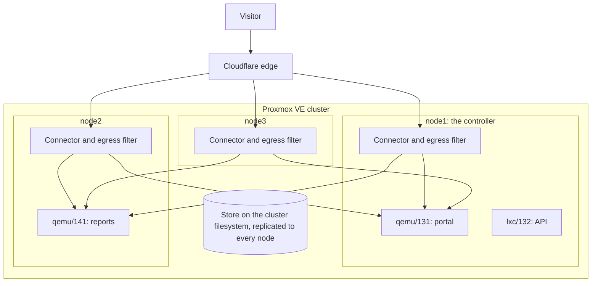

# Company cluster

This page describes pco on a Proxmox VE cluster that several teams use and one team
administers: pco on every node, how to keep the people who edit guests from publishing what they
like, and what a node's loss costs.

## The situation

A company runs a cluster of three nodes, `node1` to `node3`, with shared storage. Teams run
their applications in guests. IT administers the cluster and holds `Sys.Modify` on `/`; the
teams hold `VM.Config.Options` on their own guests, which lets them edit the Notes, and some
of them may clone guests. A customer portal, an API and a documentation site should be
reachable from the internet, and the firewall should keep no inbound port open for them.

Two facts about pco decide the rest.

- **pco runs on every node.** Each node runs its own connectors and proves the addresses of its
  own guests at `port`; the other nodes prove them at `port (attested)` on its word. One node,
  the controller, holds the lease on the cluster filesystem, decides and writes for all.
- **It fails over.** When a node is lost, the hostnames of the shared tunnel go on through the
  other nodes' connectors; when the controller's node is lost, another node takes the lease about
  two and a half minutes later, and nothing is published or withdrawn meanwhile.

## The setup

pco is set up on `node1` first and joined from `node2` and `node3`. Every node runs a replica
of the shared tunnel, and a guest's routes are served by all of them, whichever node it runs on.
The store is on the cluster filesystem and is the same on every node:



## Decisions

### Profile

The host profile, on every node. It proves the guests of each node at `port` there, and at
`port (attested)` from the other nodes, so the default `identityMinimum` serves every guest of
the cluster without an admin acknowledging segments. A company that would rather keep a daemon
off its hypervisors can run the appliance instead, a controller container and an agent
container on each other node; every guest is then proven at `observed`, which
[Hosting tenants](hosting-tenants.md) describes, with what that asks of the admins.

### The nodes

Install pco on all three: a node without pco leaves the cluster without the coverage the other
nodes need to vouch for each other's guests, and the routes of every guest are then served from
its own node alone. Before the second node joins:

- Run chrony on every node, and leave the clocks alone: the cluster filesystem judges whether
  the lease expired by the clock of the node with the lowest node id.
- Give every node an address on the bridges and VLANs of the published guests, as `node1` has.
- Keep the agent channel, TCP 8644, open between the nodes; setup offers the datacenter rule.

Guests that move between nodes, by a migration or by HA, keep being served: their routes follow
them. [Run pco on a cluster](../guides/clusters.md) has the steps.

### Admission

Set `admission` to `approve`. Several people can edit Notes, and some can clone a guest:
Proxmox copies the tags of the source to a clone, so whoever may clone a tagged guest gets a
tagged guest of their own and fills its Notes. In mode `approve` a guest is published only
after an admin has looked at it and run `pco guest approve`; a clone has an identity of its
own and waits ([Security](../security.md#approval-mode)).

The tag is the other half. `pco setup` registers `cf-tunnel` as a registered tag, so that
only a user with `Sys.Modify` on `/` can set it. IT decides which guests may publish, by
tagging them; the teams write what they publish; IT approves the guest. An approval is of a
guest, not of its hostnames, so a team can add a name to the Notes of an approved guest later.
The hostname policy is what bounds that:

- `denyHosts` for the names that no team may publish, such as the admin console and
  everything below an internal prefix.
- `maxHostnamesPerGuest` below its default of 32; a guest that names more publishes none.
- The Cloudflare token, below: a name in a zone that no token serves is never published.

A new install starts in observe-only mode, so set the mode before `pco apply`. On an install
that is publishing, approve the published guests first. `pco guest approve` works in mode
`tag` too. Changing the mode takes every route of a guest that is not approved off the air at
the next cycle.

### Tokens

One token for the zones the company publishes in, and nothing else: the three permissions of
[Cloudflare token](../cloudflare-token.md#permissions), on the account that holds those
zones and on those zones only. A zone that the token does not see cannot be published in, so
the zones of the company's other domains are out of reach of anyone who edits Notes. With
zones in two accounts, store one token for each; pco makes one tunnel in each account.

The token is stored in `/etc/pve/priv/pco`, which the cluster filesystem replicates to every
node. Every user who is root on any node can read it, and so can whoever holds a backup of
`/etc/pve`. Treat the backups of the cluster filesystem as secrets, and scope the token for
that reason.

Give it a time to live and put the replacement in a calendar. `pco status` and `pco doctor`
warn 30 days before it ends, and [the rotation](../cloudflare-token.md#rotating-a-token)
takes four steps. pco leaves 200 of the 1200 requests in 5 minutes that Cloudflare allows a
user to other tools, and keeps to what Cloudflare says is left. If automation of the company,
Terraform say, calls the API as the same user and spends more than that, lower
`cloudflareBudget` from its default of 1000 and restart the daemon, since that setting is
read at start ([Settings](../settings.md#cloudflare)).

### Egress filter

On, as it is after setup. It is what stands between a stolen token and the management
network: a rule written at Cloudflare for `10.0.0.1:8006` gets a refused connection. If some
address on a network that the node reaches must never be a target, whatever a Notes block
or Cloudflare says, `pco egress block <address>` makes sure of it; it is local to the node
and needs no daemon. If configuration management of the company loads an nftables ruleset
that begins with `flush ruleset`, the table of pco is removed each time it runs and the daemon
puts it back; `pco doctor` has a check for `nftables.service`, and the event log says each
time the table was changed ([Security](../security.md#keeping-the-table-in-place)).

### Web interface access

Admins of pco are the users that hold `Sys.Modify` on `/`, readers the users that hold
`Sys.Audit` on `/`; they sign in with what Proxmox already knows of them. Give the helpdesk a
role with `Sys.Audit`, such as PVEAuditor, and nothing more: a reader can read the state of
the install and cannot change anything.

The interface listens on the address of each node on port 8643, and is served by the
controller: on any other node it sends the browser to the controller's address, where the user
signs in again. Restrict that port with the Proxmox firewall to the admin network, as you would
port 8006. If staff reach it under a name of their own, put the name in `PCO_WEB_HOSTS` in
`/etc/default/pco-web` on every node and restart `pco-web`, and give it a certificate that the
company's own CA signed, on every node:

    pco setup --repair --web-cert own --web-cert-file /root/pco.example.com.crt --web-key-file /root/pco.example.com.key

## What it ends with

The settings that differ from the defaults:

```json
{
  "admission": "approve",
  "denyHosts": ["admin.example.com", "*.internal.example.com"],
  "maxHostnamesPerGuest": 4
}
```

Apply them as in [Settings](../settings.md#changing-the-settings). The Notes of the guest
`131`, written by the team that owns it:

````text
```cf-tunnel
portal.example.com -> :8080
api.example.com    -> :8081
```
````

IT sets the tag, as a user with `Sys.Modify` on `/`, and approves:

    qm set 131 --tags 'cf-tunnel'
    pco guest list
    pco guest approve qemu/131

`pco guest list` shows who is approved, who changed since, and who waits, with the node each
runs on:

    Approved guests:
      GUEST               IDENTITY  NOW
      qemu/131 (portal)   uuid:131  the same
      qemu/141 (reports)  uuid:141  changed to uuid:142: approve it again to publish it

    Waiting for approval (pco guest approve <owner>):
      lxc/132 (api)

    Tagged guests:
      GUEST               NODE   RUNNING  IDENTITY                              APPROVAL  ROUTES  ISSUES
      qemu/131 (portal)   node1  yes      uuid:131                              approved  1       0
      lxc/132 (api)       node1  yes      mac:3f2a91b47c0d5e6f8a9b0c1d2e3f4a5b  waiting   1       0
      qemu/141 (reports)  node2  yes      uuid:142                              changed   1       0

With the portal on `node1` and a report server on `node2`, both are served at `port`, by the
replicas of every node:

    HOSTNAME             STATE   LEVEL  SERVICE                VIA     OWNER     ZONE         NOTE
    portal.example.com   active  port   http://10.0.0.31:8080  direct  qemu/131  example.com  -
    reports.example.com  active  port   http://10.0.0.41:8080  direct  qemu/141  example.com  -

## What to watch

- **The nodes.** `pco cluster status` on the controller shows each node, whether its agent
  reports and its forwarding-table watch runs, and whether its replica is ready; `pco doctor
  --cluster` checks them all. Drain a node before its maintenance, `pco node drain`, and hand
  the lease off before the controller's, `pco cluster handoff`.
- **Coverage.** A node whose pco is stopped or broken makes the routes of every guest of the
  other nodes move to tunnels pinned to their own nodes; `pco status` names the node.
- **Quorum.** Without quorum nothing is written, anywhere; published routes keep serving. An
  approval or a change of the settings fails until it is back.
- **Upgrades.** One node at a time, the controller last, and `pco cluster finish-upgrade` once
  all of them run the new release ([Upgrade and go back](../guides/upgrade-and-rollback.md#on-a-cluster)).
- **Guests that wait.** `pco status` has the line `Approval:` with how many wait, and
  `pco doctor` warns for each. A team that clones a guest to test something will ask why it
  is not served.
- **Held routes.** `pco status` says how many routes the minimum and the rules at `observed`
  hold, and why.
- **The token.** Its expiry, and who else spends the Cloudflare API of the same user.
- **Monitoring.** `pco status` exits 1 when there is a problem, and `pco status --json` has
  the fields to alert on; `pco doctor` can run from a timer
  ([Operations](../operations.md#exit-codes-and---json)).

## Guides it uses

- [Run pco on a cluster](../guides/clusters.md): pco on every node, and what a node's loss
  costs; [Controller failover](../guides/controller-failover.md) and
  [the runbooks of a cluster](../guides/cluster-runbooks.md).
- [Decide who may publish](../guides/who-may-publish.md): the gate tag, the admission modes,
  approvals.
- [Use several tokens and accounts](../guides/several-tokens-and-accounts.md), and
  [roll out in observe-only mode](../guides/observe-then-enforce.md).
- [Back up and recover](../guides/backup-and-recovery.md): what to back up, and the bundle of
  `pco export`.
- [Upgrade and go back](../guides/upgrade-and-rollback.md), and
  [monitor pco](../guides/monitoring.md).
