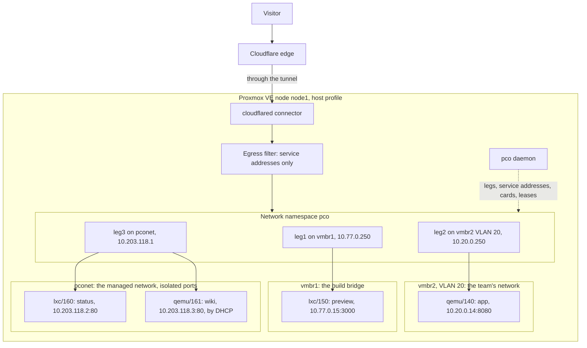

# Guests on networks of their own

This page describes a node whose guests are not on the network the node is on: a team
network on a VLAN, an internal bridge of a few guests, and guests that have no network they
should share with anything. It says which of the three ways to a guest fits each, and what
the setup ends with.

## The situation

A node called `node1` has its management address on `vmbr0`, in `192.168.4.0/24`. Its guests
are elsewhere. A team keeps its machines on VLAN 20 of `vmbr2`, `10.20.0.0/24`, with a
gateway of its own, and does not want the node in that network: the web interface of Proxmox
on every guest's doorstep is not what they signed up for. A build pipeline makes guests on the
internal bridge `vmbr1`, `10.77.0.0/24`, which has no physical port. And a few guests of the
company's own, a status page and a wiki, are kept off every network but the one they need to
be published on, and should be reached at a level the admin can prove.

pco runs on the node in the host profile. The team's VLAN is attached: a leg of pco's goes
into it, and the team changes nothing. The build bridge is attached too. The status page and
the wiki get the managed network: a card each on `pconet`, which reaches pco's leg and
nothing else.

## The setup



The node has no address in any of the three networks. The connectors dial a service address
of `198.18.0.0/16` for each guest, and the namespace translates it and sends the request out
of the right leg.

## Decisions

### Profile

The host profile: the legs live in a namespace of the node, every guest is proven at `port`
through its leg, and the managed network is isolated at layer 2, with pco's guard on the
bridge. The appliance can do the same with cards of its own, at `observed` for the attached
networks and `filtered` for the managed one; [Profiles](../profiles.md) sets the two side by
side.

### Attach or Managed

Attach where the network is somebody's and the guests should stay as they are: the team's
VLAN and the build bridge. The team reserved `10.20.0.250` for pco's leg and knows that its
MAC is seen on their VLAN, which runs over a physical port; the build bridge has no port, and
the leg's address there is pco's choice. Managed where the guests should get a network that
exists for publishing: the status page and the wiki have no other network, and
`managed.consent` stays at `per-guest`, since there are two of them and the admin tags each.
With more such guests, `auto` would attach every guest the gate tag admits that needs the
network. [Networking](../networking.md#which-way-to-a-guest) has the comparison.

### Admission

`approve`, as on any node where the people who may edit a guest are not the admins: the team
edits its own Notes. An approval records the identity of a guest, and a clone of a published
guest waits for one of its own. The consent for the managed network is another thing, given
by the tag `cf-tunnel-managed` here, and is not lifted by an approval.

### Identity minimum

`port`, the default. Every guest is on this node and is proven at `port` through its leg,
by ARP from the leg and the forwarding table of its bridge, like a guest the node is on.

### The subnet of the managed network

The default, `10.203.118.0/24`, which no node routes and no guest has an address in; pco
refuses to make the network otherwise. A `/24` holds 253 guests, and the setting cannot be
changed once the network exists.

### Egress filter

On, as always. It holds the service addresses and never a guest's real address, so a rule
written at Cloudflare that names a guest's real address reaches nothing.

## What it ends with

The two attached networks, with the uplink confirmed for the team's VLAN:

    pco network attach vmbr2:20 --address 10.20.0.250/24 --confirm-uplink
    pco network attach vmbr1 --address 10.77.0.250/24

The managed network, made once:

    pco network managed enable

The two guests with their consent beside the gate tag:

    pct set 160 --tags 'cf-tunnel;cf-tunnel-managed'
    qm set 161 --tags 'cf-tunnel;cf-tunnel-managed'

The wiki, a virtual machine, asks pco's DHCP server for its address with two lines in
`/etc/network/interfaces` for the card that appeared, `allow-hotplug ens19` and `iface ens19
inet dhcp`. The settings differ from the defaults in one place:

```json
{
  "admission": "approve"
}
```

Once the guests are approved and their Notes hold their routes, `pco routes` lists the four,
each with the way it is reached:

    HOSTNAME             STATE   LEVEL  SERVICE                 VIA              OWNER     ZONE         NOTE
    app.example.com      active  port   http://198.18.1.0:8080  attach:vmbr2.20  qemu/140  example.com  -
    preview.example.com  active  port   http://198.18.1.1:3000  attach:vmbr1     lxc/150   example.com  -
    status.example.com   active  port   http://198.18.1.2:80    managed          lxc/160   example.com  -
    wiki.example.com     active  port   http://198.18.1.3:80    managed          qemu/161  example.com  -

and `pco managed status` the two cards:

    Mode:        per-guest
    Tags:        cf-tunnel-managed is registered admin-only
    Vnet:        pconet as pco made it
    Subnet:      10.203.118.0/24, 251 addresses free
    Leg:         10.203.118.1, up
    Attached:
      GUEST              NIC   ADDRESS       MAC                CONSENT  STATE     SINCE
      lxc/160 (status)   net1  10.203.118.2  06:50:43:4f:76:02  tag      attached  2026-10-01T12:00:00+02:00
      qemu/161 (wiki)    net1  10.203.118.3  06:50:43:4f:76:03  tag      attached  2026-10-01T12:00:00+02:00

## What to watch

- **The team's VLAN.** The leg at `10.20.0.250` is one more station there; a DHCP server of
  the team that gives the address out makes the leg fail with `address in use by <mac>`,
  which `pco network list` and the check `leg vmbr2.20` of `pco doctor` show. The team sees
  nothing of the node through the leg: the namespace accepts nothing from it.
- **A clone of the status page.** A clone copies the card on `pconet`, and a running copy
  would answer for the original's address. pco sees the card as foreign: the clone carries
  the tag, so it gets a card of its own in its place, with a new address, and its hostnames
  stay in conflict with the original's. A clone without the tag has its link set down and is
  reported. `pco managed status` lists it under `Foreign`.
- **A reboot of the node.** `pco-netns.service` brings the namespace, the legs and the
  translations back before the guests start, and the DHCP server listens before the daemon
  says it is ready, so the wiki finds it at its boot. Until the daemon's first cycle has
  verified the routes, the hostnames answer 502, as on any node.
- **The limit of 15 networks**, the managed one among them, kept once for the cluster;
  `pco doctor` warns from the 13th. Fifteen is plenty here.
- **A busy target.** A guest behind a leg takes about 68 new connections a second from the
  connector, which keeps its connections open and reuses them; a target that is busier than
  that is one to reach directly.
- **Nothing in the Notes changes.** Neither Attach nor Managed is named in a route; `via=managed`
  is there for a guest with several cards that should be reached through the managed one.

## Guides it uses

- [Attach a network](../guides/attach-a-network.md): the candidates, the probe, the uplink and
  the attach.
- [Set up the managed network](../guides/managed-network.md): the vnet, the consent, the card
  and the DHCP of a virtual machine.
- [Decide who may publish](../guides/who-may-publish.md): admission mode `approve` and the
  approvals.
- [Publish a virtual machine](../guides/publish-a-vm.md): the guest agent or a static address,
  and `via=`.
