# Web interface

pco web serves a web interface over HTTPS, on the node or in the appliance. It shows what the
daemon found and did, draws how traffic reaches each guest, and lets an admin do what the
commands that ask the daemon do: start publishing, confirm what waits, approve guests, hand a
hostname to another owner, add Cloudflare tokens, edit the settings and the manual routes. A
user signs in with what Proxmox VE already knows of them, and what they may do follows from
their privileges there.

What changes the node itself stays on the command line, as root: `pco setup`, `pco uninstall`,
`pco egress`, `pco tunnel rotate`, `pco segment acknowledge` and `revoke`, `pco netns` and
`pco web cert`. Where one of them is the fix, the page shows the command with a button that
copies it. The networks pco attaches and its managed network ([Networking](networking.md)) are
set up on the command line too, with `pco network` and `pco managed`; the page shows how a
route is reached through them.

The screenshots on this page show an example install, as an admin sees it unless the text
says otherwise: one served zone with a route in every state, a connector pco does not run, a
zone that froze, guests that wait for approval and changes that wait for a confirmation.
`make docs-screenshots` takes them again.

## Opening it

On a node, `pco setup` makes the web interface unless it is given `--no-web`, and prints where
it is and how to check its certificate:

    web interface: https://node1.example.com:8643/
    web certificate: SHA-256 fingerprint AB:CD:EF:01:23:45:67:89:AB:CD:EF:01:23:45:67:89:AB:CD:EF:01:23:45:67:89:AB:CD:EF:01:23:45:67:89
    web certificate: browsers trust it once the cluster CA, /etc/pve/pve-root-ca.pem, is imported, as for port 8006

Open it under the same host name you open Proxmox VE under: if Proxmox VE is
`https://node1.example.com:8006/`, pco is `https://node1.example.com:8643/`. The browser hands
the session of Proxmox VE to pco only under that name, which is what lets you sign in without
typing anything. pco answers to the short name of the node, its fully qualified name, the
address it listens on, and the names in `PCO_WEB_HOSTS`; under any other name it refuses to
sign you in, with `pco does not answer to the name in the address bar; open it under the node's
name or add the name to PCO_WEB_HOSTS`. [Operations](operations.md#the-web-interface) says how to listen on
another address or answer to another name.

By default the certificate is signed by the cluster CA of Proxmox VE, so a browser that trusts
the CA for port 8006 trusts it for port 8643 too. A browser that warns about port 8006 warns
here as well: import `/etc/pve/pve-root-ca.pem` into it, or compare the fingerprint with the one
`pco web cert` prints on the node. [Security](security.md#the-certificate) has the three
certificate modes.

When the firewall of Proxmox VE is on, setup says so and prints the rule it needs:

    firewall: the Proxmox VE firewall is on; allow TCP port 8643 to this node, for example with pvesh create /nodes/node1/firewall/rules --type in --action ACCEPT --proto tcp --dport 8643 --enable 1

Add `--source` with the network your admins work from, so that nobody else reaches the
sign-in page.

The appliance serves the interface on port 8643 of the address of its card `net0` and nowhere
else, with a self-signed certificate of its own: open `https://<address>:8643/` and compare
the fingerprint the browser shows with the one the installer printed, or with the one
`pct exec <vmid> -- pco web cert` prints on the node. See
[Appliance](appliance.md#the-web-interface).

On a cluster the interface is served by the controller, the node that holds the lease. pco web
on any other node sends a page you open to the controller's address, `https://<address>:8643/`,
with the path and the query kept. Sign in there as on any node: the session of Proxmox VE is
bound to the host name you opened, so the browser does not hand it on, and an API token works
under any name. While no controller is known, a node serves its own page. The redirect follows
the lease as the node's daemon sees it when the page is asked for, as `pco` on that node does:
a controller that stopped is not redirected to, and one that took over is at once. The calls of a page
are never sent on: a page left open on a node that lost the lease gets `not_controller` from
its actions, with the controller's address
([API](api.md#on-a-node-that-is-not-the-controller)), and reloading it goes to the controller.
[Security](security.md#on-a-node-that-is-not-the-controller) says what that redirect discloses.
The redirect reaches the controller only where its pco web listens on that address:
`pco setup` writes the node's address into `/etc/default/pco-web`, and a node whose
`PCO_WEB_LISTEN` was set to `127.0.0.1` sends you to a page that does not answer.

The page is built for Chrome and Edge 120, Firefox 115 and Safari 17, and later versions.

## Signing in

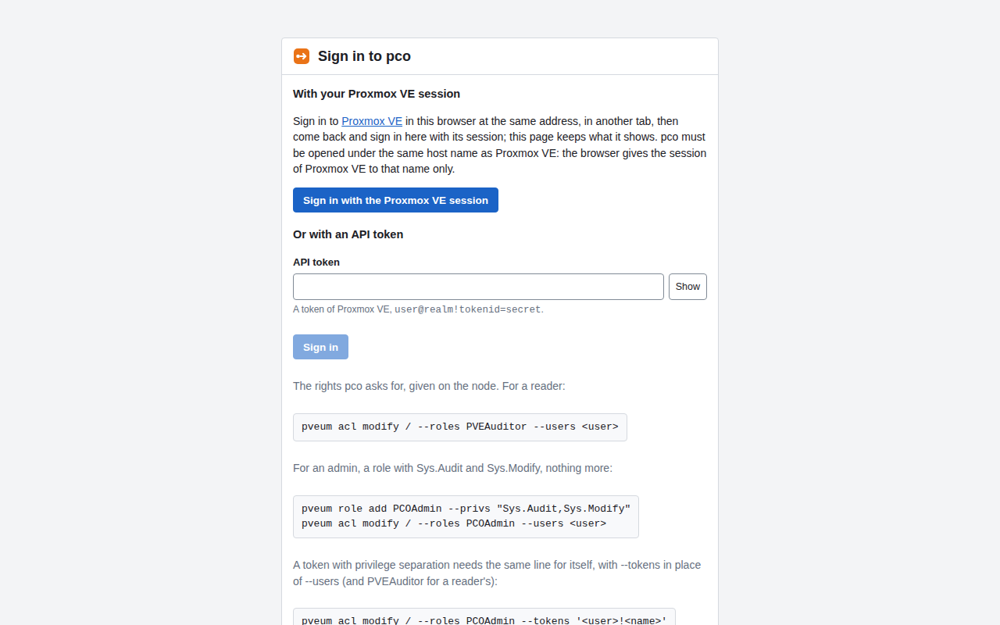

### Who may do what

The role comes from the privileges of the user, or of the token, on the path `/` of Proxmox VE:

| Privilege on `/` | Role | May |
|---|---|---|
| `Sys.Modify` | admin | everything on this page |
| `Sys.Audit`, without `Sys.Modify` | reader | look, run a diagnosis and the doctor, export the events and the settings |
| neither | none | nothing: the sign-in is refused, and the page says `This user has no Sys.Audit on /: pco cannot show it anything.` |

The sign-in page has the lines that give these rights, to run on the node. For a reader, the
built-in role `PVEAuditor`, which also holds the `VM.Audit` that says which guests the reader
may see:

    pveum acl modify / --roles PVEAuditor --users <user>

For an admin, a role with `Sys.Audit` and `Sys.Modify` and nothing more:

    pveum role add PCOAdmin --privs "Sys.Audit,Sys.Modify"
    pveum acl modify / --roles PCOAdmin --users <user>

A token with privilege separation needs the same line for itself, with `--tokens` in place of
`--users`, and `PVEAuditor` for a reader's:

    pveum acl modify / --roles PCOAdmin --tokens '<user>!<name>'

The role is not fixed at sign-in. pco asks Proxmox VE again as the session is used: a ticket's
answer is kept for 30 seconds and a token is asked again after a minute, so a `Sys.Modify` taken
away ends the admin's rights within that time, and a user who loses `Sys.Audit` is signed out.

A user whose name has characters pco cannot record as the author of a change is refused:
`pco cannot record changes under this user name: it allows letters, digits and . _ - @ ! only;
sign in with another user or an API token`.

### On a node

The browser holds the session of the Proxmox VE interface as a cookie, `PVEAuthCookie`, for the
host name of the node. Browsers keep cookies by host name and not by port, so the cookie that
port 8006 set reaches port 8643 as well. When the page loads and finds it, it signs in with it
by itself; without it, it says to sign in to Proxmox VE at the same address first. Sign in
with the Proxmox VE session, or paste an API token of Proxmox VE, `user@realm!tokenid=secret`.

The way of a sign-in, with the ticket of the Proxmox VE interface or with a token pasted in:

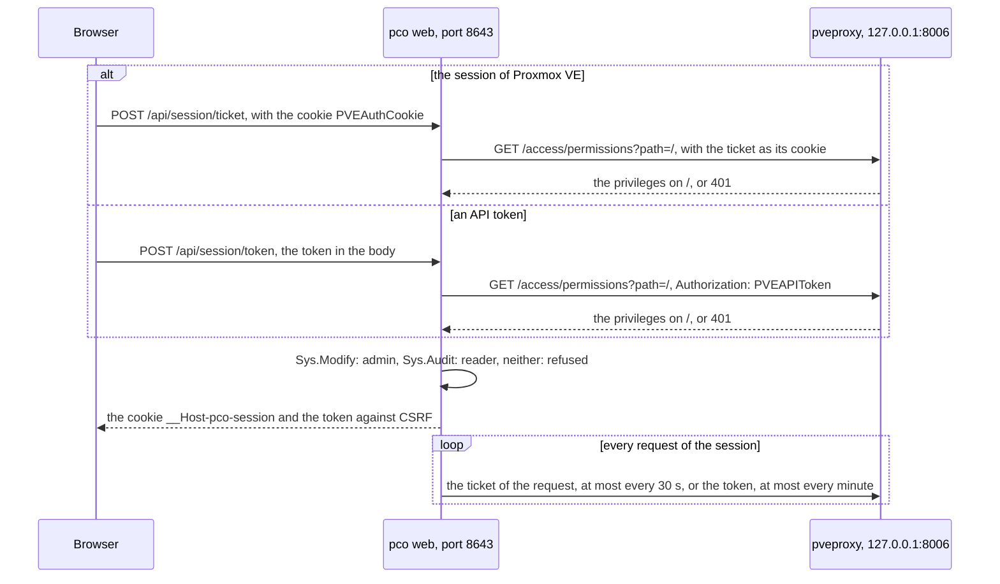

pco web asks the API of the node's own pveproxy, and only when pveproxy presents the
certificate it serves, byte for byte: while pveproxy is down another process could listen on
port 8006 and collect the tickets. It never keeps the ticket: each request is checked with the
cookie it carries. When the Proxmox VE interface renews its ticket, the next request carries the
new one and the session goes on; a ticket of another user, or none, ends it. pco does not renew
the ticket itself: a ticket lives two hours, and with the Proxmox VE interface closed for that
long the session of pco ends with it. A pasted token is kept in the memory of pco web for the
session and nowhere else.

A refusal says why: `Proxmox VE did not accept the session of this browser; sign in to Proxmox
VE again` for a ticket that expired, `Proxmox VE did not accept the token` for a token, and
`Proxmox VE on this node does not answer, or presents another certificate than the node's`
when pveproxy is away or serves another certificate than the one pco web was started with.
[Troubleshooting](troubleshooting.md#the-web-interface) goes through them.

### In the appliance

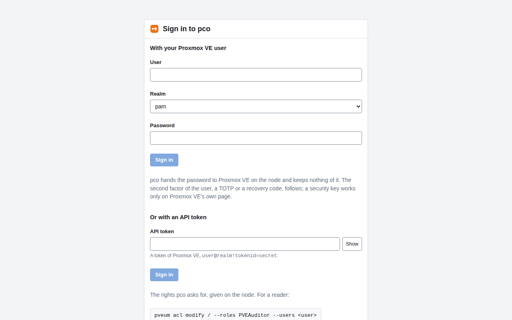

The browser has no session of Proxmox VE for the appliance's address, so the appliance asks for
the user, its realm and its password, and hands them to the API of the node as the appliance's
daemon reaches it. The password goes to Proxmox VE in one call and is dropped when the call
returns; pco keeps nothing of it. When the user has a second factor, the page asks for its
code next: a code of an authenticator app (TOTP) or a recovery code. A security key (WebAuthn)
works only on Proxmox VE's own page, as it is bound to that address: the page says `This
account's second factor is a security key, which works only on Proxmox VE's own page. Use a
TOTP or recovery code, or an API token.` The step of the code lasts two minutes and ends after
three wrong codes; then the password is asked again. The realms in the list are those of the
node, which the page shows to anyone who reaches it, as the sign-in page of Proxmox VE does.

`root@pam` signs in with its password as on the page of Proxmox VE. `PCO_WEB_ALLOW_ROOT=0` in
`/etc/default/pco-web` of the appliance refuses it, with `The password of root@pam is turned
off here`. The API token works as on a node, and is the way in for an account whose second
factor is a security key.

Proxmox VE does not lock a user out after wrong passwords, so the appliance keeps a lock of its
own, in memory. The fifth failure of an account, a wrong password or a step of the second factor
ended by three wrong codes, locks it at pco for a minute, every further one doubles that up to
15 minutes, and a sign-in that works clears it. The lock is per account and not per address:
five wrong passwords from anyone lock that user out of pco, not out of Proxmox VE, for up to 15
minutes. Sign in with an API token meanwhile. A restart of `pco-web` forgets the counts.

Proxmox VE's own limits apply behind it. On Proxmox VE 9.2 a wrong password is answered after
about three seconds and never locks the user, in the realms `pam` and `pve` and for `root@pam`
alike. Eight wrong TOTP codes in a row lock the TOTP of the user: the right code is refused as
well, until the user signs in with a recovery code or root runs `pveum user tfa unlock <user>`.
After 100 failed second-factor attempts every factor of the user is locked for an hour, recovery
codes included, unless `pveum user tfa unlock` lifts it. Through pco both locks read `Proxmox VE
did not accept the code`, as a wrong code does. Proxmox VE 8.4 was not measured.

While the user works, pco renews the ticket the sign-in obtained every 15 minutes, as Proxmox VE's
own page does.

### Sessions

| | |
|---|---|
| Idle | 30 minutes without activity end a session. Activity is what you do: a page you open, an action, keys, the pointer and scrolling, told to pco web at most once a minute. What the page fetches by itself is not, so a tab nobody looks at idles out. Two minutes before the end the page asks, with Stay signed in. |
| Longest | 12 hours, 8 for a session of a token. |
| How many | five for each user and 500 in all; a sixth sign-in of a user ends that user's oldest session. |
| Signing out | the user menu, Sign out. It ends the session of pco and not that of Proxmox VE; the tab then does not sign in with the ticket by itself until you ask it to. |
| A restart of `pco-web` | ends every session, which live in its memory only. With the session of Proxmox VE the page signs in again by itself; with a token or a password, it asks. |

Ten sign-ins a minute are allowed from one address, or from one `/64` of IPv6, with a token, a
password or a code; the eleventh is refused with `too many sign-ins from this address; try
again in <n> s`.

When a session ends while a page is open, a dialog opens over it to sign in again. The page
keeps what it shows, and what you did last is not sent again.

## Around every page

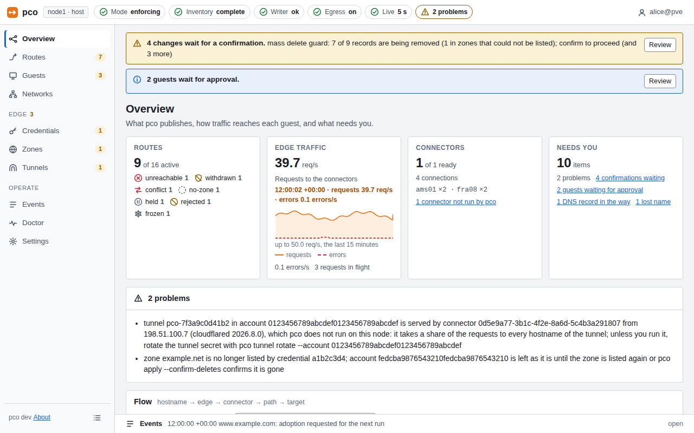

The **top bar** names the node and the profile, and has five statuses, each with a word as well
as a colour:

| Status | Says |
|---|---|
| Mode | `observe-only` or `enforcing`. |
| Inventory | `complete` when the last cycle listed every guest. |
| Writer | `ok`, or what the last cycle found of the writer of the tunnel configuration: `stale`, `foreign`, `unknown`, and in the appliance `behind`; [Problems](problems.md#writer-verdicts) says what each means. |
| Egress | `on`, `off`, `not loaded` or `changed`, and `not checked yet` before the first check: whether the egress filter confines the connectors. |
| Live | how long ago the last cycle's news reached the page. It turns into Reconnecting, Stale, Daemon: no answer or pco web: no answer; see below. |

Beside them, the number of problems of the last cycle. A narrow window shows the worst of the
five alone. The user menu has the theme, the density, About pco and Sign out.

The page holds one stream of the daemon's news for each browser, which the tabs share. **Live**
means the stream is open and a cycle finished recently. **Reconnecting** means the stream
dropped and the page is opening it again. **Stale** comes after 15 seconds of reconnecting, or
when no cycle has finished for three times the poll interval, or three times the length of the
last cycle when that is longer, where `pco doctor`'s `cycle` check warns too: the figures grey
out, the dots of the map stop, and a banner says how old the data is. **Daemon: no answer**
means pco web cannot reach the daemon on its socket, and **pco web: no answer** that the
browser cannot reach pco web. Published routes keep working through all of these: pco is not in
the data path.

The **banners** under the top bar say what needs attention, most severe first, each with one
action at most: pco web or the daemon out of reach, an egress filter that does not confine the
connectors (with the command that fixes it, to copy), a writer that is not `ok`, stale data, a
cycle that held, an incomplete inventory, what waits for a confirmation, guests that wait for
approval, observe-only mode, no Cloudflare token yet, too many tabs of pco open in one browser
session, and a newer pco that needs the page reloaded.

The **navigation** counts what needs a person: routes that are not active, guests that wait for
approval and routes in conflict, credentials that are not usable, frozen zones, connectors pco
does not run, and, for an admin, the failures of the doctor's last run in this browser.

The **events strip** at the bottom shows the newest event, turns red on an error, and opens to
the last five; [Events](#events) has them all.

About pco, at the foot of the navigation and in the user menu, gives the versions of pco web
and of the daemon, the profile, the node, the boot of the daemon and its poll interval, and links
the licences of the libraries the page bundles, `/licenses.txt`.

## Overview

The first page: four figures, the problems of the last cycle, the flow map and the live events.

- **Routes**: how many are active, and how many are in each other state.
- **Edge traffic**: the requests per second the connectors on this node passed in the last
  sample, with the errors, over the last 15 minutes.
- **Connectors**: how many of pco's connectors are ready, their connections to Cloudflare's edge
  and the locations, and how many connectors pco does not run.
- **Needs you**: problems, confirmations waiting, guests waiting for approval, DNS records in the
  way and names that lost the marker, each a link to where it is dealt with.

The problems are those of `pco status`, in the daemon's words; [Problems](problems.md) has
every one.

### The flow map

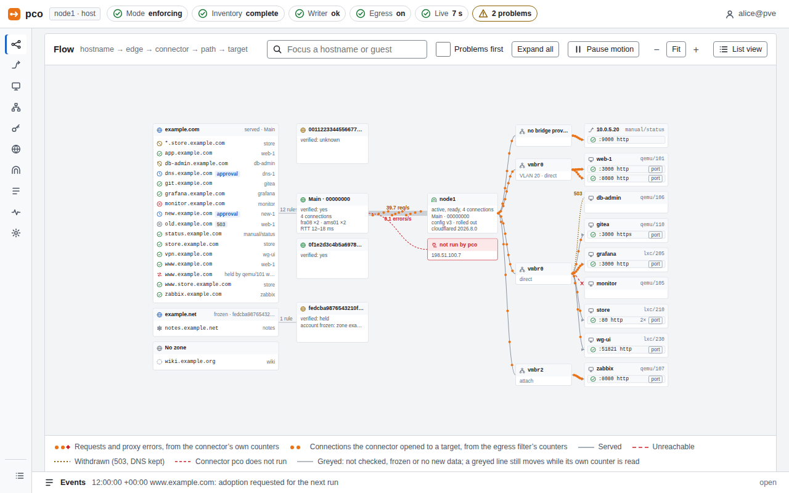

The map draws every hostname's way from Cloudflare to its guest, in five columns, left to right:

| Column | A card for each | Shows |
|---|---|---|
| hostname | zone, with a line for each hostname | the state of each route and its owner; a route in conflict names the holder, a hostname a record of someone else holds has a `DNS` tag, a held route a `503` tag, a guest that waits for approval says so |
| edge | tunnel, one in each account | whether its configuration is verified, its connections to the edge and their locations, the round trip |
| connector | connector on this node | ready, connections, the configuration version rolled out, the version of cloudflared; a connector pco does not run as a red card of its own, with the command that gives the tunnel a new secret in its tooltip |
| path | bridge and VLAN a route was proven on, or the network a route is reached through | the VLAN as the guest's card has it, and `direct`; a route reached through a leg of pco's own has the card of its network, `vmbr1 · attach` or `pconet · managed`; routes proven on no bridge, such as manual routes to an address, share one card |
| target | guest, or address of a manual route | a line for each published port, with the identity level |

On a cluster the connector column holds a card for each node that runs a connector of the
tunnel, a replica, with a chip in the colour of its readiness, and a tunnel pinned to a node has
an edge card of its own, `Main · pinned to pve2`, with a line to that node alone. Above six
replicas of one tunnel they fold into one card, `replicas 7/7 ready`, which opens on a click. A
replica opens its node in the drawer. In the list view a route of a cluster has two more steps:
its placement, and how each replica reaches its target.

Hovering or focusing a card shows its chain and dims the rest; a click, or Enter, opens its
details in a drawer. The search box focuses the map on one hostname, guest, zone or tunnel: it
then shows that chain whole, and the live events below follow it.

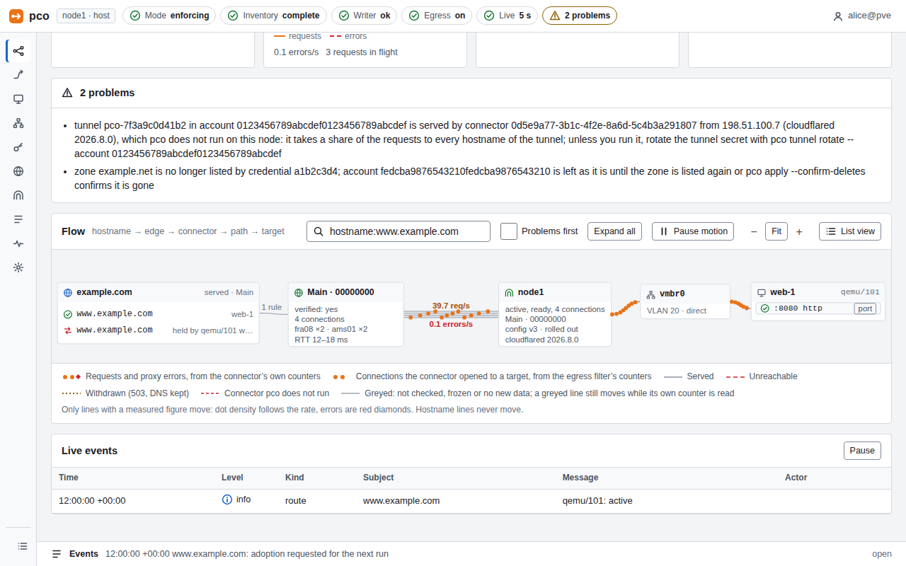

**What moves, and why.** Only a line with a measured figure moves, and the legend says where each
figure comes from. pco has two sources, both read every 5 seconds and kept for 15 minutes:

- **The trunk**, between the edge and the connector, carries the connector's own counters: the
  requests it passed and the proxy errors (the connector could not reach the guest, the
  visitor got a 502). The dots follow the rate, errors are red diamonds, and the figure is
  beside the line. These counters are tunnel-wide: they are every request of the tunnel,
  whichever hostname it was for.
- **The port lines**, from the connector through the path to a port of a guest, carry the
  connections the connector opened to that address and port, which the egress filter counts.
  They are new connections, not requests: cloudflared keeps its connections to a guest open and
  reuses them, so a busy guest may show few. Two routes on the same address and port share one
  figure, and the tooltip says so. The line from the connector into a path carries the sum of
  the targets behind it.

There are no figures per hostname: the hostname lines never move. pco counts no bytes and no
requests for a guest, and asks Cloudflare for no analytics. Where the egress filter is off, not
loaded or not the one pco loads, or its counters could not be read, the port lines show state
only, and the legend says why in those words. The trunk keeps its dots.

Dot density follows the rate on a logarithmic scale, and the exact figure is always beside the
line or in its tooltip. A greyed line is one the last cycle did not check, of a frozen zone, or
without new data. One of the first two still moves while its own counter is read. One without
new data, after three reads in a row gave none, stands still at the last figures, with
`no data since <time>`, and a stale page stops every dot. Pause motion stops them too, and a
browser set to reduce motion starts with them stopped; then chevrons and the figure stand for
the dots.

| Line | Means |
|---|---|
| plain | served |
| red, dashed, a cross at the port | unreachable: the guest does not answer |
| amber, dotted, `503` at the end | withdrawn: the rule answers 503 and the DNS record is kept |
| red, dashed, to a red card | a connector pco does not run |
| greyed | not checked in the last cycle, frozen, or no new data |

A held route has no line past the connector, and a rejected one no line at all.

**Large installs.** The map draws at most 150 cards and 400 lines, whatever the install. Up to 40
routes and 40 guests it shows everything. Above that, a zone card shows twelve lines, routes
that are not active first, and folds the rest, and guests whose routes are all active fold
into one card for each path. Above 200 a zone card is one card with counts by state, and
Problems first is on: the routes that are not active stay drawn with their chains. Expand all
opens what is folded, and a focus shows its chain whole. Fit fits the width, and the map
scrolls down. On a wide screen, with a mouse, a map of more than 40 cards has a mini map to move
around it.

### The list view

List view, and every window narrower than 720 pixels, shows the same content as a list: a line
for each hostname with its state, which opens to its chain from the zone to the port, with the
target's figure where there is one. It is the way to read the map with a screen reader. The
Path step of a chain names the bridge and VLAN, and for a route through a leg says how the leg
fares, in the words of the `path` step of `pco diagnose`: `vmbr1 · attach · leg up, service
198.18.1.0 → 10.77.0.11`, or `the leg is not up: <why>`, which fails the step.

| Action | What it does | Who | Confirmation | Command line |
|---|---|---|---|---|
| Focus a hostname or guest | Shows one chain or one neighbourhood, and the events of it. The address of the page keeps it, so a view can be shared. | admin and reader | none | `pco diagnose <hostname>` walks one chain |
| Problems first | Draws the routes that are not active first. | admin and reader | none | `pco routes` |
| Expand all, Fit, zoom | Open what is folded; fit the width; zoom. | admin and reader | none | none |
| Pause motion | Stops every dot. | admin and reader | none | none |
| List view | The map as a list. | admin and reader | none | `pco routes` |
| Pause, Go live (events) | Stops and resumes the live events under the map. | admin and reader | none | `pco events` |

## Routes

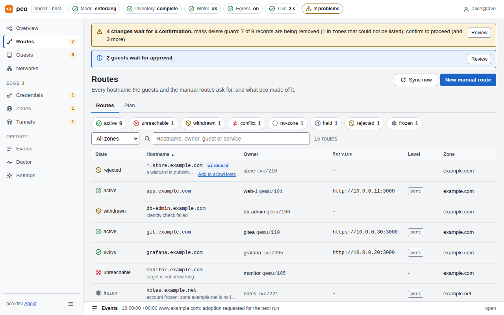

Every hostname the guests and the manual routes ask for, with its state, owner, service, identity
level and zone, as `pco routes` lists them; the service of a route reached through a leg is its
service address, which the gateway forwards to the guest. The chips filter by state, the select
by zone, and the search box matches the hostname, the owner, the guest's name and the service. A route that
is not active says why under its hostname. Over the table a line says when these are the routes
of an earlier cycle: before the first cycle, after a cycle that held, and when the inventory was
incomplete.

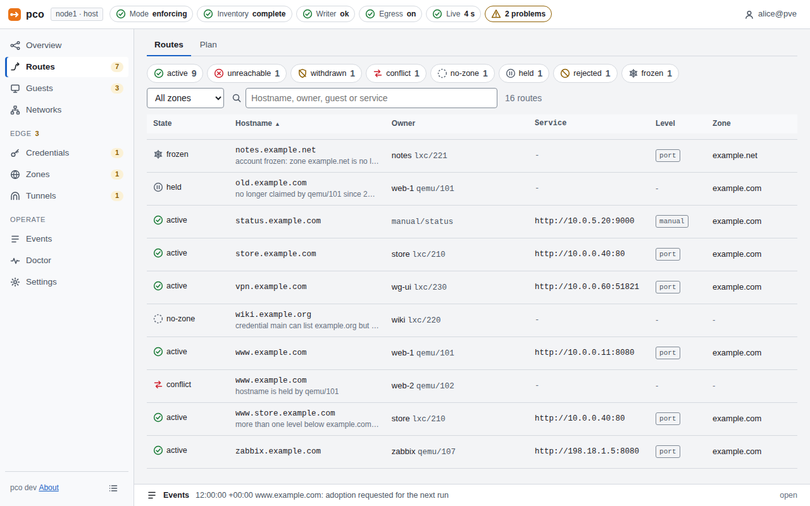

A row opens the route in a drawer, or as a page of its own on a phone. Its address,
`/routes/<hostname>?owner=<owner>`, can be shared.

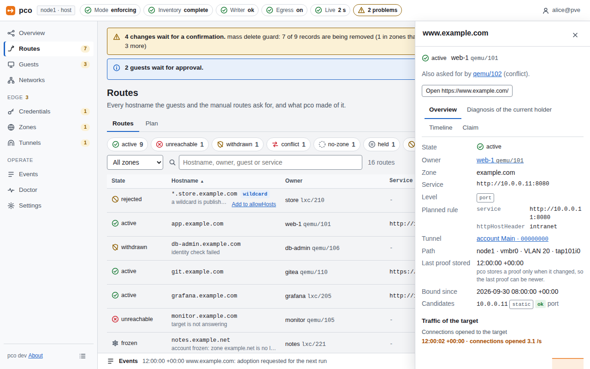

| Tab | Shows |
|---|---|
| Overview | The state and why, warnings, the owner, zone, service and level, the ingress rule pco plans for it, the tunnel, the path the address was proven on with when the proof was last stored and since when the guest is bound there, for a route reached through a leg a Via line (`attach vmbr1: leg up, service 198.18.1.0 → 10.77.0.11`, or why the leg is not up), every candidate address with where it came from and what its check found, `managed` for an address pco leased on its managed network, and the connections opened to the target over the last 15 minutes. On a cluster also the placement (the shared tunnel, or the node the route is pinned to and why), a move between tunnels under way with the step it is at, and each replica with the level it proved, whether it reaches the target and holds it in its egress set, and what fails. `port (attested by pve1)` is a port the replica proved through the attestation of pve1, as the replica reports it, shown only when pve1 is a host node and the one the inventory says runs the guest (otherwise the replica shows its level without the attestation), and never without that node; `port (uplink)` is a port a replica on another node than the guest's, the controller's own included, proved without an attestation: where that node sees the guest behind its uplink; when the path was proven on another node than the guest's, the page says that its port is where that node sees the guest, not the guest's own port. |
| Diagnosis of the current holder | `pco diagnose` for the hostname, run when asked: the daemon walks the chain of the route that holds the hostname, from the claim to an answer of the guest, and stops at the first step that fails. The tab is there only on the route the daemon would diagnose. |
| Timeline | The events of the route, from memory and from the event log on the node, newest first, with the admin who caused each. |
| Claim | Who holds the hostname, since when, and who waits for it. |

| Action | What it does | Who | Confirmation | Command line |
|---|---|---|---|---|
| Sync now (`POST /api/v1/sync`) | Asks the daemon for a cycle now. | admin | none | `pco sync` |
| New manual route | Opens the form of a [manual route](#manual-routes). | admin | none | `pco route manual add` |
| Open `https://<hostname>/` | Opens the published hostname in a new tab; only for a hostname of plain letters, digits and dashes. | admin and reader | none | none |
| Adopt, Take back (`POST /api/v1/adopt`) | Replaces the DNS record of someone else that stands in the way of the hostname, or takes back a record of this install that lost its marker. | admin | a dialog that shows the record in the way, says that it is kept in `/etc/pve/pco/adopted.jsonl` first and that the change waits for a run in which the tunnel is verified and its connector ready; the request is dropped after five minutes if no run could make it | `pco adopt <hostname>` |
| Edit the manual route | Opens the form of the manual route that owns the hostname. | admin | none | none |
| Add to allowHosts | On a route rejected because no `allowHosts` pattern names its apex or wildcard: opens the settings with the pattern added, for you to review and save. Nothing is saved until you press Save. | admin | the review of the [settings](#settings) | `pco settings apply <file>` |
| Run diagnosis (`POST /api/v1/diagnose`) | Runs `pco diagnose` for the hostname. One runs at a time for each user, six a minute. | admin; a reader when the route that holds the hostname is a guest it may see or a manual route | none | `pco diagnose <hostname>` |
| Hand to … (`POST /api/v1/claims/resolve`) | Hands the hostname to an owner that waits for it. | admin | a dialog with the holder and those that wait, which says what the hand-over does | `pco claims resolve <hostname> <owner>` |

### Manual routes

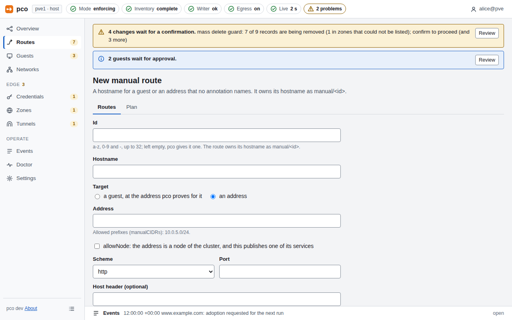

A manual route publishes a hostname that no Notes name, to a guest, at the address pco proves
for it as for a route in its Notes, or to an address inside the prefixes of the setting
`manualCIDRs`, which nothing proves: its level is `manual`. It owns its hostname as
`manual/<id>` and competes in the claims like any owner; the form says when another owner holds
the hostname now. Its options are those of the Notes: a Host header, and for `https` the name
the certificate is checked against and `noTLSVerify`. `allowNode` lets a route to an address
publish a service of a node of the cluster. [Annotations](annotations.md) has what each option
does, and [Identity](identity.md) what a manual route proves.

A route is saved with the revision it was read at. When someone changed it in between, the daemon
refuses, and Look again reads it as it is now; the changes made in the form are dropped then.

| Action | What it does | Who | Confirmation | Command line |
|---|---|---|---|---|
| Make the route (`POST /api/v1/routes/manual`) | Makes the route; the next cycle publishes it. Without an id, pco gives it one of eight hex digits. | admin | the form checks what it can first; a route that publishes a service of a node asks once more, naming the service | `pco route manual add <hostname> --guest <owner> --port <port>`, or `--address <ipv4>` in place of `--guest` |
| Save (`PUT /api/v1/routes/manual/:id`) | Changes the route, at the revision it was read at. | admin | as above | no command changes a route in place; remove it with `pco route manual remove <id>` and add it again |
| Delete (`DELETE /api/v1/routes/manual/:id`) | Removes the route; from the next cycle pco stops publishing its hostname for it, and the claim goes to the next owner that waits. | admin | a dialog | `pco route manual remove <id>` |

A reader sees the manual routes and their form, read-only.

## Plan

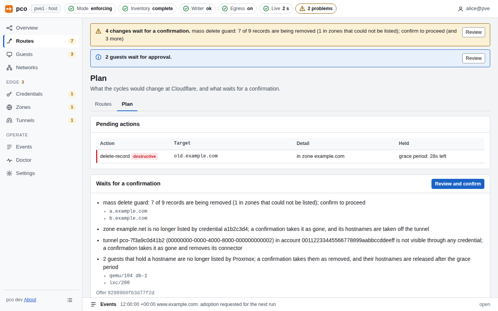

What `pco plan` shows: the actions the last cycle did not carry out and why each is held, what
waits for a confirmation, the records of someone else that stand in the way of a hostname, and
the names that point at the tunnel but lost the marker of this install. A destructive action is
marked so. When the Cloudflare budget holds the actions back, a banner says so.

While pco observes only, the head of the page has Start publishing.

| Action | What it does | Who | Confirmation | Command line |
|---|---|---|---|---|
| Start publishing (`POST /api/v1/apply`) | Leaves observe-only mode: from the next cycle the daemon changes Cloudflare. It confirms nothing that waits. | admin | a dialog that counts the planned actions by kind | `pco apply` |
| Review and confirm (`POST /api/v1/apply`) | Accepts what waits for a confirmation at the next run. In observe-only mode it starts publishing as well. | admin | the dialog below | `pco apply --confirm-deletes` |
| Adopt, Take back (`POST /api/v1/adopt`) | As on a route. | admin | as on a route | `pco adopt <name>` |

### Confirming what waits

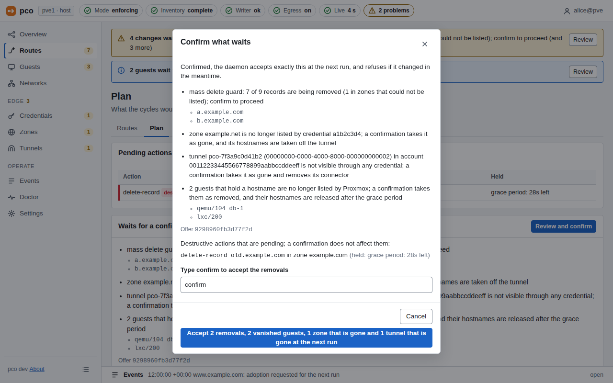

What waits for a confirmation is what pco will not remove on its own: more DNS records at once
than the mass delete guard lets through, guests that Proxmox no longer lists, zones that left the
listing of their credential, and tunnels no credential sees. [Problems](problems.md#what-waits-for-a-confirmation)
has each kind.

The daemon names each list of what waits with an offer, the first 16 hex digits of the SHA-256 of
the list, and accepts a confirmation only with the offer of the list as it is now. The dialog
shows every entry and every item of one state, never cut short, and sends that state's offer.
The list can change while you read it: a cycle may find another guest gone, or a record back.
When the stream brings a state with another offer, the dialog marks what was added and what
went, says `What waits changed while you were reading`, and sends nothing until Review the new
list shows the new one. The daemon refuses an old offer as well, with `what waits for a
confirmation changed since it was shown; look again and repeat`. So a confirmation accepts
exactly what the admin read, and nothing that came after.

Where the list removes something for good, DNS records or vanished guests, you type `confirm`
first, and the button names what it accepts: `Accept 2 removals, 2 vanished guests, 1 zone that
is gone and 1 tunnel that is gone at the next run`. Destructive actions that are pending and
that a confirmation does not affect are listed apart. Afterwards the dialog says what was
confirmed for the next run.

## Guests

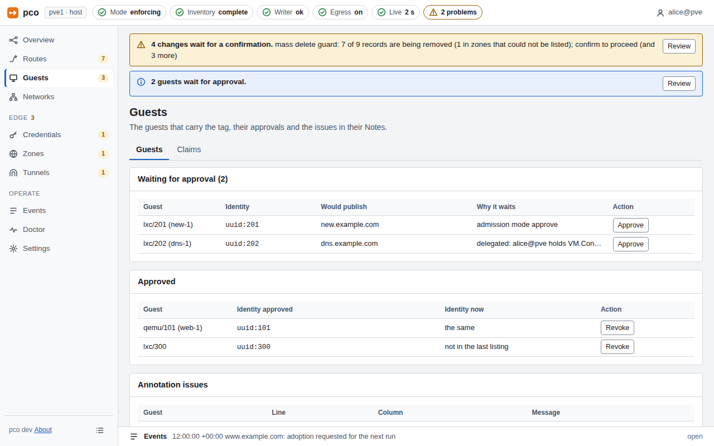

The guests page has four cards: the guests that wait for approval, with the identity an approval
would be of, the hostnames it would publish and why it waits; the approvals, with the identity
each was made in and whether the guest has it still; the issues in the Notes of the guests; and
every tagged guest of the last listing of Proxmox VE. A guest opens its page.

| Action | What it does | Who | Confirmation | Command line |
|---|---|---|---|---|
| Approve (`POST /api/v1/guests/approve`) | Approves the guest in the identity shown. An approval admits a guest while the admission mode is approve, and releases what waits at `observed`, or on a soft-denied address, in either mode. | admin; not while the last cycle did not list every guest, nor for a guest Proxmox VE reports no identity for | a dialog that repeats the identity, the hostnames, why it waits, and the MACs and addresses the approval records; the daemon refuses when the guest changed since it was shown | `pco guest approve <owner>` |
| Revoke (`POST /api/v1/guests/revoke`) | Removes the approval: in approve mode the guest's routes stop being published. | admin | a dialog | `pco guest revoke <owner>` |

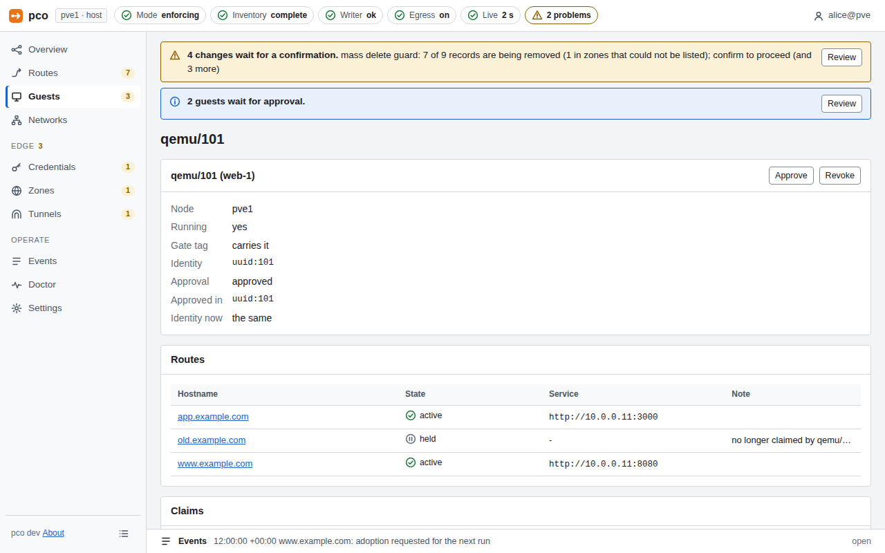

A guest's page, `/guests/qemu/101`, has its node, whether it runs and carries the gate tag, its
identity and approval, its routes, the claims it holds or waits for, the route text of its Notes
with the issues marked at their lines, and its events. Approve and Revoke are there too. The
page shows the route text of the Notes only, never the rest of them.

### Claims

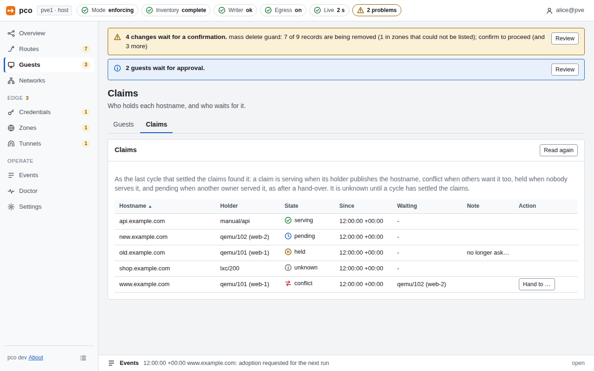

Who holds each hostname and who waits for it, as the last cycle that settled the claims found
it, which `pco claims list` shows too. A claim is `serving` when its holder publishes the
hostname, `conflict` when others want it too, `held` when nobody serves it, `pending` when
another owner served it, as after a hand-over, and `unknown` until a cycle has settled the
claims. The claims are read when the page opens; Read again reads them anew.

| Action | What it does | Who | Confirmation | Command line |
|---|---|---|---|---|
| Hand to … (`POST /api/v1/claims/resolve`) | Hands the hostname to one of the owners that wait for it; the holder waits for it from then on, in the place in line its claim gives it. | admin | a dialog with the holder and those that wait, nobody chosen, which says what follows: when the new holder serves it, or why it does not yet | `pco claims resolve <hostname> <owner>` |
| Read again | Reads the claims anew. | admin and reader | none | `pco claims list` |

## Networks

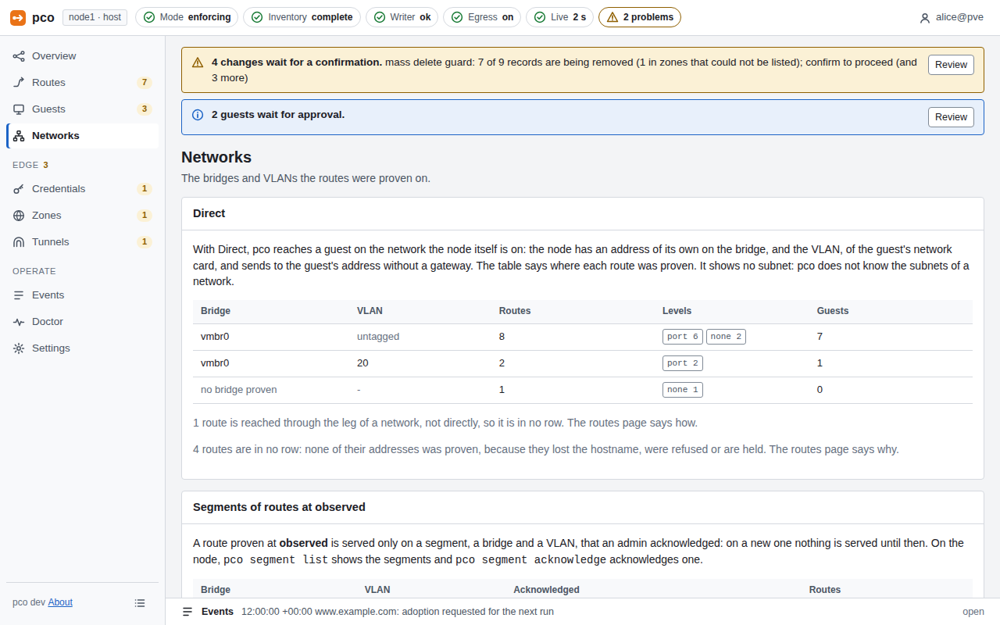

Where the routes were proven directly, as the node itself: a row for each bridge and VLAN, with
the number of routes, their identity levels and their guests, and a row for the routes proven on
no bridge, such as manual routes to an address. A row opens its routes and guests. pco shows no
subnet: it does not know the subnets of a network. A route reached through the leg of a network
is in no row; a line under the table counts them, and the flow map and the route's page say
through which network. The networks pco attached and its managed network are not shown here
yet: `pco network list` and `pco managed status` show them. The page says what each identity
level proves and which level the setting `identityMinimum` serves.

The segments of routes at `observed` are listed with whether an admin acknowledged them. They are
acknowledged on the node, as root, with `pco segment acknowledge`: the page has no action.

## Credentials

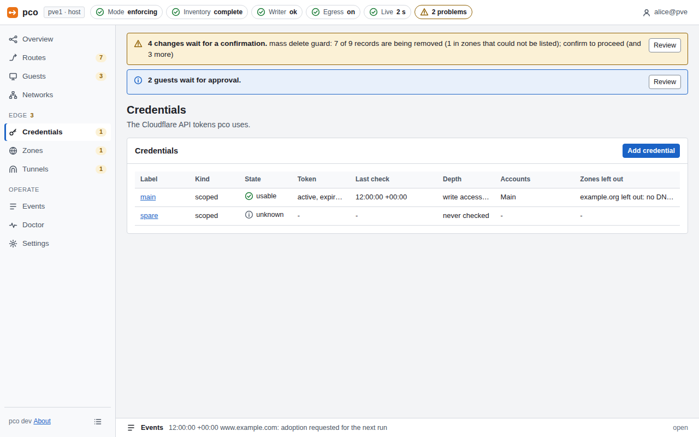

The Cloudflare API tokens pco uses, as the store keeps them and their last check found them: the
label, the kind of token, whether it is usable, its state and expiry, when it was last checked and
how far, its accounts and the zones it leaves out. A credential opens its page, with the whole
last check as a list of what passed and what did not.

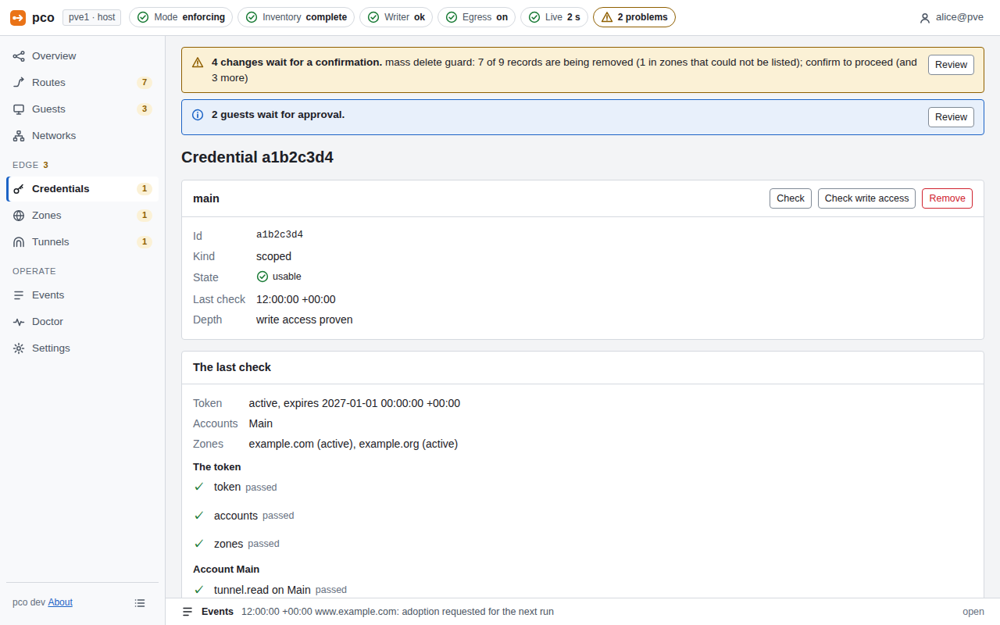

| Action | What it does | Who | Confirmation | Command line |
|---|---|---|---|---|
| Add credential, Check and add (`POST /api/v1/credentials`) | Checks the token with Cloudflare and stores it when it can do what pco needs. The token goes to the daemon once and is never shown again; the field is emptied whatever the answer. A refused token shows what it can and cannot do. | admin | none; the page checks the shape of the token first | `pco credential add --label <label>` |
| Check, on the page of a credential (`POST /api/v1/credentials/:id/check`) | Checks what the token can read. | admin | none | `pco credential check <id>` |
| Check write access, on the page of a credential (`POST /api/v1/credentials/:id/check`) | Proves the write permissions with a test DNS record and a test tunnel, which it deletes again. | admin | `A deep check creates and deletes a test DNS record and a test tunnel. Continue?`, and above 12 zones a warning that it may not finish within the minute the daemon waits | `pco credential check <id> --deep` |
| Remove, on the page of a credential (`DELETE /api/v1/credentials/:id`) | Stops using the token and removes it. The daemon refuses while the credential still manages zones, tunnels or records, and says which. | admin | type the label of the credential | `pco credential remove <id>` |

[Cloudflare token](cloudflare-token.md) says how to make a token and how to read its check.

## Zones

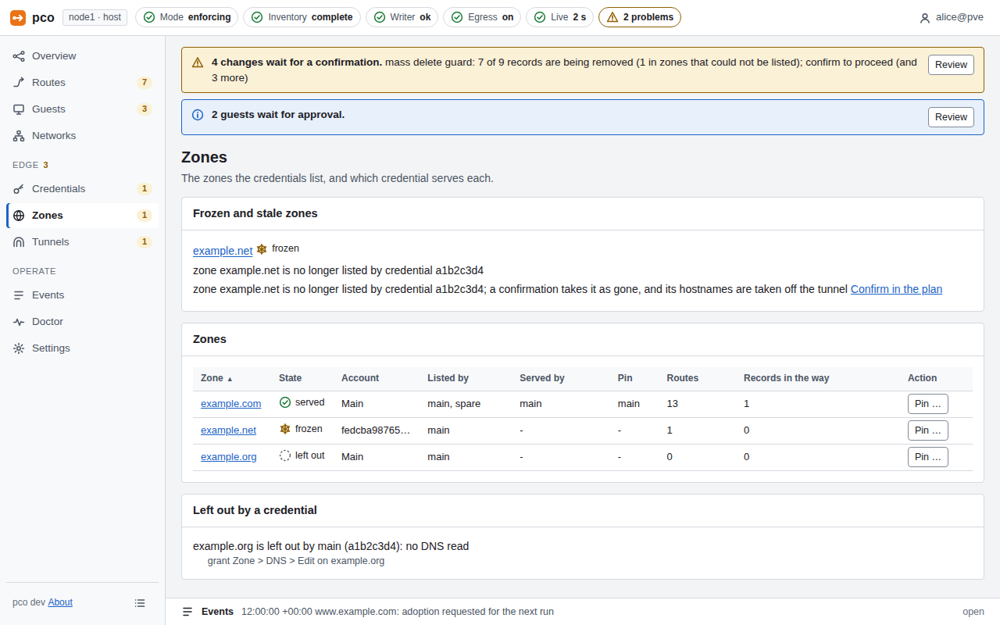

The zones as the last cycle used them: whether each is served, frozen, left out or not served,
its account, the credentials that list it, the one that serves it and the one it is pinned to,
its routes and the records in its way. Frozen and stale zones are listed first with why in full,
and a link to their entry in the plan where a confirmation lets them go. The zones a credential
leaves out are listed last, with what to grant. A zone opens its page, with the same and what the
credentials' checks found of it.

| Action | What it does | Who | Confirmation | Command line |
|---|---|---|---|---|
| Pin … (`PUT /api/v1/settings`) | Gives the zone to one of the credentials that list it, and keeps it there, or takes its pin off: the setting `zonePins`, saved at the revision the settings were read at. | admin | a dialog with the credentials to choose from, which says what the pin becomes; settings changed in between are refused, and Look again reads them anew | `pco settings apply <file>` |
| Confirm in the plan | Opens the entry of the zone in the plan. | admin | the [confirmation](#confirming-what-waits) | `pco apply --confirm-deletes` |

## Tunnels

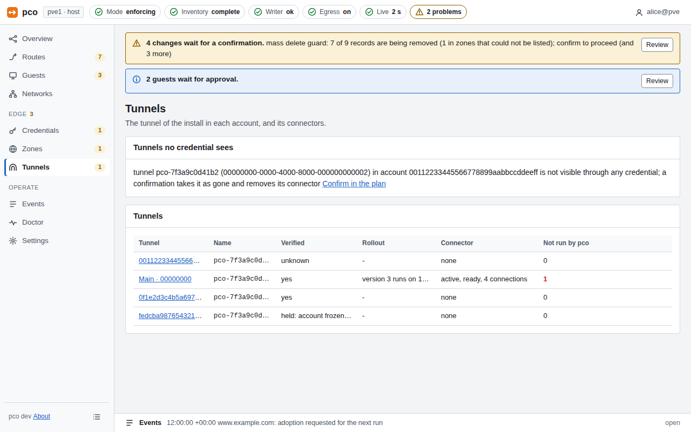

The tunnel of the install in each account, told apart by the name of the account and the first
eight characters of its id, since every tunnel of an install has the same name: whether its
configuration is verified, which version runs on how many connectors, its connector on this node
and how many connectors pco does not run. Tunnels no credential sees any more are listed first,
with a link to their entry in the plan. On a cluster a tunnel pinned to a node shares the
account of the shared one and is told apart by the node, `Main · pinned to pve2`; its page is
`/edge/tunnels/<account>?tunnel=<name>`.

A tunnel opens its page: the account, name and id, the credential, the configuration version,
the connector with its id, the version of cloudflared, its edge locations and round trips, the
requests and errors over 15 minutes, and its events. A connector pco does not run is shown in red
with what is known of it: whoever runs it holds the tunnel's token and gets a share of the
requests to every hostname of the tunnel. The page offers the command that gives the tunnel a new
secret, to run as root on the node, and does not run it: rotating a secret restarts every
connector of the tunnel, so the daemon takes it from root only.

| Action | What it does | Who | Confirmation | Command line |
|---|---|---|---|---|
| Confirm in the plan | Opens the entry of the tunnel in the plan. | admin | the [confirmation](#confirming-what-waits) | `pco apply --confirm-deletes` |
| Copy, in the red block of a tunnel with a connector pco does not run | Copies `pco tunnel rotate --account <account>`, to run on the node. | admin and reader | none | `pco tunnel rotate --account <account>` |

## Nodes

On a cluster the navigation has Nodes, with a count of the nodes that need someone: one that
waits for admission, one whose join token was used more than once (contested), one whose agent
went quiet, and those the new CA refuses after a rotation. A node alone has no such page.

The page has the lease (the node that holds it, its address, the generation and how long ago it
was refreshed), the cluster (quorum and quorum device, the members of the Proxmox cluster,
whether every node runs a forwarding-table watch), a row for each node of the registry and the
addresses blocked on every node. A row has the node's state, role, its agent (when it was last
heard, whether it watches, its build and protocol), whether its replica of the shared tunnel is
ready, its targets (verified, failing, below the identity minimum, pinned to it), when its
certificate expires and how far its clock is from the controller's. A row opens the node in a
drawer, or as a page of its own, `/nodes/<name>`, with the routes pinned to it, those it is a
replica of with how it reaches each, the uses of its join token and its events.

| Action | What it does | Who | Confirmation | Command line |
|---|---|---|---|---|
| Join token… (`POST /api/v1/cluster/join-tokens`) | Makes a join token for an appliance agent of the node you name, shown once, with the line that uses it. | admin | a dialog | `pco cluster join-token --node <node>` |
| Hand off the lease… (`POST /api/v1/cluster/handoff`) | Hands the lease to another active node, or to whichever takes it. | admin | a dialog | `pco cluster handoff` |
| Admit… (`POST /api/v1/nodes/:name/admit`) | Admits a node that waits. An appliance agent is admitted with the fingerprint of its certificate, which `pco agent status` prints in its container; the page refuses one that is not hex, or too short, before it sends anything, and shows the daemon's refusal of one that is not the enrolled certificate's. The dialog lists every use of the join token, from where and as which container. | admin | a dialog | `pco node admit <name> --fingerprint <sha256>` |
| Drain…, End the drain… (`POST /api/v1/nodes/:name/drain`, `POST /api/v1/nodes/:name/undrain`) | Takes a node out of the replicas of the shared tunnel, and puts it back. The last ready replica is drained only when you say so. | admin | a dialog | `pco node drain <name>`, `pco node undrain <name>` |
| Forget… (`POST /api/v1/nodes/:name/forget`) | Takes a node out of the install: its entry is removed, its agent refused, its pinned tunnels deleted and, while `cluster.rotateOnForget` is on, the secret of the shared tunnel rotated. A node whose disk is out of your hands is forgotten as compromised, which only root on the controller may ask for, and only after `pvecm delnode`: the dialog shows both lines. | admin | the name of the node typed | `pco node forget <name>` |
| End a block (`POST /api/v1/cluster/unblock`) | Ends the block of an address whose guest's MAC was seen on the port of another guest. | admin | a dialog | `pco cluster unblock <address>` |

The banners above every page say what the cluster went through: the controller moved (from,
to, generation, when), a hand-off under way, a controller that is fenced or behind what the
agents remember, a controller that took over and waits for the agents before it writes, a node
whose coverage was lost, a CA rotation, addresses blocked on every node, an upgrade that has not
finished, and a cluster that is not quorate.

### This node

On a node that does not hold the lease, while no controller is known, the page is that of the
node's own agent, This node (`GET /api/v1/local/agent`, for an admin): the controller it follows, the epoch, the snapshot it applied last
and how old it is, its connectors, its egress set and gateway, and its local problems. Every
action is refused there; the controller's pages are served on the controller. The navigation
offers This node to admins only; a reader who opens `/agent` is told the page is for admins,
and still sees whether this node holds the lease and which node does.

## Events

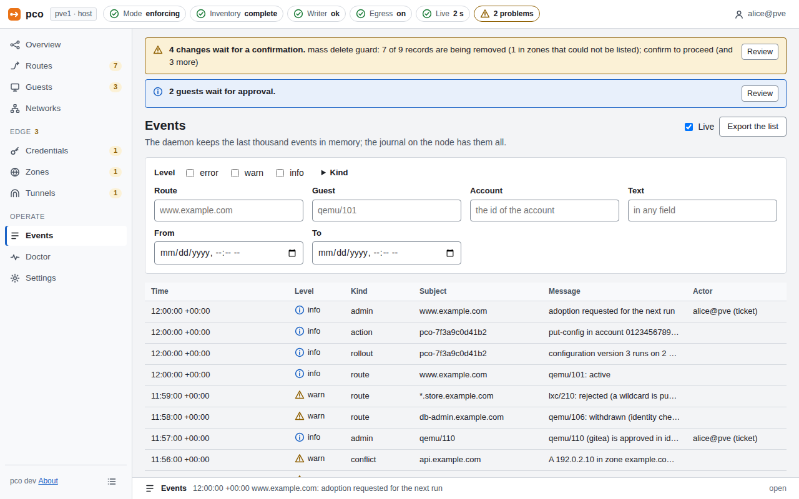

The events of the daemon, newest first: routes that changed state, conflicts, what was applied
at Cloudflare, holds, problems, what happened to the egress filter, and what admins did, with
who did it: `alice@pve (ticket)` for a user of the web interface, `root (cli)` for a command run
as root. The filters, kept in the address of the page, are the level, the kind, the route, the
guest, the account, words in any field, and a time range. [Problems](problems.md#event-kinds)
says what each kind reports.

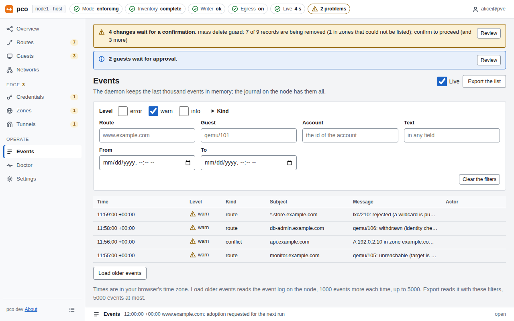

The page follows the events the daemon sends while it is open, and the daemon keeps the last
thousand in memory. Load older events reads the event log on the node, a thousand more each time
and up to 5000; older ones are in the journal, `journalctl -u pco`. When many events come at
once, such as one for each route at the first cycle after a start, the stream sends the first 32
of the kinds that come by the thousand, `route`, `action` and `claim`, one by one, and the rest as
one line that counts them; Load older events reads them.

| Action | What it does | Who | Confirmation | Command line |
|---|---|---|---|---|
| Live | Adds the events that come to the list, or stops adding them. | admin and reader | none | `pco events` |
| Load older events | Reads older events of these filters from the event log on the node. | admin and reader | none | `pco events --since 2h` |
| Export the list | Downloads the events of these filters, at most 5000, as JSON, `pco-events-<node>-<yyyymmdd>-<hhmmss>.json`. | admin and reader | none | `pco events --json` |

## Doctor

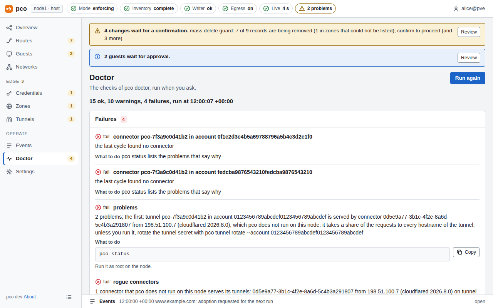

The checks of `pco doctor`, run when you ask and only then, since they probe the node and
Cloudflare: failures first, then warnings, then what passed, each with what to do. When the fix
is a command, it is there to copy. A reader gets the counts and not the findings, which name
guests that wait for approval and the hostnames of conflicts and lost markers that a reader may
not see. Under the results, This install says, in the appliance, which container it was installed
as and whether this one proved to be it.

| Action | What it does | Who | Confirmation | Command line |
|---|---|---|---|---|
| Run the checks, Run again (`POST /api/v1/doctor`) | Runs the checks. Two runs a minute for each user. | admin, with the findings; reader, with the counts | none | `pco doctor` |

## Settings

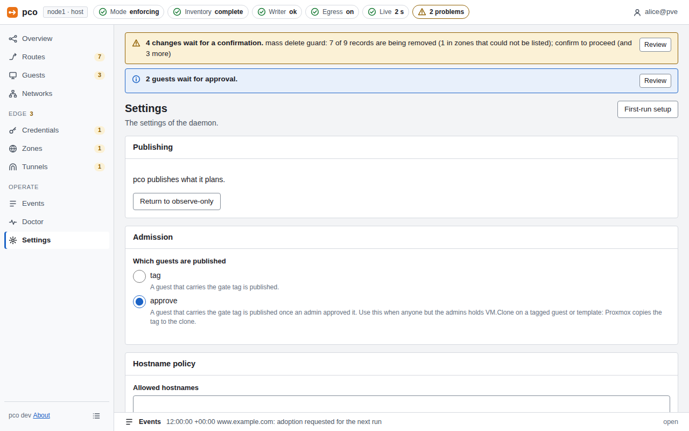

Every setting of [Settings](settings.md), in sections: Publishing, Admission, Hostname policy,
Identity, Manual routes, Timing, Limits, Zones and Gate tag, each with its range, its default and
`read at start` where a change needs a restart of the daemon. What the daemon finds wrong with
the settings is listed first. The page checks what it can as you type, and the daemon checks
every save; its answer wins and is shown at the field. The settings of the managed network are
not on the page: they are set in the file. On a cluster the `cluster` block is shown key by key as
the file has it, and a save keeps it as it was read; it too is set in the file. First-run setup,
in the head, opens the [setup](#first-run-setup).

Settings are saved at the revision they were read at. When someone else saved in between, a
dialog shows what they changed and what you changed, marks a setting changed on both sides, and
lets you put your edits on the saved settings or take the saved ones.

| Action | What it does | Who | Confirmation | Command line |
|---|---|---|---|---|
| Save settings (`PUT /api/v1/settings`) | Saves the settings. | admin | a dialog with every change, what the first entry of `allowHosts` stops and which settings take effect only after a restart | `pco settings apply <file>` |
| Return to observe-only | Part of the next save: from then on pco changes nothing at Cloudflare until publishing starts again. Leaving observe-only is not a setting: Start publishing on the plan does it. | admin | the review of the save | `pco settings apply <file>` with `"observeOnly": true` |
| Discard changes | Takes the form back to the saved settings. | admin | none | none |
| Restart pco… (`POST /api/v1/daemon/restart`) | After a save of a setting read at start: the daemon finishes the running cycle and stops, and systemd starts it again. The connectors keep running, and so do the routes they serve. | admin | a dialog | `systemctl restart pco` on the node |
| Export | Downloads the settings and the manual routes as one file, `pco-settings-<node>-<yyyymmdd>.json`, without any secret or approval. | admin and reader | none | `pco settings show --json`, `pco route manual list --json` |
| Import… (`PUT /api/v1/settings` and the calls of the manual routes) | Reads such a file, checks all of it, and writes nothing until you confirm. Merge adds the routes of the file and updates those with the same id; Replace also deletes those the file does not have. The writes stop at the first refusal, and the page says what was saved. | admin | a dialog with every change of the settings and of the routes | `pco settings apply <file>`, `pco route manual add` and `remove` |

## First-run setup

While no Cloudflare token is stored, the page opens on the setup after the first cycle, and
Settings has it always. Skip for now goes to the overview, in this browser only; the setup then
shows a banner with Show the setup first again. A reader sees
how far the setup is and that an admin has to finish it.

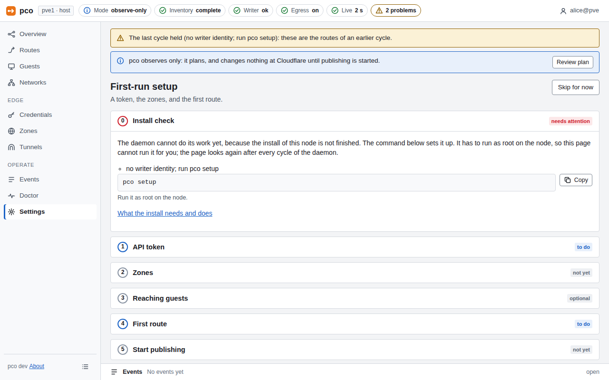

Step 0, **Install check**, is there only while the daemon cannot work because the install of the
node is not finished. Only root on the node can run the command it gives, so the page copies it
and looks again after every cycle.

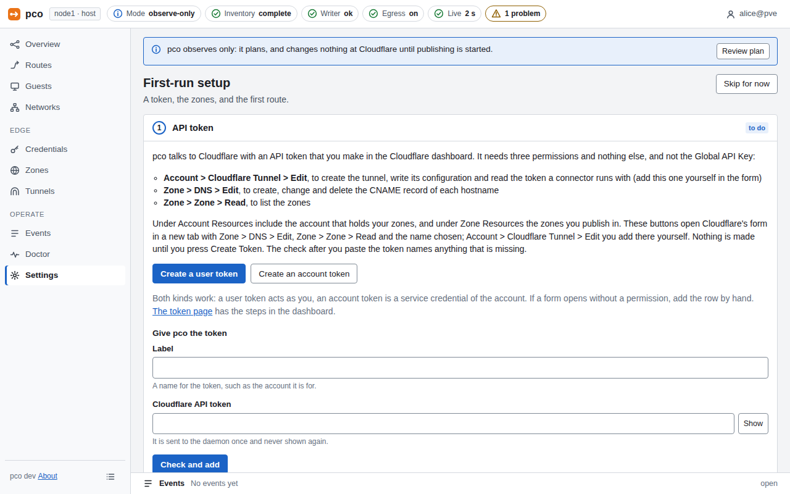

Step 1, **API token**, says what the token needs and why. Create a user token and Create an
account token open the form of the Cloudflare dashboard in a new tab, with `Zone > DNS > Edit`,
`Zone > Zone > Read` and the name `pco on <node>` chosen. Cloudflare documents no key for
`Account > Cloudflare Tunnel > Edit` in such a link, so you add that row in the form yourself;
[Cloudflare token](cloudflare-token.md#from-the-web-interface) has the links. Nothing is made
until you press Create Token there. Paste the token: the check that follows names anything that
is missing, and Check write access proves the rest.

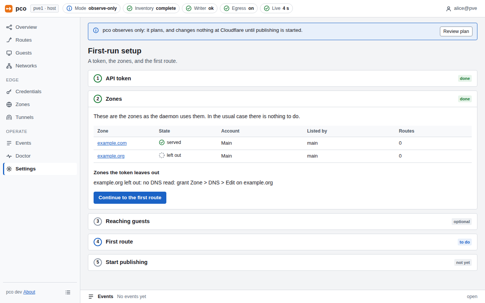

Step 2, **Zones**, shows the zones as the daemon uses them, and the ones the token leaves out with
what to grant. In the usual case there is nothing to do. Step 3, **Reaching guests**, is
optional: it says that the node reaches a guest through an address of its own on the guest's
bridge and VLAN, and where routes were proven so far.

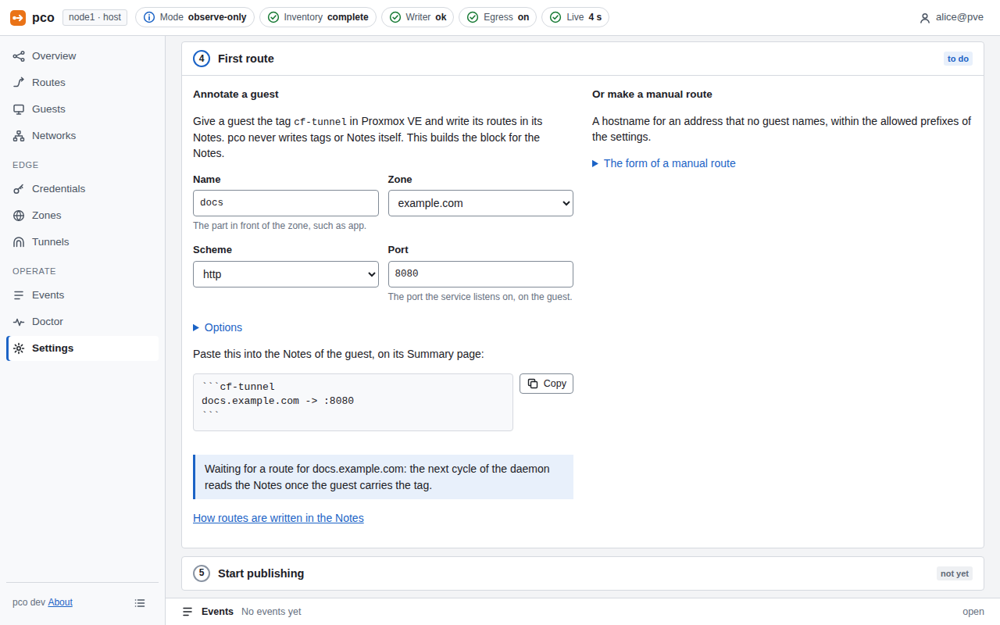

Step 4, **First route**, writes the block for the Notes of a guest from a name, a zone, a scheme
and a port, with the options of the Notes, and waits for the route to appear; or it makes a
manual route. pco never writes tags or Notes itself: you paste the block into the Notes of the
guest and give it the tag.

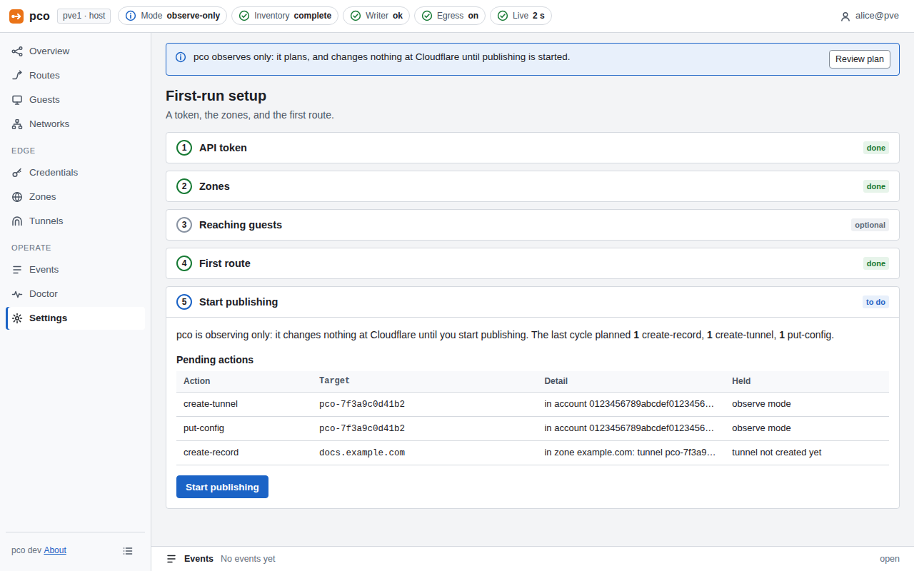

Step 5, **Start publishing**, shows the plan and leaves observe-only mode.

| Action | What it does | Who | Confirmation | Command line |
|---|---|---|---|---|
| Copy (step 0) | Copies `pco setup`, to run as root on the node. | admin | none | `pco setup` |
| Check and add, Check again, Check write access (step 1) | As on [Credentials](#credentials). | admin | as there | `pco credential add`, `pco credential check <id> [--deep]` |
| Copy (step 4) | Copies the block for the Notes. | admin | none | none |
| The form of a manual route (step 4) | As on [Manual routes](#manual-routes). | admin | as there | `pco route manual add` |
| Start publishing (step 5, `POST /api/v1/apply`) | Leaves observe-only mode. | admin | the step shows the plan above the button | `pco apply` |

## What a reader sees

A reader sees the guests it holds `VM.Audit` on, the ones the list of `/cluster/resources` of
Proxmox VE gives it, which pco reads again every minute, and what belongs to the cluster as a
whole. pco web filters what the daemon answers before it reaches the reader's browser:

| What | A reader gets |
|---|---|
| Routes | those of guests it sees, and every manual route; what their replicas and placement say loses the MACs and the ports of guests it names |
| Guests that wait for approval, approvals, the guest list, the Notes of a guest | those of guests it sees; the page of another guest is not found |
| Issues | those in the Notes of guests it sees, and every issue of the settings |
| The appliance's identity | its container and node, whether it proved to be it, and the principals that can reach into it, as an admin sees them; of its copies and tenants, the guests that carry a MAC of the appliance, those it sees; why the proof failed, as free text |
| Pending actions, records in the way, names that lost the marker | those of the hostnames of routes it sees, and every action on a tunnel |
| What waits for a confirmation, and its offer | nothing: a reader cannot confirm |
| Claims | those whose holder it sees, with the owners it sees that wait; a claim whose holder it does not see is not there at all, also when its own guest waits for that hostname: the route's state, `conflict`, still shows it |
| Events | those of guests and routes it sees, and those about neither, without the admin who acted and the account; never one of the audit trail, of an enrolment, an attestation, a placement or a block, which the replicas and the placement of a route sum up |
| Traffic | the trunk of every tunnel, and the figures of the routes it sees; `shared by` counts only those |
| A diagnosis | only of a hostname whose holder is a guest it sees, or a manual route; otherwise as if there were no route |
| The doctor | the counts of its checks |
| Zones, tunnels, connectors, connectors pco does not run, credentials, settings, segments, the egress filter, the admission mode | as an admin sees them; a credential never carries its token |
| The networks and the managed network | the networks without the MACs of their legs; of the managed network the cards, the waiting guests and the foreign cards of guests it sees, without their MACs, identities and `pveum` lines, the pool grant and the appliance's isolation; a reason that carries a command is cut to its name, and the service addresses of a network, which name the guests behind them, not at all |

The filter keeps out what names a guest in a field of its own. It cannot keep out what free text
says, and pco does not try: the problems of the last cycle, the reason a cycle held and why the
appliance's proof of itself failed are shown to a reader as they are; the message of an event it gets may name a guest it does not see, as a
claim conflict quotes both owners; the reason of a route may name the holder of its hostname
(`hostname is held by qemu/101`), and the steps of a diagnosis may name another owner of the
hostname. Treat those texts as visible to every reader.

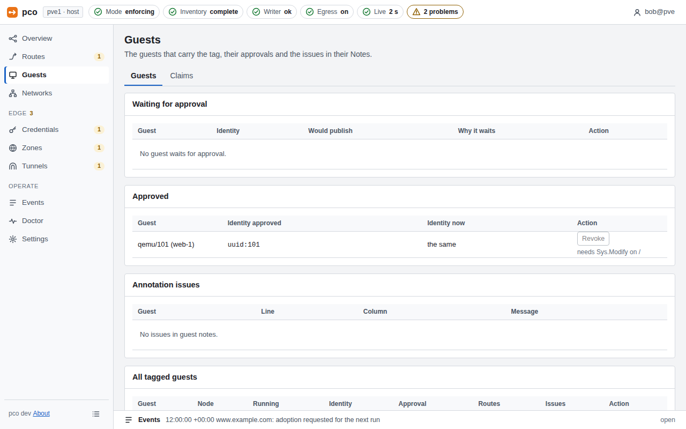

A reader sees the buttons of an admin disabled, with `needs Sys.Modify on /` beside them.

## Using it

**Keyboard.** Skip to content is the first stop of the Tab key. In a table, the arrow keys, Page Up,
Page Down, Home and End move between rows, and Enter or Space opens a row. On the map, the arrow
keys move along the chains, Home and End go to the first and the last column, Enter opens the
details and Escape closes a tooltip. Tabs move with the arrow keys, Home and End; Escape closes a
drawer and a dialog. Every figure of the map is in the list view as text too.

**Themes.** The user menu has the theme, System, Light or Dark, and the density, Comfortable or
Compact. The browser keeps both, for that browser only.

**Times** are shown in the browser's time zone with their offset from UTC, as `12:00:00 +00:00`,
with the date when it is not today. The tooltip of a time gives it in the node's time zone and in
UTC, and the detail of a row lists all three for the keyboard. The node's zone is `TZ` of
`pco-web.service`, or the zone `/etc/localtime` links to.

**Addresses.** Every view has an address of its own that can be shared: a route, a guest, a
filter of the events, a focus of the map.

| Page | Address |
|---|---|
| Overview | `/` |
| Routes, a route, the plan | `/routes`, `/routes/<hostname>?owner=<owner>`, `/routes/plan` |
| Manual routes | `/routes/manual/new`, `/routes/manual/<id>` |
| Guests, a guest, claims | `/guests`, `/guests/qemu/101`, `/guests/claims` |
| Networks | `/networks` |
| Credentials, zones, tunnels | `/edge/credentials`, `/edge/zones`, `/edge/tunnels`, each with `/<id>`, `/<zone>` or `/<account>` |
| Events, doctor, settings, setup | `/events`, `/doctor`, `/settings`, `/setup` |

Scripts use the daemon's socket instead of the page: [API](api.md).
